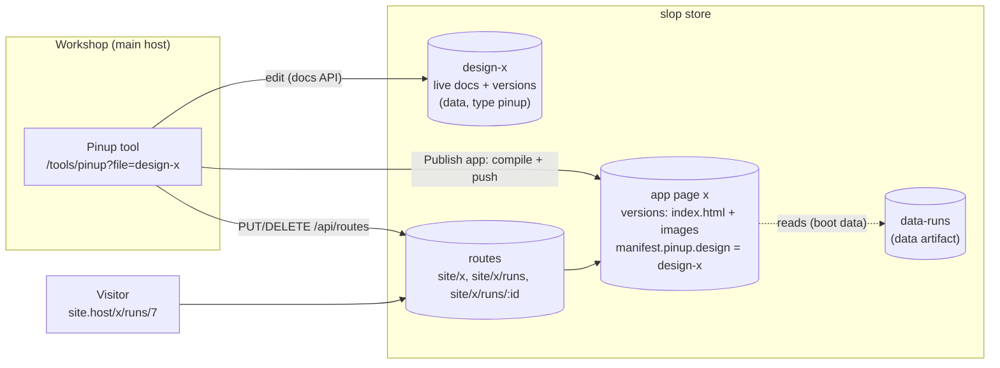
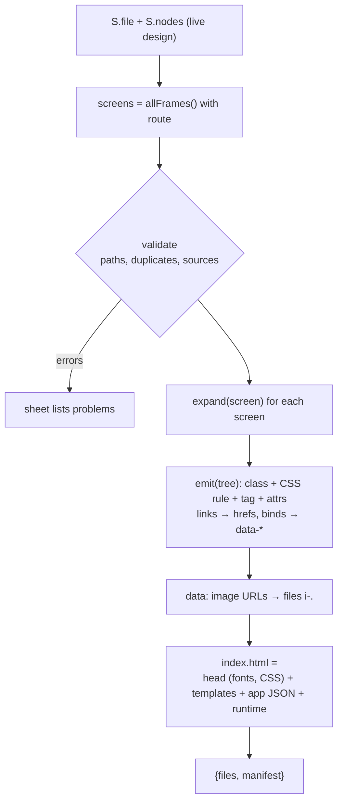
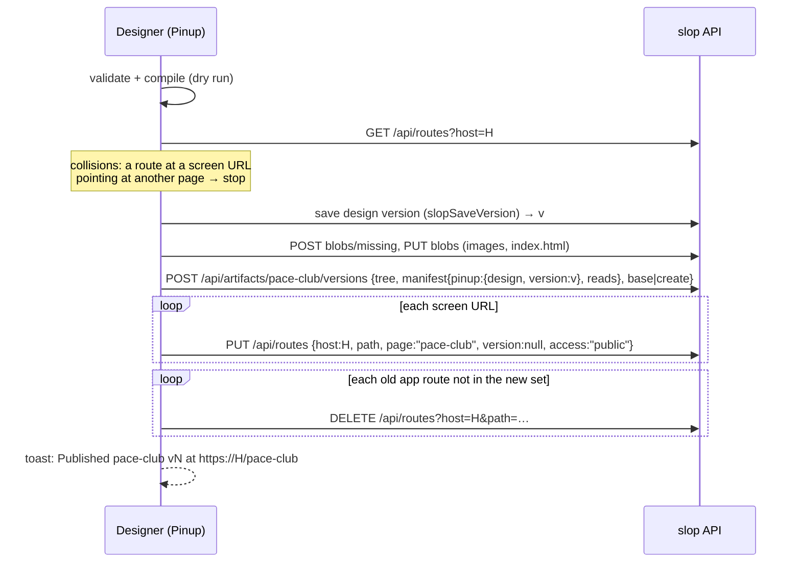

# Intern guide: Pinup apps, compiling designs into routed slop pages

## 0. What you are building

slop (slop.computer) serves versioned pages on site hosts. Pinup is a screen-design tool that, since SLOP-004, runs inside slop's Workshop and edits a *design*: a set of live JSON documents, one per layer. Today a design can only be published as a **prototype**, which is the full Pinup page in a read-only "Present" mode, inside a device frame, at about 849 KB per page.

This ticket adds **Pinup apps**. A Pinup app is a real page on the site whose source is a design:

- Each top-level screen of the design gets a **path** (`/`, `/runs`, `/runs/:id`).
- **Publish app** compiles the design into an ordinary slop page artifact: small, static HTML with real links, plus a short in-page script.
- The compiled page is routed so that every screen has its own URL on a site host.
- Screens can **show data** from slop data artifacts: text placeholders, frames that repeat once per record, and screens that show one record named by the URL.
- The loop stays inside Pinup: edit the design, press Publish, and the site changes. The Workshop shows **Edit in Pinup** on such a page.

The user's phrasing was: "basically I want to create/edit real routed pages in pinup", and "we could also just have apps that are pinup only, instead of trying to bridge directly". So the design is the only source. We do not try to import hand-written pages into Pinup, and we do not sync both ways.



## 1. Vocabulary

| Term | Meaning |
|---|---|
| **Artifact** | A named thing in slop: a `page` (HTML) or `data` (files that become records). Has numbered, immutable **versions** and a `main` pointer. |
| **Manifest** | The JSON stored with a version (`slop.json` on disk). Pages declare `reads`, tools declare `tool`. Unknown keys are kept. |
| **Route** | `(host, path) → page`, optionally with `bindings` (name → data artifact) and a `record` pattern. Follows `main` when `version` is null. |
| **Boot data** | JSON the server injects into a page (`#slop-boot`); `runtime.js` turns it into `window.slop`. |
| **Design** | A data artifact of type `pinup`, edited live through the docs store (`meta/file`, `nodes/<id>`, …). |
| **Screen** | A top-level frame in a design (not a component, not a group) that has a `route` path. |
| **App page** | The page artifact compiled from a design; its manifest has `pinup: {design, version}`. |
| **App runtime** | The short script inlined in the compiled page: picks the screen for the URL and fills in data. |

## 2. The slop side you need to know

### 2.1 Artifacts, versions, manifests and push

A push sends a complete tree of `path → sha256` (blobs already uploaded) plus an optional manifest:

```text
POST /api/artifacts/{id}/versions          permission versions:push (pkg/server/kernel.go:34)
{ "tree": {"index.html": "<sha>", "i-3fa9….jpg": "<sha>"},
  "manifest": {"pinup": {"design": "design-x", "version": 4}, "reads": {"runs": "data-runs"}},
  "base": 7,                               // optimistic concurrency: the main you built on
  "create": {"title": "Pace Club", "kind": "page", "project": "play"},   // instead of base, for a new artifact
  "moveMain": false,                       // optional: store the version without publishing it
  "message": "Published from Pinup" }
→ { artifact, version, created, unchanged, warnings: [] }
```

- Blobs go first: `POST /api/blobs/missing {sha256:[…]}` returns the hashes the server lacks, and each is uploaded with `PUT /api/blobs/{sha}`. The Pinup adapter does this in `slopPush` (`web/pinup/slop/js/00-slop-host.js:229`).
- A version has at most 2,000 files and 200 MB (`kernel.go:335`, `:362`).
- The handler decodes only `reads` and `tokens` from the manifest and adds **warnings** for problems (`kernel.go:368-393`); the CLI prints them (`cmd/slop/cmds/push.go:185`). Other keys, such as `pinup`, are stored untouched.
- A push without a manifest stores `{}`, so the manifest is per version and never inherited.

### 2.2 Routes and how a path resolves

Routes live in `pkg/store/routes.go` (`Route{Host, Path, Page, PageFrom, Version, Bindings, Record, Access}`) and are matched by `pkg/routing/routing.go`:

- `Match(pattern, path)`: `:name` captures one segment, a trailing `*` captures the rest, and `*` alone is the fallback.
- `Specificity`: a literal segment counts 3, a `:param` 2, a trailing `*` 1. The most specific matching route wins, so `/x/runs` beats `/x/:screen`.
- The API is `GET /api/routes?host=` (`routes:read`), `PUT /api/routes` with `{route…, note}` (`routes:write`), and `DELETE /api/routes?host=&path=&note=` (`routes:write`) (`kernel.go:40-44`). Every change is logged and can be undone (`POST /api/routes/undo`).

### 2.3 From request to page: boot data and `window.slop`

On a site host (`pkg/server/serve.go:372-440`):

1. `routing.Resolve` finds the route for the path.
2. `target` picks the page version: `main`, or the pinned version.
3. `renderPage` (`serve.go:124`) reads `index.html` and builds boot data:
   - `route: {host, path, params}`: `path` is the request path, `params` the captured segments;
   - `data`: for every name in the page manifest's `reads`, plus the route's `bindings`, the records of that data artifact's `main`;
   - `record`: the route's `record` pattern filled from the params, as a **path string** (`render.Boot.Record string`);
   - `version: {artifact, n}`, `mode: "site" | "preview" | "tool" | …`.
4. `render.Inject` puts the JSON in `<script id="slop-boot">` and adds `runtime.js`.

`pkg/render/assets/runtime.js` (22 lines) defines:

```js
window.slop = {
  route: {host, path, params},
  data: { <name>: { list(): Promise<rows>, get(id): Promise<row|null>, all: rows } },
  record: "runs/7.json" | null,      // a path; find it with rows.find(r => r.path === slop.record)
  version: {artifact, n}, mode, tokens, tool }
```

### 2.4 Records

`pkg/records/records.go` turns each file of a data version into one record (`Parse`):

- `.json`: the object's keys, plus `id` (the base name without extension) and `path`;
- `.md`: front matter keys, `body`, `html` (rendered with goldmark), `minutes`, `tags`;
- `.csv`, `.txt`: `csv` / `text`;
- other files (images): `{id, path, file: true}`, and the server adds `src: "/_d/<artifact>/<n>/<path>"` (`serve.go:74`).

So `data-runs` with files `runs/7.json` → `{id: "7", path: "runs/7.json", title: …}`.

### 2.5 Files of a page on the site

A page can load its own files with relative URLs. When a request path has an extension, the server looks it up in the version of the page the path resolves to, then in the page named by the `Referer` (`serve.go:388-408`). `fileFor` (`serve.go:172`) tries the path, then **only the base name at the version's root**. The practical rule is: **put a page's assets at the root of its version and reference them by bare name.** `/_v/<artifact>/<n>/<file>` also works for routed pages (`serve.go:373`), but needs the version number, which a compiler doesn't know before the push.

### 2.6 Tools and grants

A tool is a page whose manifest has `tool: {title, icon, permissions}` (`pkg/store/tools.go`, `ToolPermissions`). An admin enables a version; the Workshop then opens it at `/tools/<id>?…` in an iframe and hands it a one-hour grant carrying only those permissions (`tool.js`: `api.get/post/put/del/putRaw/stream`, `api.can(p)`, `api.args`, `api.config.siteHosts`, `api.setArgs`). A grant reaches only endpoints registered with `guardPerm(…, "<perm>", …)`.

The Pinup tool manifest is generated by `web/pinup/slop/build.js` and currently asks for `docs:read, docs:write, artifacts:read, versions:push, threads:write, routes:write`. This ticket adds **`versions:read`** (record lists for data binding, `GET /api/artifacts/{id}/versions/{n}/records`, `pkg/server/preview.go:16`) and **`routes:read`** (to reconcile an app's routes). Changing permissions means an admin re-enables the new tool version.

### 2.7 The Workshop page view

`web/workshop/src/screens/WatchScreen.tsx` shows one artifact; for pages its toolbar is `PageToolbar` in `web/workshop/src/components/organisms/WatchRight.tsx:40`. That toolbar already has a conditional button:

```tsx
{p.v.manifest && 'tool' in p.v.manifest ? <Button onClick={() => navigate(toolPath(p.a.id, p.v.n))}>Open as tool</Button> : null}
```

**Edit in Pinup** is the same pattern on `manifest.pinup`. `toolPath` and `navigate` are in `web/workshop/src/app/router.ts`.

## 3. The Pinup side you need to know

Pinup's source is `web/pinup/src/*.js`: fourteen numbered modules concatenated into one function scope. Upstream code is never edited. slop code lives in `web/pinup/slop/js/` and is spliced into the same scope by `web/pinup/slop/build.js` (sorted by file name: `00-slop-host.js` first, `95-slop-ui.js` near the end). Because function declarations are hoisted and are mutable bindings, slop code can **call** any Pinup function and **wrap** one (`const old = protoPanel; protoPanel = function () { … old() … }`).

### 3.1 The node model

`norm(id, d)` (`02-store.js:29`) fills defaults. It starts from `Object.assign({}, d)`, so **unknown fields survive**, which is how we add `route` and `repeat`. The fields that matter here:

| Field | Meaning |
|---|---|
| `type` | `frame, rect, ellipse, line, text, icon, svg, instance` |
| `page`, `parent`, `z` | which design page; parent node or null (top level); order among siblings |
| `x, y, w, h` | position and size in px (relative to the parent) |
| `sw`, `sh` | sizing per axis: `fixed`, `hug` (text, auto-layout frames) or `fill` (inside auto layout) |
| `layout` | auto layout `{dir: row|col, gap, pad:[t,r,b,l], align, justify, wrap}` or null (absolute children) |
| `fills` | `[{t:'solid', c}, {t:'gradient', css}, {t:'image', src, fit}]` |
| `text`, `font`, `size`, `weight`, `tstyle` | text content and style (or a type token) |
| `link` | prototype link `{to: <frameId>|'back', on: 'click'|'hover', tr, dur}` |
| `flow` | on a top-level frame: the name of a flow that starts here |
| `component`, `of`, `ov` | a main component; an instance's main and its overrides |
| `mode` | `dark` on a frame switches token values |
| `visible`, `clip`, `group` | hidden layers are skipped; frames clip by default; groups are frames without paint |

The file-level document `meta/file` is `S.file = {name, pages, tokens, …}`. `applyRemoteFile` (`02-store.js:264`) keeps unknown keys too, so `S.file.app` survives as well. Write it with `setFile({app})` (`02-store.js:182`), which records an undoable history entry.

Helpers you will call: `get(id)`, `kids(id)` (children in z order), `allFrames()` (top-level frames on every page), `framesOnPage(pid)`, `topOf(id)`, `components()`, `slug(s)`, `esc(s)`, `toast(msg)`, `sheet(title, body, opts)`, `h(tag, attrs, …children)`, `patch(id, p, {label})`.

### 3.2 From layers to HTML: the existing export

`07-export.js` already turns layers into HTML and CSS:

- `expand(n, P)` (`:19`) walks a subtree *as rendered*: instances are expanded into their main component with overrides, and hidden layers are dropped. It returns a tree of `{n, P, kids, inst, main}`.
- `cssFor(n, P, {root, export: true, var})` (`03-render.js:92`) gives a node's CSS:
  - position: `relative` inside auto layout or at the root, else `absolute` with `left/top`;
  - size from `sw/sh`: `flex: 1 1 0px` for fill on the main axis, `align-self: stretch` on the cross axis, px for fixed, nothing for hug;
  - flexbox for `layout`;
  - paint: fills as `background`, text style, borders, radius, effects;
  - `overflow: hidden` for clipping frames (`:180`).
- `tagFor(n, inst)` (`:30`) chooses `h1/h2/h3/p/span` for text by size, `button` for layers named like buttons, and `nav/header/footer` by name.
- `exportHTMLParts(ids)` (`:42`) emits one class per node (unique per call), the CSS rules, and the body markup. **Links are kept only as `data-link="<target frame name>"`.** `tokensCSS()` gives `:root` and `.dark` variables, and `usedFonts` plus `fontLink` give a Google Fonts `<link>`.

The compiler in this ticket reuses `expand`, `cssFor`, `tagFor`, `iconSVG`, `cleanSVG`, `tokensCSS`, `usedFonts` and `fontLink`. It does **not** call `exportHTMLParts`, because that writes links as frame names (ambiguous, and no URLs) and has no place for data attributes. Instead it has its own emitter of about 40 lines, modelled on it.

### 3.3 Images

On slop, Pinup has no asset store (`cap('assets')` is null), so `imageSrcFor` (`04-canvas.js:1079`) shrinks an uploaded image to a JPEG **data URL** of at most ~180 KB and stores it in the fill (`{t:'image', src:'data:image/jpeg;base64,…'}`). The HTML importer may also produce `src` values that are ordinary URLs. The compiler turns data URLs into files (§5.5).

### 3.4 Prototype links and present mode

`06-proto.js` is the player: `openPresent(startId)`, `showFrame(id, transition)`, and a back stack. The start screen is a frame with `flow`, else the first frame. The Prototype tab of the inspector is `protoPanel()` (`05-panels.js:818`). It returns an **array of sections** built with `sec(title, actions, …body)`:

- with nothing selected: "Flows" and "How to wire a prototype";
- with a top-level frame selected: "Flow starting point";
- with any selection: "Interaction", which sets `link`.

`renderInspector()` (`05-panels.js:456`) calls `protoPanel()` through its binding, so a wrapper can append sections.

### 3.5 Pinup on slop today (SLOP-004)

- `00-slop-host.js` installs `window.claude` with `db` (the live docs mirror), `user`, `room` and `downloads` in **tool** mode. In **player** mode it serves a read-only static db from a bound version.
- `95-slop-ui.js` holds:
  - the **slop menu** (`#bSlop`, `slopMenu()`): Save version, Publish prototype, Hand off, Copy agent brief, Open another design;
  - `slopSnapshotFiles`, `slopSaveVersion`, `slopPublishSheet` (routes to `pinup-player` with a `design` binding).
- `SLOP.api` is the tool client, and `SLOP.file` is the design artifact id.

## 4. Design: the app model

### 4.1 Goals and non-goals

Goals:

- A design can be published as a **real page**: small, static markup, real `<a href>` links, one URL per screen, correct 404s for unknown paths.
- Screens can show **data** from slop data artifacts, so a page can be a blog index, a catalogue or a list of runs, not only a mockup.
- The **editing loop** is Pinup → Publish → site, and the Workshop shows the link both ways.

Non-goals, for now:

- importing hand-written pages into Pinup, and two-way sync;
- forms, writes, custom logic (public visitors cannot write to slop anyway);
- responsive breakpoint variants (§12);
- server-side rendering (slop pages render in the browser; so does this).

### 4.2 Two artifacts and one link

```text
design-pace-club   data, type pinup     the source: live docs + saved versions
pace-club          page                 compiled output: index.html + i-<hash>.<ext> files
                   manifest: {"pinup": {"design": "design-pace-club", "version": 5},
                              "reads": {"runs": "data-runs"}}
```

The design records its app in the live file:

```js
S.file.app = {
  page: 'pace-club',          // app page artifact id
  host: 'site.example.com',   // a site host from api.config.siteHosts
  base: '/pace-club',         // URL prefix; '/' is allowed
  data: { runs: 'data-runs' } // name → data artifact (phase 2)
}
```

The app page records its source in every version's manifest (`pinup.design` and the design `version` it was compiled from). That gives:

- the Workshop's **Edit in Pinup** (`/tools/pinup?file=<design>`);
- a **warning** on hand-written pushes. A `slop push` to a page whose `main` manifest has `pinup`, without `pinup` in the new manifest, returns the warning *"pace-club is compiled from design-pace-club by Pinup; the next Publish app replaces this version"*.

**Ownership rule.** The design owns the page. To turn a Pinup app into hand-written code, push without the `pinup` key (accepting the warning) and remove `S.file.app`. From then on the page is ordinary code.

### 4.3 Screens and their paths

A screen is a top-level, non-component, non-group frame with a `route` field:

```js
node.route = '/'            // the app's start
node.route = '/runs'
node.route = '/runs/:id'    // a parameter (phase 2: names a record)
node.record = 'runs'        // phase 2: on a screen with a :param, the data source whose record it shows
```

Rules, checked before publishing:

- A path starts with `/`. Its segments are lowercase letters, digits and `-_`, or `:name`. No `*`; trailing slashes are dropped.
- Paths are unique within the app after normalization (`/runs/:id` and `/runs/:slug` are the same pattern).
- The URL of a screen is `join(base, route)`: base `/pace-club` plus `/` gives `/pace-club`; plus `/runs/:id` gives `/pace-club/runs/:id`.
- Frames without `route` are not part of the app. They stay design-only: scratch work, components, alternatives.

**Make this an app** assigns paths once to every top-level frame on the current page that has none: the flow-start frame (or the first frame) gets `/`, the others `/` + `slug(name)`. The Prototype tab then shows a **Page path** field on a selected top-level frame (§7.2).

## 5. Design: the compiler

### 5.1 Pipeline



The output is a plain object `{files: {path: string | Uint8Array}, manifest}`. `slopPush` (extended to take bytes and a manifest) uploads it.

### 5.2 The document

```html
<!doctype html>
<html lang="en">
<head>
<meta charset="utf-8">
<meta name="viewport" content="width=device-width, initial-scale=1">
<title>Pace Club</title>
<link rel="stylesheet" href="https://fonts.googleapis.com/css2?family=Inter:wght@400;600;700&display=swap">
<style>
*, *::before, *::after { box-sizing: border-box; }
body { margin: 0; }
p, h1, h2, h3, h4 { margin: 0; }
a { color: inherit; text-decoration: none; }
button { all: unset; box-sizing: border-box; cursor: pointer; }
:root { --brand: #3B5BFD; … }  .dark { … }                 /* tokensCSS() */
.welcome { position: relative; width: 100%; max-width: 390px; min-height: 100vh; margin: 0 auto; … }
.find-a-run { … }                                          /* one rule per emitted node */
</style>
</head>
<body>
<template id="s-k9TzQ" data-bg="#F7F7F8"> <main class="welcome">…</main> </template>
<template id="s-p2Lx8"> … </template>
<script type="application/json" id="pinup-app">{"base":"/pace-club","screens":[…]}</script>
<script>/* app runtime, §6 */</script>
</body>
</html>
```

- **All screens in one file.** A route serves only a version's `index.html` (`serve.go:126`), so the runtime shows the right screen. Screens are inside `<template>`: they are parsed but not rendered, so images in other screens do not load, and the runtime inserts the matching one before first paint (the script runs at the end of `body`).
- **One stylesheet.** The compiler emits all screens in one pass, so class names are unique across screens.
- **The screen root** is a `<main>`. Its CSS is changed for a page:
  - `width: 100%`, `max-width: <frame w>px` and `margin: 0 auto` replace `width: <w>px`;
  - `min-height: 100vh` replaces a fixed `height` when the frame has auto layout;
  - for a frame with absolute children, `min-height: <h>px` keeps the children inside.
  - The frame's first solid fill becomes the `body` background (`data-bg`), so the area beside a 390 px column matches.
- **Fonts.** The Google Fonts link is kept, as in Pinup's export. slop's help says pages should make no external requests, so §12 lists self-hosting fonts as follow-up work.

### 5.3 Emitting nodes

```text
emit(t, depth, ctx):                               // t from expand()
  n := t.n
  cls := uniqueClass(n.name)
  css := cssFor(n, t.P, {root: depth = 0, export: true, var: exVar})
  if depth = 0: css := pageRoot(css, n)           // §5.2
  rules += ".cls { css }"
  link := (t.inst and t.inst.link) or n.link
  tag := tagFor(n, t.inst)
  if depth = 0: tag := "main"
  if link and not ctx.inLink:                     // links become anchors
      tag := "a";  attrs.href := hrefFor(link, ctx) // §5.4
      css.display ?= "block"                       // an anchor is inline by default
  if ctx.inLink and tag = "button": tag := "span" // no interactive content inside <a>
  data binding attributes (§8): data-t, data-repeat, data-img
  text  → <tag …>esc(text)</tag>
  icon  → <span …>iconSVG(n)</span>
  svg   → <div …>cleanSVG(markup)</div>
  line  → <hr …>
  frame → <tag …> emit(kids) </tag>
```

### 5.4 Links

A prototype link `{to: frameId}` becomes a URL:

- target is a screen (has `route`) → `href = join(base, target.route)`;
  - with `:params` → `data-href` holds the template (`/pace-club/runs/{{id}}`), and the runtime fills it from the data scope (§8.4);
- target frame has no `route` → no link (the compiler reports it as a warning: "Find a run links to Filters, which is not a page");
- `to: 'back'` → `href = join(base, '/')` and `data-back`; the runtime calls `history.back()` when the previous page was in the app;
- triggers other than click (`hover`) and transitions (`dissolve`, `slide-left`…) are ignored: a page navigation is instant.

Links are ordinary links: following one is a page load served by the server, not a script. The runtime is only needed to choose the screen and fill in data.

### 5.5 Images

Every fill `{t:'image', src}` whose `src` is a `data:` URL is decoded, hashed (SHA-256), and written once as `i-<first 16 hex>.<ext>` at the root of the version (§2.5). The CSS refers to it by bare name: `background: url("i-3fa9c0….jpg") center / cover no-repeat`. A design whose 30 layers share one image produces one file. Image fills with `http(s):` URLs are left as they are.

### 5.6 The app JSON

```json
{"name": "Pace Club", "base": "/pace-club", "start": "k9TzQ",
 "screens": [{"id": "k9TzQ", "name": "Welcome", "route": "/", "title": "Welcome"},
             {"id": "p2Lx8", "name": "Run", "route": "/runs/:id", "record": "runs"}]}
```

## 6. Design: the app runtime

The runtime is inlined in `index.html` (about 3 KB), so it is versioned with the page and an old version keeps working when the compiler changes. It does four things:

```text
boot():
  app  := JSON(#pinup-app)
  path := rel(slop.route.path, app.base)        // "/pace-club/runs/7" → "/runs/7"
  best := the screen whose route matches path with the highest Specificity
           (same rules as pkg/routing: literal 3, :param 2)
  if not best:
      if slop.mode = "site": show "Not found" text; return
      best := app.start                         // previews and thumbnails show the start
  scope := {}
  if best.record: scope := record(best.record, params)    // §8.2
      if none: show "Not found"; return
  el := clone(template "s-"+best.id)
  bind(el, scope)                               // §8: repeats, text, images, hrefs
  body.style.background := template.data-bg
  document.title := best.title or app.name
  body.append(el)
  links with data-back: onclick → if referrer is in the app then history.back()
```

- **The runtime does not need `--record` on the route.** It matches the request path itself, and the page's `reads` give it every data source. So every route of the app is a plain route to the app page, and the routes need no per-screen bindings.
- **Path matching duplicates `pkg/routing.Match`.** Specificity also matches the server's. The server has already chosen this page by the same rules, so the runtime only has to choose among the app's own screens.

## 7. Design: the editor

### 7.1 The slop menu

`slopMenu()` (`95-slop-ui.js`) gains a group:

- **Make this an app…** (when `S.file.app` is absent): a sheet with the page id (default `slug(S.file.name)`), the site host (from `api.config.siteHosts`), and the base path (default `/` + page id). It writes `S.file.app` and assigns paths (§4.3).
- **App settings…**: the same sheet, plus **Data sources** (§8.1).
- **Publish app**: validate, compile, push, route (§9). It needs `versions:push` and `routes:write`.
- **Preview app**: compile and push with `moveMain: false`, then open the Workshop's watch view of that version in a new tab (`<publicUrl>/watch/<page>/<n>`). Nothing on the site changes.

### 7.2 The Prototype tab

`protoPanel` is wrapped. The wrapper appends sections according to the selection:

| Selection | Section | Content |
|---|---|---|
| nothing, app configured | **App** | host + base, list of screens with their URLs, the warnings of a dry-run compile, Publish button |
| a top-level frame | **Page path** | text field for `route` (empty = not a page); full URL shown below; for a path with `:param`, a "Shows one record of [source ▾]" select (`record`) |
| a frame inside a screen | **Repeat** | "Repeat for each record of [none / source ▾]" (`repeat`), with a note that the first child is the template |
| a layer with an image fill | **Image from data** | field name (`fills[i].bind`) |
| a text layer | **Data** | a note: write `{{field}}` in the text; lists the fields available here (from the first record of the source in scope) |

All edits go through `patch` / `setFile`, so they are undoable, shared live with other editors, and visible to agents through `slop docs`.

## 8. Design: data binding (phase 2)

### 8.1 Sources

`S.file.app.data = {name: artifactId}`. The App settings sheet lists data artifacts (`GET /api/artifacts`, kind `data`, excluding type `pinup` and `tokens`). The compiler copies `data` into the page manifest as `reads`, so the server injects `window.slop.data[name]` on every route of the app. To show field names in the editor, Pinup reads the records of the source's `main` (`GET /api/artifacts/{id}/versions/{main}/records`, `versions:read`) and caches them per source.

### 8.2 Record screens

A screen whose route has a parameter and a `record` source shows one record:

```text
record(source, params):
  rows := slop.data[source].all
  key  := the first param's value               // "/runs/:id" with "/runs/7" → "7"
  return rows.find(r => r.id = key) or rows.find(r => r.slug = key)
```

`id` is the file's base name (§2.4), so `runs/7.json` is `/pace-club/runs/7`. Markdown posts usually have a `slug` in their front matter, which is accepted as a second key.

### 8.3 Repeats

A frame with `repeat: source` compiles to:

```html
<div class="run-list"><template data-repeat="runs"> <a class="run-card" data-href="/pace-club/runs/{{id}}">…</a> </template></div>
```

- **Only the first child is the template.** The frame's other children are dropped from the output; in the design they are sample copies that make the layout readable.
- The runtime clones the template once per row, in order, and binds each clone with the row as its scope.
- `repeat` on a frame with no children is reported as an error.
- Optional fields `limit` (number) and `sort` (`"field"` or `"-field"`) are applied before cloning.

### 8.4 Placeholders and scope

- **Text:** a text layer whose `text` contains `{{…}}` compiles with `data-t="<original text>"`. The runtime sets `textContent = fill(text, scope)`.
- **Links:** `data-href` (from a link to a screen with params) is filled the same way. Each `:param` of the target route becomes `{{param}}`, so a card in a `runs` repeat links to `/pace-club/runs/{{id}}`.
- **Images:** `fills[i].bind = "photo"` compiles to `data-img="photo"`. The runtime sets `style.backgroundImage = url(scope.photo.src or scope.photo)`. A file record has `src`, and a string field can be a URL.

```text
fill(template, scope):
  replace each {{ path }} with lookup(scope, path), where path is a.b.c
  lookup walks the scope chain: repeat row → screen record → {app: {name}}
  a missing value becomes ""; values are inserted as text, never as HTML
```

Scopes nest: a repeat inside a record screen sees the row first, then the record. Nested repeats over a record's array field (`repeat: "record.tags"`) are a later extension.

**What the designer sees.** On the canvas the text still reads `{{title}}`. Preview app shows real data. Drawing sample values on the canvas would mean changing Pinup's renderer, so it is listed in §12.

## 9. Design: publishing



- **Collision check first.** If a screen URL is already routed to a different page, publishing stops with the route's page named, before anything is written. Publishing never overwrites someone else's route.
- **Stale routes are removed.** When a screen is renamed or deleted, the routes of this host that point at the app page but are not in the new set are deleted. Routes on other hosts, or pointing elsewhere, are never touched.
- **Routes follow `main`** (`version: null`). A route is rewritten only when it does not already point at the app page with `version: null`, so republishing leaves the route log alone.
- **The design is saved first,** so `manifest.pinup.version` names a design version that exists and can be diffed later.
- **Access** is `public`. Everything on the published screens and in the `reads` sources is public. The publish sheet says so, as the prototype sheet already does.

## 10. Design: Workshop, server, agents

- **Workshop.**
  - `PageToolbar` shows **Edit in Pinup** when `v.manifest.pinup?.design` is set; it navigates to `/tools/pinup?file=<design>`.
  - The data toolbar (`WatchScreen.tsx`) shows **Open in Pinup** for artifacts of type `pinup`.
  - Both are disabled with a title when the Pinup tool is not enabled (`GET /api/tools`).
- **Server.** In `push` (`kernel.go`), if the artifact's current `main` manifest has `pinup` and the incoming one does not, append the ownership warning (§4.2). There is no refusal: the warning is enough, and it keeps `slop push` usable for graduating a page to code.
- **Agents.** `route`, `record`, `repeat` and `fills[].bind` are node fields, so agents can set them with steps (`{op:'update', id, set:{route:'/runs'}}`), like any other change. `slop help pinup` gains a section "Pinup apps": the fields, the placeholder syntax, and publishing from the editor. Publishing stays a human action in the editor.

## 11. Implementation plan

| # | Work | Files |
|---|---|---|
| 1 | App model, screen paths, validation, compiler (static), image extraction, inline runtime (screen selection, links, back) | `web/pinup/slop/js/96-slop-app.js` (new) |
| 2 | `slopPush` takes bytes and a manifest | `web/pinup/slop/js/00-slop-host.js` |
| 3 | Menu: Make this an app, App settings, Publish app, Preview app; publish flow with route reconciliation | `web/pinup/slop/js/95-slop-ui.js`, `96-slop-app.js` |
| 4 | Prototype tab sections: App, Page path | `96-slop-app.js` (wraps `protoPanel`) |
| 5 | Tool permissions `versions:read`, `routes:read` | `web/pinup/slop/build.js` |
| 6 | Workshop: Edit in Pinup, Open in Pinup | `WatchRight.tsx`, `WatchScreen.tsx` |
| 7 | Push warning for compiled pages, with a Go test | `pkg/server/kernel.go`, `pkg/server/kernel_test.go` |
| 8 | Data binding: sources, record screens, repeats, placeholders, image fields; Repeat/Data sections | `96-slop-app.js` |
| 9 | Help topic and agents' fields | `pkg/doc/topics/pinup.md` |
| 10 | End-to-end check in a browser on the local server; screenshots in the ticket | ticket `various/` |

Testing strategy:

- **Compiler and runtime** are plain functions. A node script loads `dist/slop-check.js` (the bundle as a script) with a stubbed DOM and checks:
  - the compiled HTML of a fixture design: unique classes, `href`s, templates, `data-t`;
  - path validation;
  - the runtime's matcher against `pkg/routing` cases.
- **Server:** a Go test for the push warning.
- **End to end:** in a browser, on the local server:
  1. make Pace Club an app and publish it;
  2. load each screen URL on the site host and follow links;
  3. add a data source and a repeat, publish, and see the records;
  4. load an unknown path and get a 404;
  5. push by hand and see the warning;
  6. open the page in the Workshop and follow Edit in Pinup.

## 12. Risks and open questions

- **Fixed-width designs.** A 390 px design is a mobile column on desktop, which is acceptable. A desktop design on a phone shrinks only where layers use auto layout with *fill*. Breakpoint variants (`Home @1280` compiled into a media query) are the follow-up.
- **External fonts** (§5.2): self-host the used families as version files.
- **SEO and no-JS.** The markup is in `<template>`, and the runtime inserts it, so crawlers that do not run JS see an empty body. A later server-side "pick the template" step in `renderPage` (for pages whose manifest has `pinup`) would fix this without changing the compiler.
- **Data size.** Every route of the app injects every source. That is fine at slop's sizes, but per-screen `reads` would be the fix.
- **Canvas sample data** (§8.4) needs a hook in Pinup's text renderer, which means touching upstream code. It is deferred.
- **Nested interactive content.** A button inside a linked card becomes a `span`. A link inside a link is dropped (the outer link wins).

## 13. API and file reference

| API | Permission | Used for |
|---|---|---|
| `GET /api/artifacts`, `GET /api/artifacts/{id}` | `artifacts:read` | existence check, `main`, data sources |
| `GET /api/artifacts/{id}/versions/{n}/records` | `versions:read` | field names for the editor |
| `POST /api/blobs/missing`, `PUT /api/blobs/{sha}` | `versions:push` | upload |
| `POST /api/artifacts/{id}/versions` | `versions:push` | push the app page (create, base, moveMain) |
| `GET /api/routes?host=` | `routes:read` | collision check, stale routes |
| `PUT /api/routes`, `DELETE /api/routes?host=&path=` | `routes:write` | screen routes |

| File | Role |
|---|---|
| `web/pinup/src/07-export.js` | `expand`, `tagFor`, `exportHTMLParts`, `tokensCSS`, `usedFonts`, `fontLink` (reused, not edited) |
| `web/pinup/src/03-render.js:92` | `cssFor` |
| `web/pinup/src/05-panels.js:818` | `protoPanel` (wrapped) |
| `web/pinup/src/02-store.js` | `norm`, `setFile`, `patch` |
| `web/pinup/slop/js/00-slop-host.js` | tool adapter, `slopPush` |
| `web/pinup/slop/js/95-slop-ui.js` | slop menu, Save version, Publish prototype |
| `web/pinup/slop/js/96-slop-app.js` | **new**: app model, compiler, runtime, publish, panels |
| `web/pinup/slop/build.js` | tool manifest and permissions |
| `pkg/server/serve.go` | site resolution, `renderPage`, `fileFor` |
| `pkg/routing/routing.go` | `Match`, `Specificity` (the runtime mirrors them) |
| `pkg/render/assets/runtime.js` | `window.slop` |
| `pkg/records/records.go` | record shape |
| `pkg/server/kernel.go` | push (warning), routes API |
| `web/workshop/src/components/organisms/WatchRight.tsx` | `PageToolbar` (Edit in Pinup) |
| `web/workshop/src/screens/WatchScreen.tsx` | data toolbar (Open in Pinup) |
| `pkg/doc/topics/pinup.md` | `slop help pinup` |
