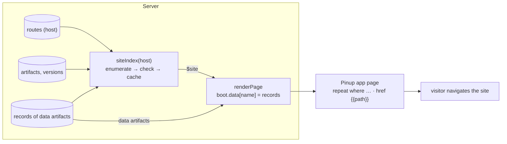

# Intern guide: site-aware Pinup apps

## 0. What you are building

SLOP-005 made Pinup designs into real pages ("Pinup apps"). A Pinup app can read **data artifacts** (records) and show them: repeated frames, record screens, `{{field}}` placeholders. It cannot yet be the front door of a site. It cannot list the site's pages, its links can only go to the app's own screens, it cannot filter records, and it cannot show a Markdown post.

This ticket closes those gaps:

1. **`$site`, a built-in data source.** Any page can read it (`"reads": {"pages": "$site"}`). It gives one record per **public URL** on the page's host: static routes, every record a record route serves (each journal post, each catalogue entry), and every page a page-from route admits (each `/r/<release>`). Each record has its path, title, project, and when it last changed.
2. **Links to any URL.** A layer can link to `/journal`, to `{{path}}` from a record, or to an external `https://…` URL. Until now, links could only go to the app's own screens.
3. **Filters on repeats** (`where record.visibility = listed`, `section = journal`). The `section` field of `$site` rows is what lists group by.
4. **Repeats over a list field** of the record in scope, such as tags or a gallery.
5. **Rich text.** A text layer can show a record's `html` (rendered Markdown), sanitized.

With these, the site's navigation can be designed in Pinup: a home page that lists every public page grouped by section, a journal index linking to each post, and a catalogue whose cards link to each entry's real URL.



## 1. Background you need

### 1.1 How a page gets data (unchanged by this ticket)

The server injects boot data into every page it serves (`pkg/server/serve.go`, `renderPage`, ~line 124):

```text
renderPage(page version, resolution, host, reqPath, mode):
  boot.route = {host, path: reqPath, params}
  for name, b in bindings(page, route):     // manifest reads + $tokens + route bindings
      if b.N == 0: continue                 // no version: nothing to inject
      if name == "$tokens": boot.tokens = tokens.json; continue
      boot.data[name] = records(b.artifact, b.N)
  return render.Inject(index.html, boot)    // <script id=slop-boot> + /_slop/runtime.js
```

`bindings` (`serve.go:~99`) merges the page manifest's `reads` (name → data artifact at `main`), the special `$tokens`, and the route's `bindings`. Each binding is resolved to a version number `N`. `records` (`serve.go:50`) parses a data version's files into records (`pkg/records/records.go`) and caches them per `artifact@n` (`recCache`).

`pkg/render/assets/runtime.js` exposes these records as `window.slop.data[name] = {list(), get(id), all}`. **`$site` slots in here**: it is a binding name the server answers itself, the way it already handles `$tokens`.

### 1.2 Routes and their kinds

A route (`pkg/store/routes.go`, `Route{Host, Path, Page, PageFrom, Version, Bindings, Record, Access}`) is one of these:

| Kind | Example (local `site.localhost`) | Which URLs it serves |
|---|---|---|
| static | `/about → about` | exactly `/about` |
| record route | `/journal/:slug → journal-post`, record `posts/{slug}.md` | `/journal/<slug>` for each record of the page's data whose path matches `posts/<slug>.md` |
| record route (bound) | `/apps/:id → storefront-entry`, record `{id}.json`, binding `catalog` | `/apps/<id>` for each catalogue record |
| page-from | `/r/:page`, pageFrom `{page}`, else `release-missing` | `/r/<id>` for each page of the else page's project that the template admits (`admits`, `serve.go:266`) |
| param, no record | `/pace-club/runs/:id → pace-club` | any value; **cannot be enumerated** by the server |
| fallback | `* → not-found` | every unmatched path (not a page to list) |
| private | `access: admins` | not public: never listed |

Path matching and precedence live in `pkg/routing/routing.go`:

- `Match(pattern, path)`: `:name` captures one segment, a trailing `*` the rest;
- `Specificity`: literal 3, `:param` 2, `*` 1;
- `Resolve(routes, host, path)`: the most specific match wins, and it fills `Record` and `PageFrom` from the params with `fill`;
- `TemplateMatcher(t)`: the regexp for a `{name}` template, with one `(.+)` per placeholder.

### 1.3 What visitors can already reach

Site requests (`serveSite`, `serve.go:319`) use only routes with `access == "public"`. A record route serves *any* record id whose file exists, so every record of a routed data artifact is already reachable by URL. The index makes those URLs **discoverable**, which is a real change (§3.5).

### 1.4 Pinup apps (SLOP-005), the parts this ticket extends

`web/pinup/slop/js/96-slop-app.js`:

- **`S.file.app.data`** maps a source name to a data artifact. It becomes the compiled page's `reads`.
- **The compiler** (`slopAppCompile`) emits:
  - `data-t` for text templates;
  - `data-href` for links to screens with params;
  - `data-img` / `data-img-fit` for image fields;
  - `<template data-repeat data-sort data-limit>` for repeats.
- **The runtime** (`slopAppRuntime`, copied into the page) binds them:
  - `lookup(chain, "a.b")` walks the scope chain: repeat row → screen record → `{params, app}`;
  - `fill(t, chain)` replaces `{{…}}`;
  - `bind(root, chain)` handles repeats first, then text, links and images, and removes each attribute once bound.
- **The Prototype tab sections** (`slopAppSections`):
  - App (screens, Preview, Publish);
  - Page path (and the record source of a screen);
  - Repeat (source, sort, at most);
  - Image from data;
  - Data (placeholder hint with field names from `slopAppFields`).
- **Tests:** `web/pinup/slop/tests/app.js` (Playwright) checks the compiled HTML and runs the runtime with injected boot data.

## 2. Requirements

- **R1:** A page can read `$site` and gets the public URLs of its host as records, consistently in site mode and in Workshop previews.
- **R2:** The index lists only what a visitor can reach: public routes, never the fallback, never a URL that another route shadows.
- **R3:** The index leaves out what is marked unlisted:
  - pages whose manifest says `"listed": false`;
  - records that say `draft: true`, `hidden: true`, `listed: false`, or a hiding `visibility` (`hidden`, `private`, `draft`, `unlisted`, `internal`).
- **R4:** It is cheap: cached per host and rebuilt after changes, never once per request.
- **R5:** In Pinup, a layer can link to a URL template. The URL is validated at compile time and again after filling.
- **R6:** Repeats can filter (`where`) and can iterate over a list field of the scope.
- **R7:** A text layer can show a record field as sanitized rich text.
- **R8:** Admins and tools can see the index (`GET /api/site?host=`) to design against it.

## 3. Design: the `$site` source

### 3.1 Record shape

One record per URL, sorted by path:

```json
{ "id": "/journal/routes-not-templates",
  "path": "/journal/routes-not-templates",
  "title": "Routes, not templates",
  "kind": "record",                     // page | record | project-page
  "route": "/journal/:slug",
  "page": "journal-post",
  "project": "lab", "projectName": "Lab",
  "section": "journal",                 // first path segment; "" for "/"
  "depth": 2,                           // number of segments
  "updated": "2026-10-26T…Z",
  "record": { "id": "routes-not-templates", "date": "2026-10-26", "tags": ["routing"], … } }
```

- **`id` is the path,** so `get(id)` and record screens work. A Pinup screen `/go/:x` with record `$site` would not be useful; `$site` is meant for lists.
- **`title`:**
  - a record route uses the record's `title`, else the record id;
  - a static or project page uses the page artifact's title, else its id.
- **`record` is present only for record routes.** It carries the record's own fields *without* `body`, `html`, `text` and `csv`, so that a site index embedded in every page stays small.
- **`updated`:**
  - static and project pages: the creation time of the page's main version;
  - record routes: the creation time of the data version.

### 3.2 Enumerating URLs

```text
siteIndex(host):
  public := routes(host) where access = public
  out := {}
  for rt in public:
    if rt.path = "*": continue
    switch:
      case rt.pageFrom ≠ "":                          // /r/:page
        for a in artifacts(project(rt.page)) where kind=page, main>0, a.id ≠ rt.page, admits(rt, a.id):
          params := TemplateMatcher(rt.pageFrom) submatches of a.id, named by the template
          add(FillPath(rt.path, params), kind=project-page, page=a)
      case rt.record ≠ "":                            // /journal/:slug, record posts/{slug}.md
        re, names := RecordMatcher(rt.record)         // posts/(?P<slug>[^/]+)\.md
        for b in bindings(main of rt.page, rt) where b is a data artifact:
          for r in records(b):
            if m := re.match(r.path) and listed(r):
              add(FillPath(rt.path, m), kind=record, page=rt.page, record=r)
      case hasParams(rt.path): continue                // cannot enumerate
      default:
        add(rt.path, kind=page, page=rt.page)
  keep only entries where Resolve(public, host, path).route.path = entry.route   // R2: not shadowed
             and the page (or admitted page) has a main and listed ≠ false
  sort by path; cap at 2000 entries
```

**Two helpers are new in `pkg/routing`:**

- `RecordMatcher(pattern) (*regexp.Regexp, []string)`: `posts/{slug}.md` → `^posts/([^/]+)\.md$` with names `[slug]`. A route parameter is one path segment, so a placeholder never matches `/`.
- `FillPath(pattern, params) (string, bool)`: replaces `:name` segments with the url-escaped value. It returns false when a parameter is missing or the pattern has `*`.

**Shadowing (R2).** Two routes can both match a URL. On the local data, `/apps/:id` and `/apps/:slug` have the same specificity, and only one of them wins. An entry is kept only if resolving its path returns the route that produced it. The index then never lists a URL whose page is not the one described.

### 3.3 Where it plugs in

```go
// serve.go, bindings(): reads values starting with "$" are server sources.
for name, a := range m.Reads { out[name] = ResolvedBinding{Artifact: a} }   // "$site" stays as artifact "$site"
// N stays 0 for "$site" (Store.Artifact fails); renderPage handles it first:

// serve.go, renderPage():
for name, b := range s.bindings(ctx, page, route) {
    if b.Artifact == SiteSource {                    // "$site"
        boot.Data[name] = s.siteIndex(ctx, siteHostFor(host))
        continue
    }
    if b.N == 0 { continue }
    …
}
```

- **The host.** On a site host, `renderPage` already receives the request host. In sandbox previews the Workshop passes the route's host, and with no host the first configured site host is used.
- **Push validation** (`kernel.go`, manifest `reads` check). A value starting with `$` must be a known source (`$site`); others get the warning `reads.x: $foo is not a known source`.
- **The data gate.** `/_d/` (`serve.go`, `reads()`) is unaffected: `$site` has no files, and the gate's artifact regexp cannot match `$`.

### 3.4 Caching (R4)

```text
type siteCache struct { mu; gen uint64; entries map[host]{gen, at, rows} }
siteIndex(host): if cached.gen = gen and now - cached.at < 30s: return rows
                 rows := build(host); store {gen, now, rows}; return rows
publish(evs):    if any ev.type in {route.set, route.removed, ref.moved, version.created,
                                    artifact.created, artifact.updated, project.updated}: gen++
```

- **`publish` is the single place every handler sends committed events through** (`server.go:101`), so bumping a generation there invalidates the cache after any change that can affect the index.
- **The 30-second ceiling covers changes the process does not see,** such as a second replica or SQL by hand.
- **Building is O(routes + records of record routes + artifacts of page-from projects).** On the local data that is 20 routes, 104 catalogue records, 2 posts and 100 release pages.

### 3.5 Exposure and unlisted content (R3)

The index makes reachable URLs *discoverable*. Before this ticket, a hidden catalogue entry was reachable only by someone who knew its id. So:

- **Records** are skipped when they have `draft: true`, `listed: false`, `hidden: true`, or a hiding `visibility` (`hidden`, `private`, `draft`, `unlisted`, `internal`). The francois catalogue uses `listed` (100 entries, which are listed) and `hidden` (4 entries, which stay out). (As built: the first version required `visibility` to be `public`, which hid every `listed` entry; see diary step 3.)
- **Pages** are skipped when their main manifest has `"listed": false`. This suits utility pages such as a not-found page that also has a normal route.
- **Never listed:** non-public routes, the fallback, and a page-from route's else page.

The skip rules are in one function, `listedRecord(r)` / `listedPage(v)`, documented in `slop help agents` and `slop help pinup`.

### 3.6 API (R8)

```text
GET /api/site?host=<site host>      permission routes:read (admins, and tools that hold it)
→ [ {id, path, title, kind, route, page, project, projectName, section, depth, updated, record?}, … ]
```

Pinup reads this endpoint to show field names and sample rows in the editor. Agents can `curl` it with their token, and `slop site ls` prints it.

## 4. Design: Pinup features

### 4.1 Links to a URL (R5)

A new node field, **`href`**, holds a URL template. It is separate from Pinup's prototype `link`, so the upstream player and the canvas arrows are not affected:

```js
node.href = '/journal'            // a page of the site
node.href = '{{path}}'            // from the record in scope ($site rows have path)
node.href = 'https://example.com' // external
```

**Compiler** (in `emit`): `href` takes precedence over `link`.

- A template without `{{` is validated now. It must match `^(/|https?://|mailto:|#)`, otherwise the compiler reports an error ("Link “…” is not a site path or http(s) URL").
- A template with `{{` becomes `href="#" data-href="<template>"`.
- `http(s)` links get `rel="noopener"`, and nothing else is added.

**Runtime** (`bind`): after filling, the same pattern is checked again, because data can contain `javascript:`. A failed check, or a missing value, removes `href`.

**UI**: a **Link to a URL** section in the Prototype tab for any selected layer inside a screen, with a field and a note listing `{{path}}` when the scope is `$site`.

### 4.2 Filters (R6)

`repeat.where` is a list of conditions that are ANDed:

```js
node.repeat = { from: 'pages', where: [{ field: 'section', op: '=', value: 'journal' }, { field: 'kind', op: '!=', value: 'project-page' }], sort: 'path', limit: 0 }
```

| op | true when |
|---|---|
| `=`, `!=` | `String(v) === value` (or not). Arrays: some element equals / none does |
| `contains` | string contains `value` (case-insensitive), or array has an element equal to it |
| `<`, `>` | the same numeric-aware compare as sort (`localeCompare` with `numeric`), so dates and numbers work |
| `exists`, `missing` | the value is not empty (`null`, `''`, `[]`) / is |

Compiled as `data-where='[…]'` (JSON in an attribute, escaped). Runtime: `rows.filter(r => where.every(c => test(lookup([r], c.field), c)))`, then sort, then limit.

`value` can be a placeholder (`{{params.section}}`, `{{record.id}}`), filled from the enclosing scope before testing. A screen `/topics/:tag` can then list `pages where record.tags contains {{params.tag}}`.

### 4.3 Repeating a list field (R6)

`repeat.field` instead of `repeat.from`:

```js
node.repeat = { field: 'record.tags' }   // or 'tags', 'gallery'
```

- **Runtime:** `items := lookup(chain, field)`. Anything that is not an array becomes empty.
- **Scope of each copy:** an object item becomes the scope as it is; a primitive item becomes `{value: item, index: i}`.
- **Filters, sort and limit** apply as for sources.
- **UI:** the Repeat section's select gains "Items of a list field…", followed by a field input.

### 4.4 Rich text (R7)

`node.html = 'html'` on a text layer means: replace this layer's content with the sanitized HTML of that field.

```text
sanitize(html):
  doc := DOMParser().parseFromString(html, 'text/html')
  walk doc.body; for each element:
    if tag ∉ {p br strong b em i u s a ul ol li h1..h6 blockquote code pre hr img figure figcaption table thead tbody tr th td span sup sub small}:
        replace the element with its children (script, style, iframe, object, template, form … removed entirely)
    drop every attribute except a[href|title], img[src|alt|title]; drop href/src not matching ^(/|https?://|mailto:|#)
  return doc.body.childNodes
```

- **The text layer's CSS stays** (font, colour, size).
- **Block spacing:** the compiler adds a class `pinup-rich`, whose rules set `white-space: normal`, give `> * + *` a top margin of `.6em`, and set `img { max-width: 100% }`.
- **Why sanitize at all:** goldmark renders without `WithUnsafe`, so raw HTML in Markdown is already omitted. But JSON records can carry any HTML, so the runtime sanitizes regardless of source.

### 4.5 Sources in the editor

- **App settings** lists *This site's public pages (`$site`)* alongside the data artifacts.
- **Fields:** `slopAppFields('$site'-backed source)` calls `GET /api/site?host=<app host>` and offers the top-level keys plus `record.<key>` for keys seen in rows with a `record`.
- **Conditions:** the Repeat section shows them as rows of field, op and value, with "Add condition" and "Remove". The value field accepts placeholders.

## 5. Implementation plan

| # | Work | Files |
|---|---|---|
| 1 | `RecordMatcher`, `FillPath` + tests | `pkg/routing/routing.go`, `routing_test.go` |
| 2 | `siteIndex` (enumerate, shadow check, unlisted rules, cap, cache + invalidation), `GET /api/site` | `pkg/server/siteindex.go` (new), `server.go` (`publish`, cache field), route registration |
| 3 | `$site` in `renderPage`, push validation of `$` reads | `pkg/server/serve.go`, `kernel.go` |
| 4 | Go tests: kinds, exclusions, shadowing, injection into a page, invalidation | `pkg/server/siteindex_test.go` |
| 5 | Workshop: show `$site` as "site index" in Routes; skip `$` sources in preview samples | `RoutesScreen.tsx`, `WatchRight.tsx` |
| 6 | Pinup: `href` (compile, runtime validation, UI) | `96-slop-app.js` |
| 7 | Pinup: `where`, `field` repeats, rich text (compile, runtime, UI) | `96-slop-app.js` |
| 8 | Pinup: `$site` in App settings and field hints | `96-slop-app.js` |
| 9 | Browser test additions | `web/pinup/slop/tests/app.js` |
| 10 | Docs: `slop help pinup`, `slop help agents` | `pkg/doc/topics/*.md` |
| 11 | End to end: a "Site map" Pinup app on the local server | ticket `various/` |

## 6. Testing

- **Go:**
  - routing helpers (table tests);
  - `TestSiteIndex` builds a site with a static page, a record route with posts (one `draft: true`), a page-from route with two project pages, an admins-only route, a fallback, a shadowed route, and a page with `"listed": false`. It checks the exact list of paths, titles and kinds, that a page reading `$site` gets the rows in its boot JSON, and that setting a route invalidates the cache.
- **Browser** (`slop/tests/app.js`):
  - a list of `$site`-shaped rows filtered by `section`;
  - `href="{{path}}"` filled per row;
  - a `javascript:` value is dropped;
  - a tag list repeat;
  - rich text with a `<script>` and `onclick` stripped.
- **End to end:** publish a Pinup "Site map" app on `site.localhost` that lists every public URL grouped by section and links to each, then click through to a journal post and a release.

## 7. Risks and open questions

- **Size.** Every page that reads `$site` embeds the whole index, which is capped at 2000 entries, and record fields are trimmed. A per-reader filter (`"reads": {"posts": "$site?section=journal"}`) is a possible extension.
- **Discoverability** (§3.5) relies on conventions (`visibility`, `draft`, `listed`). Teams have to know them, so they are documented in the help topics.
- **Param routes without records** (`/pace-club/runs/:id`) are not listed. The Pinup app's own record screens are therefore not in `$site`, but the app lists them itself from its data.
- **Multiple replicas** see each other's changes only within 30 seconds.

## 8. Reference

| API / symbol | Where |
|---|---|
| `renderPage`, `bindings`, `records`, `admits`, `serveSite` | `pkg/server/serve.go` |
| `publish` | `pkg/server/server.go:101` |
| push manifest checks | `pkg/server/kernel.go` (`push`) |
| `Match`, `Specificity`, `Resolve`, `TemplateMatcher`, `fill` | `pkg/routing/routing.go` |
| `Route`, `ValidRoutePath` | `pkg/store/routes.go` |
| `Artifact`, `Artifacts(project)`, `Version` | `pkg/store/artifacts.go` |
| `records.Parse` | `pkg/records/records.go` |
| `window.slop.data` | `pkg/render/assets/runtime.js` |
| Pinup app compiler, runtime, sections | `web/pinup/slop/js/96-slop-app.js` |
| Pinup app browser test | `web/pinup/slop/tests/app.js` |
| Workshop routes table, preview context | `web/workshop/src/screens/RoutesScreen.tsx`, `components/organisms/WatchRight.tsx` |
