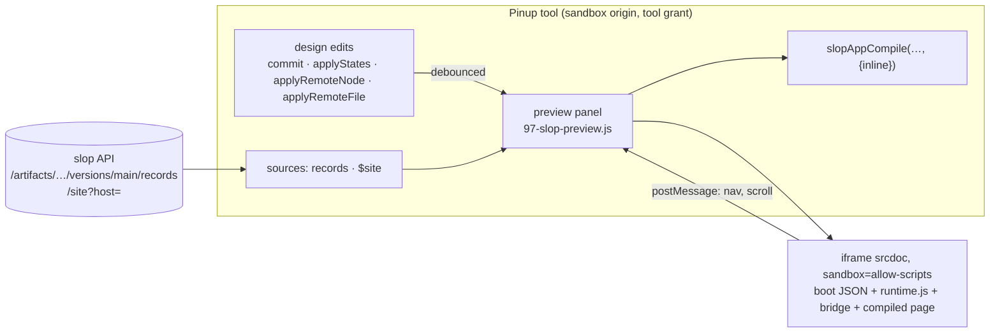

# Intern guide: the live preview panel in Pinup

## 0. What you are building

A Pinup app (SLOP-005, SLOP-006) is a design compiled into a slop page. Today a designer sees that page in only two ways:

- **Preview app** pushes a version without moving `main` and opens it in the Workshop in another tab.
- **Publish app** puts it on the site.

Both write a version, and both leave Pinup. On the canvas, text still reads `{{title}}` and repeats show sample copies.

This ticket adds a **live preview panel** to Pinup. It is a floating window beside the canvas that shows the compiled page as visitors will see it:

- **Compiled in the browser.** The panel uses the same compiler that Publish uses, so what it shows is what will be published.
- **Real data.** Each data source's records, and the `$site` index, are loaded through the tool grant, and the panel injects them the way the server injects boot data.
- **Kept current.** It recompiles after every change, whether local, remote, undo, or an agent's step, about 350 ms after the last one. The scroll position is kept.
- **It follows you.** Selecting a layer shows its screen. On a screen with a `:param`, a record picker chooses which record to show.
- **Navigable.** A link to another screen of the app moves the preview there. A link that leaves the app opens in a new tab.
- **Device widths:** phone (390), tablet (768) and desktop (1280), scaled to fit the panel.
- **Nothing is written.** It pushes no version, sets no route, and keeps no state on the server.



## 1. Background you need

### 1.1 What a compiled app page needs at run time

`slopAppCompile` (`web/pinup/slop/js/96-slop-app.js`) produces one `index.html` with:

- a `<template id="s-<frameId>">` per screen;
- the app JSON (`#pinup-app`: base, start, screens with routes and records);
- the runtime (`slopAppRuntime`, inlined).

When the server serves the page, `render.Inject` (`pkg/render/render.go`) adds two things after `<head>`:

- `<script type="application/json" id="slop-boot">{route, data, record, version, mode}</script>`;
- `<script src="/_slop/runtime.js">`.

`runtime.js` (`pkg/render/assets/runtime.js`, 22 lines) turns the boot JSON into `window.slop`:

- `route: {host, path, params}`;
- `data[name] = {list(), get(id), all}`;
- `record`, `version`, `mode`, `tokens`, `tool`.

The app runtime then works from that object:

1. matches `slop.route.path` against the screens;
2. picks a record;
3. binds repeats, placeholders, links, images and rich text;
4. inserts the screen.

In `mode` `preview` it is forgiving: an unknown path shows the start screen, and an unknown record shows the first record. A panel only has to rebuild that environment, a boot JSON plus `runtime.js`, around the compiled HTML.

### 1.2 Where the data comes from

| Source in `S.file.app.data` | Request (tool grant) | Permission |
|---|---|---|
| a data artifact id | `GET /api/artifacts/{id}/versions/main/records` (`pkg/server/preview.go:16`; `versionNumber` accepts `main`) | `versions:read` |
| `$site` | `GET /api/site?host=<app host>` (`pkg/server/siteindex.go`) | `routes:read` |

Both endpoints return what the server would inject: `records()` adds `src` to file records, and `/api/site` returns the cached site index. Pinup already holds both permissions since SLOP-005 and SLOP-006.

### 1.3 Iframes, sandboxing and messages

The Pinup tool itself runs in an iframe on a sandbox origin (`s<label>.sandbox.localhost:18120`) with a one-hour API grant in memory. The preview must not be able to read that grant or call the API, so:

- **The preview is an `<iframe sandbox="allow-scripts">` with `srcdoc`.** Without `allow-same-origin`, the document gets an *opaque origin*. Its scripts run, but it cannot touch the parent's DOM, storage or `SLOP.api`, and the parent cannot touch its DOM either.
- **The two sides talk only through `postMessage`.** The parent accepts a message only when `event.source` is the current preview iframe's `contentWindow`.
- **Relative URLs resolve against `<base href>`.** A `srcdoc` document's base URL is the parent's URL unless the document sets one. The panel sets `<base href="http://<site host>/">` so that `/_d/…` image URLs of data records load from the site.
- **`/_slop/runtime.js`** is served on sandbox origins (`serve.go`, sandbox handler), so the tool can `fetch` it once and inline its text.

### 1.4 Pinup hooks used

Pinup's modules share one function scope, and the slop modules are spliced into it (`web/pinup/slop/build.js`). A module can wrap a function declaration by reassigning its name: `const f = commit; commit = function (...a) { const r = f.apply(this, a); after(); return r; }`. Callers look the name up at call time, so they get the wrapper.

| Function | Where | Called when |
|---|---|---|
| `commit(changes, opts)` | `src/02-store.js:127` | any local edit (inspector, canvas, steps) |
| `applyStates(list, which)` | `src/02-store.js:170` | undo and redo |
| `applyRemoteNode(id, data)` | `src/02-store.js:256` | another tab or an agent changed a layer |
| `applyRemoteFile(data)` | `src/02-store.js:264` | `meta/file` changed (pages, tokens, `app`) |
| `select(ids, opts)` | `src/04-canvas.js:70` | the selection changed |
| `boot()` | `src/99-boot.js:78` | after the icon set is loaded (the slop toolbar button is added here) |

The panel's stacking order sits between Pinup's canvas overlays (z-index ≤ 6) and menus (60), sheets (70) and toasts (80). The value is 40, which also keeps it under Present mode (50).

## 2. Requirements

- **R1:** A toolbar button and a slop-menu item toggle the panel. It opens over the canvas, can be moved and resized, and remembers its geometry per browser.
- **R2:** The panel compiles the current design with `slopAppCompile` in a preview mode that keeps images inline, and shows it with the data a published page would get.
- **R3:** Changes recompile the preview about 350 ms after the last one; selection changes and hover redraws do not.
- **R4:** The preview follows the selected screen. It offers a screen picker and, for record screens, a record picker. The device widths are 390, 768 and 1280, scaled to fit.
- **R5:** Links inside the preview:
  - links to screens of the app navigate the preview, and Back returns;
  - other site paths and external URLs open in a new tab.
- **R6:** The preview cannot reach the tool's grant: an opaque origin, and messages accepted only from the current preview window.
- **R7:** Compile errors are shown in the panel, and the last good render stays visible.
- **R8:** No version, route or document is written.

## 3. Design

### 3.1 State

```js
const PV = {
  open: false, el: null, stage: null, frame: null,   // DOM
  device: 390,                                         // 390 | 768 | 1280
  path: null,                                          // URL path shown (null: the selected or start screen)
  history: [],                                         // paths, for Back
  scroll: 0,                                           // restored after each render
  data: null, dataKey: '', loading: null,              // source name → rows; the app.data it was loaded for
  runtime: null,                                       // text of /_slop/runtime.js
  timer: 0, seq: 0,                                    // debounce; render sequence (drop stale renders)
};
```

### 3.2 Rendering

```text
pvRender():
  if !S.file.app: show "Make this an app"; return
  chk := slopAppCheck(); show chk.errors (the last frame stays) and chk.warnings
  if chk.errors: return
  data := await pvLoad()                       // cached per app.data; refresh button reloads
  out  := await slopAppCompile(chk, 'live', {inline: true})
  if this render is stale (seq changed): return
  path := PV.path or pvScreenPath(selected screen or start)
  boot := {route: {host: app.host, path, params: {}}, data, mode: 'preview', version: {artifact: app.page, n: 0}}
  doc  := out.files['index.html'] with, right after <head>:
            <base href="<proto>//<app.host>/">
            <script type="application/json" id="slop-boot">JSON(boot), "<" escaped</script>
            <script>runtime.js text</script>
            <script>bridge(PV.scroll)</script>
  swap(doc)                                    // double buffer, §3.5
```

**Preview mode in the compiler.** `slopAppCompile(chk, version, {inline: true})` skips turning `data:` images into files, so the CSS keeps the data URLs. The SHA-256 work is skipped, and no file needs serving. Everything else is identical to Publish.

### 3.3 Paths and pickers

```text
pvScreenPath(screen, recordId?):
  route := screen.route with each ":name" replaced by
             recordId, or the first row's id of screen.record's source, or "sample"
  return join(app.base, route)
pvCurrentScreen():  the screen whose route matches PV.path (same matcher as the runtime), else the start screen
```

- **Screen picker:** the app's screens by name. Choosing one sets `PV.path = pvScreenPath(screen)`.
- **Record picker:** shown when the current screen has `record`. It lists the source's rows as `title` or `id`; choosing one sets the param.
- **Follow the selection:** the wrapped `select` resolves `topOf(sel[0])`. If that is a screen other than the current one, it sets `PV.path = pvScreenPath(it)`, clears `history`, and renders.

### 3.4 The bridge script and messages

Placed in the preview's `<head>`, before the app runtime runs:

```js
(function (restore) {
  var sent = 0;
  addEventListener('scroll', function () { clearTimeout(sent); sent = setTimeout(function () { parent.postMessage({ pinupPreview: 'scroll', y: scrollY }, '*'); }, 120); });
  addEventListener('DOMContentLoaded', function () { if (restore) scrollTo(0, restore); });
  addEventListener('load', function () { if (restore) scrollTo(0, restore); });
  addEventListener('click', function (e) {
    var a = e.target.closest && e.target.closest('a[href]');
    if (!a) return;
    e.preventDefault(); e.stopImmediatePropagation();          // before the runtime's own Back handler
    parent.postMessage({ pinupPreview: 'nav', href: a.getAttribute('href'), back: a.hasAttribute('data-back') }, '*');
  }, true);
})(SCROLL);
```

The parent handles them like this:

```text
on message e:
  if e.source ∉ {current frame, incoming frame}.contentWindow or !e.data.pinupPreview: ignore
  scroll: PV.scroll := e.data.y
  nav:
    if back and PV.history: PV.path := pop(); render
    href := e.data.href
    if href starts with "/" and rel(href, app.base) matches a screen:
        push PV.path; PV.path := href; PV.scroll := 0; render
    else if href starts with "/": open <proto>//<app.host><href> in a new tab
    else if /^https?:/: open href in a new tab (noopener)
```

### 3.5 Swapping frames without a flash

Assigning `srcdoc` to a visible iframe shows a blank document until the new one loads. Instead, `swap(doc)`:

1. creates a second iframe on top of the first with `opacity: 0`;
2. sets its `srcdoc`;
3. on `load`, gives it `opacity: 1` and removes the old frame.

If another render starts first, the pending frame is discarded.

### 3.6 Device scaling

```text
stageW, stageH := the stage's client size
s := min(1, stageW / device)
iframe: width = device px; height = stageH / s px; transform = scale(s); transform-origin = 0 0
```

A `ResizeObserver` on the stage recomputes this when the panel is resized.

### 3.7 Live updates

```text
for f in [commit, applyStates, applyRemoteNode, applyRemoteFile]:
    wrap f: call it, then pvChanged()
pvChanged(): if PV.open: clearTimeout(PV.timer); PV.timer = setTimeout(pvRender, 350)
```

Hover and selection do not go through these functions, so they never recompile. A change to `S.file.app.data` (sources) changes `dataKey`, and the next render reloads the data. The refresh button reloads it on request.

### 3.8 The panel

```text
#slopPreview  (position: fixed; z-index 40; resize: both; min 280×240)
  header (drag handle):  "Preview" · screen select · record select · device seg (390 768 1280) · ↻ · ×
  .pv-msg               errors / "Make this an app" / loading
  .pv-stage             holds the iframe(s)
  footer                "Compiled 15:04:05 · 4 screens · runs 4 rows · pages 241 rows"
```

- **Geometry** is saved in `localStorage` under `pinup.slop.preview` (`{x, y, w, h, device}`) inside `try/catch`.
- **The default** is right-aligned beside the inspector (`right: 300px`), 440 × min(78vh, 760) px.

### 3.9 Errors

- A compile error shows the checker's messages in `.pv-msg` and keeps the last frame.
- A failed data load shows "Could not load <source>: <message>"; that source renders as empty.
- A missing `/_slop/runtime.js` falls back to a 10-line shim with the same `window.slop` shape.

## 4. Implementation plan

| # | Work | Files |
|---|---|---|
| 1 | `slopAppCompile(chk, version, {inline})` | `web/pinup/slop/js/96-slop-app.js` |
| 2 | Panel: state, DOM and CSS, drag and resize, pickers, device scaling, render, swap, bridge, messages, data loading, runtime fetch | `web/pinup/slop/js/97-slop-preview.js` (new) |
| 3 | Hooks: `commit`, `applyStates`, `applyRemoteNode`, `applyRemoteFile`, `select`; toolbar button `#bPreview`; menu item | `97-slop-preview.js`, `95-slop-ui.js` |
| 4 | Browser test: open the panel with a stub API and check screens, data, the record picker, navigation by link, live update after an edit, and a compile error | `web/pinup/slop/tests/app.js` |
| 5 | Docs: `slop help pinup` | `pkg/doc/topics/pinup.md` |
| 6 | End to end: Site map and Pace Club on the local server, screenshots | ticket `various/` |

## 5. Testing

- **The browser test** runs Pinup unwrapped (as in SLOP-005), so it can stub `SLOP.api` (`get` answers the two data requests from fixtures) and set `PV.runtime` to the real `runtime.js`. Playwright reaches the opaque-origin frame through `page.frames()`. Checks:
  - the start screen with data;
  - selecting a record screen shows the first record;
  - choosing another record;
  - clicking a link inside the preview navigates it;
  - an edit (`patch` of a text) appears after the debounce;
  - an invalid path shows the error and keeps the frame;
  - the iframe has `sandbox="allow-scripts"` and no `allow-same-origin`.
- **End to end:** open the panel on `design-site-map` and `design-pace-club` in the local Workshop, edit, select screens, and follow links.

## 6. Risks and open questions

- **Cost per keystroke.** Compiling is O(layers) plus string building. For the designs at hand (40–120 layers) it takes milliseconds; the 350 ms debounce bounds the rate.
- **Data size.** `$site` on the local data is 241 rows. It is loaded once per panel session and on refresh, not on every render.
- **Fonts** load from Google in the preview, as on the published page.
- **Images from data** load from the site host. A data artifact that no public route reads is not served there (`/_d/` gate), so such images do not show in the preview until the app is published.
- **Showing sample data on the canvas itself** remains a separate, riskier change to Pinup's text rendering.

## 7. Reference

| Symbol | File |
|---|---|
| `slopAppCheck`, `slopAppCompile`, `slopAppRuntime`, `slopAppJoin`, `slopAppPath` | `web/pinup/slop/js/96-slop-app.js` |
| `slopMenu`, boot wrapper (`#bSlop`) | `web/pinup/slop/js/95-slop-ui.js` |
| `SLOP.api` (`get`, `can`, `config`) | `web/pinup/slop/js/00-slop-host.js`, `pkg/render/assets/tool.js` |
| `commit`, `applyStates`, `applyRemoteNode`, `applyRemoteFile` | `web/pinup/src/02-store.js` |
| `select`, `topOf` | `web/pinup/src/04-canvas.js`, `02-store.js` |
| `h`, `ico`, `toast`, `lsGet`/`lsSet` | `web/pinup/src/01-util.js` |
| `runtime.js`, `render.Inject` | `pkg/render/assets/runtime.js`, `pkg/render/render.go` |
| records and site APIs | `pkg/server/preview.go`, `pkg/server/siteindex.go` |

## 8. As built (2026-10-29)

The implementation follows §3, with these differences:

| Guide | As built | Why |
|---|---|---|
| `PV`, `pv*` | `LP`, `lp*` (`LP_KEY`, `lpRender`, `lpToggle`, CSS `.lp-*`) | Pinup's Present mode already declares `PV` and `pvBack`, `pvFit`, … in the same function scope; the first build failed with `Identifier 'PV' has already been declared`. |
| `PV.path` | `LP.at = {id, params}` | A screen id plus parameters survives editing a screen's route; the path is computed at render time (`lpPath`). |
| wrap `applyStates` | not wrapped | `applyStates` calls `commit`, which is wrapped. |
| swap on `load` | swap on a `ready` message (DOMContentLoaded + one frame), `load` as fallback | `load` waits for fonts and images; the page is complete earlier. |
| hooks in tool mode | store and selection hooks in every mode except player; the toolbar button and reopen-on-load in tool mode | The browser test runs Pinup without a grant and needs the hooks; they do nothing while the panel is closed. |
| follow every `select` | follow only when the selection changes (`!same(was, S.sel)`) | Pinup re-selects the same layers; following then undid a screen reached by a link in the preview. A mutation check confirms the test catches it. |
| data loader in the panel | `slopAppRows(id, host)` in `96-slop-app.js`, shared with the Prototype tab's field list | One definition of "the rows a source gives the page". |
| — | the panel reopens when Pinup loads if it was open (`pinup.slop.preview.open`) | Designers keep it open across sessions. |

**Files:** `web/pinup/slop/js/97-slop-preview.js` (new, 367 lines), `96-slop-app.js` (`opts.inline`, `slopAppRows`), `95-slop-ui.js` (menu item), `slop/tests/app.js` (29 checks), `pkg/doc/topics/pinup.md` ("The live preview").
