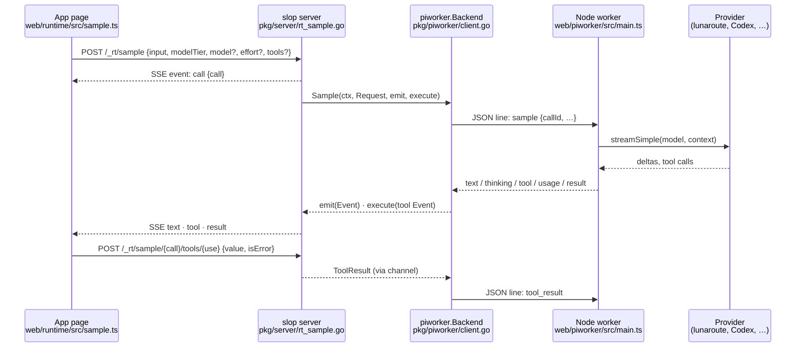

# Intern guide: `sample` on geppetto with Pi credentials

## 1. What this ticket is about

slop is a Go server that hosts web pages written against the **claude.ai Artifact runtime contract**. One capability of that contract is `sample`: a page calls `await sample("prompt", {tools})` and receives a model's answer. The page can also define tools, which the model may call. The tool functions run in the page.

Today, slop serves `sample` through a **Node child process**, the *Pi worker*. The worker runs the Pi SDK (`@earendil-works/pi-ai` and `pi-coding-agent` 0.85.1). Pi reads the user's model configuration and credentials from `~/.pi/agent`, and it calls the model providers.

This ticket replaces the Node worker with Go code built on **geppetto**, the go-go-golems library for LLM inference. The goals are:
- no Node runtime in slop's container image;
- one language at the model boundary;
- the same user configuration as before. Credentials and model choices still come from `~/.pi/agent`, read by a new geppetto package.

The work lands in two repositories:

| Repository | Branch | What lands there |
|---|---|---|
| `~/code/wesen/go-go-golems/geppetto` | `task/pi-agent-provider` (from `origin/main` at `b58b7483`) | a new package that reads Pi's agent directory and turns a Pi model name into a geppetto engine with credentials |
| `slop-computer` | `task/slop-geppetto-sample` (from `task/slop-runtime`) | a Go `sample` backend on geppetto that replaces the Node worker |

**What does not change:** the page API, the HTTP API of `sample` (`/_rt/sample…`), the admin-only policy, consent, and the audit row. The existing browser suite `web/rt-conformance/sample`, with 20 checks, is the acceptance test. It must pass unchanged on the new backend.

The guide is organized as follows:
- §2 explains the system as it is today;
- §3 describes Pi's files;
- §4 introduces geppetto;
- §5 explains why we use geppetto and nothing else;
- §6–7 give the design for each repository;
- §8–10 cover the phases, the tests and the risks.

---

## 2. The system today

### 2.1 The path of one call



The Go server never talks to a provider directly. It talks to the `piworker.Backend` interface. This is the seam the ticket uses: we write a new implementation of `Backend` and leave everything above it alone.

### 2.2 The seam: `piworker.Backend`

`pkg/piworker/backend.go` defines the types every backend uses:

```go
type Backend interface {
	Models() []Model                                        // for sample.limits
	Sample(context.Context, Request, func(Event), ExecuteTool) error
	Close() error
}

type Request struct {
	Images          []Image         // base64 JPEG/PNG/WebP/GIF
	CallID          string          // "sc" + 24 hex
	Input           json.RawMessage // a string, or [{role, content}] ending on user
	Options         Options         // {ModelTier, Model, Effort}
	Tools           []Tool          // {Name, Description, InputSchema}
	MaxRounds       int             // the server sets 10
	MaxOutputTokens int             // 0 = 65,536
}

type Event struct {               // what a backend emits
	Type       string             // text | thinking | tool | usage | result | error
	Text, Delta string            // text and thinking: whole text so far, and the new part
	ToolCallID, Name string; Input json.RawMessage   // tool
	Result *Result; Error *Failure; Usage *Usage
}

type ExecuteTool func(context.Context, Event) (ToolResult, error) // blocks until the page answers
```

Three implementations exist today:
- `piworker.Client`, in `client.go`, which starts and talks to the Node process;
- `piworker.Fake`, in `fake.go`, which is deterministic and used by `TestRuntimeSample` and `slop serve --pi-fake`;
- the new geppetto backend, which this ticket adds.

### 2.3 The server side: `pkg/server/rt_sample.go`

`startSample` checks the policy, in order:
1. a live view (otherwise `session_expired`);
2. a configured backend (otherwise `sampling_disabled`);
3. `sample` declared in the app's manifest (otherwise `not_declared`);
4. a level of at least admin (otherwise `not_granted`);
5. the viewer's recorded consent.

It then validates the request with `piworker.ValidateRequest`, opens the SSE response and calls `Backend.Sample`. Its two callbacks do this:
- **`emit`** forwards `text`, `thinking`, `result` and `error` to the page. It adds up `usage` for the audit row and never forwards it.
- **`execute`** registers a channel for the tool use, sends `tool {use, name, input}` to the page, and waits. The wait ends with the page's answer, after 150 s with an error result, or when the call is cancelled.

`sampleTool` (`POST /_rt/sample/{call}/tools/{use}`) delivers a page's tool result into that channel. `cancelSample` cancels the call's context. After the call, one audit row is written (`action = sample`) with the model, tokens, duration and whether the call was cancelled.

**None of this file changes in SLOP-010.**

### 2.4 The Node worker: what we are replacing

`web/piworker/src/main.ts` (442 lines) does five things. Each of them must exist in the Go version.

1. **Load Pi.** It calls `ModelRuntime.create` with the agent directory, registers the lunaroute provider (`lunaroute.ts`), and lists the available models scoped by `settings.json`'s `enabledModels`. It reports `ready {models}`.
2. **Resolve the model.** The tier (`quick`, `default`, `complex`) maps to a model through `--model-quick/default/complex`. An explicit `model` wins when it is in the catalog; an unknown one falls back to the tier. Effort (`low`, `medium`, `high`) maps to a Pi thinking level.
3. **Convert the input.** A string becomes one user message; a list of turns becomes messages. Images join the last user message. The page's tools become provider tool definitions.
4. **Run the rounds.** Each round is one streamed provider call. Text and thinking deltas are emitted as they arrive. If the model asks for tools, each tool call is sent to Go, the worker waits for the results, appends them, and starts the next round. This repeats up to `MaxRounds` times.
5. **Bound the output.** `OutputBudget` (`output-budget.ts`) gives each call 65,536 generated tokens shared by its rounds. Each round asks for `min(model.maxTokens, remaining)`. After each round the provider's reported usage is checked against what was admitted, and the call fails if it exceeds it.

The worker also maps provider failures to contract error codes in `provider-error.ts`: `rate_limited`, `prompt_too_large`, `empty_completion` and `upstream_error`.

### 2.5 How the server is started

`cmd/slop/cmds/serve.go` builds the backend from flags:

```text
--pi-fake                       → piworker.Fake{}
--pi-worker <worker.js>         → piworker.Start(ctx, node, script, agentDir, tmp, tiers)
--pi-node, --pi-agent-dir       → Node binary, ~/.pi/agent by default
--model-quick/default/complex   → tier map, e.g. lunaroute/glm-5.3-flash
```

The new backend gets its own flag (§7.4). The Node path stays available until the new backend passes the suite.

---

## 3. Pi's agent directory

Pi keeps its configuration in `~/.pi/agent`. Four files matter. The Go loader must read them exactly as Pi does. The formats below come from Pi's type definitions in `node_modules/@earendil-works/pi-ai/dist/auth/types.d.ts` and `pi-coding-agent/dist/core/auth-storage.*`, and from the non-secret files on the development machine.

> [!warning] Never print, log or commit the contents of `auth.json`. Tests use fixture directories under `testdata/` with fake keys.

### 3.1 `auth.json`: one credential per provider

```ts
type Credential = ApiKeyCredential | OAuthCredential;          // keyed by provider id
interface ApiKeyCredential { type: "api_key"; key?: string; env?: Record<string, string> }
interface OAuthCredential  { type: "oauth"; access: string; refresh: string; expires: number /* ms epoch */; [k: string]: unknown }
```

```json
{
  "lunaroute":    { "type": "oauth", "access": "<gateway key>", "refresh": "…", "expires": 0 },
  "openai-codex": { "type": "oauth", "access": "<JWT>", "refresh": "<rotating>", "expires": 1793000000000 },
  "zai":          { "type": "api_key", "key": "<key>" }
}
```

How each kind is used:
- **An API key** is used as a fixed bearer token. `env` holds provider-scoped values, such as Cloudflare account ids.
- **An OAuth credential** has an access token that expires at `expires`. It is renewed with `refresh` through the provider's token endpoint. The new credential is written back.
- **Lunaroute** stores its gateway key in `access`. Its refresh returns the same credential (`lunaroute.ts`: `refreshToken(c) { return c }`), so in practice it is a fixed key.
- **Codex** refresh tokens rotate: after a refresh, the old refresh token is invalid (see §10).

**Writing.** Pi locks the file with *proper-lockfile* before every write:
1. The lock is a **directory** named `auth.json.lock`, created with `mkdir`. Creating a directory either succeeds or fails, so only one process gets the lock.
2. The holder updates the directory's mtime periodically.
3. Another process treats the lock as stale when its mtime is older than the stale interval. proper-lockfile defaults to 10 s; Pi passes its own `staleMs`, so read `auth-storage.js` before relying on the value.
4. Under the lock, Pi re-reads the file, applies the change, and writes with mode `0600`.

A Go writer must follow the same protocol, or it can corrupt the file or lose a rotated refresh token.

### 3.2 `models-store.json`: the cached catalog

This file is the catalog Pi refreshed from providers. Its top level is keyed by provider and holds `{models: [...]}`:

```json
{ "lunaroute": { "models": [
  { "id": "glm-5.3", "name": "glm-5.3", "api": "openai-completions", "provider": "lunaroute",
    "baseUrl": "https://gw.lunaroute.com/v1", "reasoning": true, "input": ["text","image"],
    "cost": {"input":0,"output":0,"cacheRead":0,"cacheWrite":0},
    "contextWindow": 131072, "maxTokens": 32768, "headers": { … } } ] } }
```

On the development machine the store holds these providers. The model counts and wire APIs were read with `jq` from the structure only:

| Provider | Models | `api` values |
|---|---|---|
| lunaroute | 13 | `openai-completions` |
| openai-codex | 9 | `openai-codex-responses` |
| zai | 7 | `openai-completions` |
| fireworks | 22 | `anthropic-messages`, `openai-completions` |
| kimi-coding | 4 | `anthropic-messages` |
| minimax | 3 | `anthropic-messages` |
| amazon-bedrock | 157 | `bedrock-converse-stream` |

**Pi's built-in catalog is not in this file.** It ships inside the npm package as `pi-ai/dist/providers/data/*.json`, for 39 providers. Counted across that catalog, the `api` values are:
- `openai-completions`: 679 models;
- `anthropic-messages`: 325;
- `bedrock-converse-stream`: 121;
- `openai-responses`: 107;
- `azure-openai-responses`: 39;
- `mistral-conversations`: 32;
- `google-generative-ai`: 29;
- `google-vertex`: 14;
- `openai-codex-responses`: 8.

A Go loader without the npm package sees only `models-store.json` and `models.json`. That is enough for the providers in use (§3.4).

### 3.3 `models.json`: user-defined providers and overrides

This file holds user-defined providers: their base URL, API, models, and sometimes an API key. On the development machine its top-level keys are `providers`, `fireworks`, `glm-lunaroute-test` and `wafer`, and `providers` holds `lunaroute`. The loader merges it over the store: a provider or model defined here wins. Treat this file as secret too, because it can hold keys.

### 3.4 `settings.json`: defaults and scope

```json
{ "defaultProvider": "openai-codex", "defaultModel": "gpt-5.6-luna", "defaultThinkingLevel": "minimal",
  "enabledModels": ["lunaroute/glm-5.3", "lunaroute/glm-5.3-flash", "openai-codex/gpt-6-astra",
                    "lunaroute/deepseek-4.1-flash", "lunaroute/deepseek-4.1-flash-background",
                    "openai-codex/gpt-6-luna", "openai-codex/gpt-6.1-sol"] }
```

`enabledModels` is the list the user cycles through in Pi. slop lists every model it can serve, as `sample.limits` does today with 48 models. slop uses `enabledModels` only to pick a default when no tier flag is set. Every enabled model is either lunaroute (`openai-completions`) or openai-codex (`openai-codex-responses`). **Supporting those two APIs covers the configuration in use.**

---

## 4. geppetto in one chapter

geppetto (`~/code/wesen/go-go-golems/geppetto`, module `github.com/go-go-golems/geppetto`, latest tag `v0.13.11`) is the inference library used by pinocchio and other go-go-golems tools. Five parts matter here.

### 4.1 Turns and blocks: the conversation

`pkg/turns` models a conversation as a `Turn` holding ordered `Block`s:

```go
t := &turns.Turn{}
turns.AppendBlock(t, turns.NewSystemTextBlock(system))
turns.AppendBlock(t, turns.NewUserTextBlock("What is 2+2?"))
turns.AppendBlock(t, turns.NewUserMultimodalBlock(text, images))   // images: []map[string]any{media_type, content}
turns.AppendBlock(t, turns.NewAssistantTextBlock(prev))            // earlier assistant turn
turns.AppendBlock(t, turns.NewToolCallBlock(id, name, args))       // the model asked for a tool
turns.AppendBlock(t, turns.NewToolUseBlock(id, result))            // the tool's result
turns.AppendBlock(t, turns.NewToolUseBlockWithError(id, result, msg))
```

`toolblocks.ExtractPendingToolCalls(t)` (`pkg/turns/toolblocks/toolblocks.go`) returns the `tool_call` blocks that have no matching `tool_use` block yet.

The turn's `Data` carries typed settings. Two of them are used here:
- `engine.KeyInferenceConfig.Set(&t.Data, cfg)` sets per-turn inference parameters;
- `engine.KeyToolDefinitions` advertises tools to the model.

### 4.2 Engines: one provider call

```go
// pkg/inference/engine/engine.go
type Engine interface {
	// RunInference processes a Turn and returns the updated Turn. It does NOT run tools:
	// tool calls in the response are left as tool_call blocks.
	RunInference(ctx context.Context, t *turns.Turn) (*turns.Turn, error)
}
```

One `RunInference` call is one streamed provider request, which is exactly one *round* in Pi's terms. Engines are created by `factory.NewStandardEngineFactory(opts...).CreateEngine(*settings.InferenceSettings)` (`pkg/inference/engine/factory/factory.go:108`), which chooses the engine by `settings.Chat.ApiType`:

| `ApiType` | Engine | Package |
|---|---|---|
| `openai`, `anyscale`, `fireworks` | Chat Completions | `pkg/steps/ai/openai` |
| `open-responses`, `openai-responses` | Responses | `pkg/steps/ai/openai_responses` |
| `claude`, `anthropic` | Anthropic Messages | `pkg/steps/ai/claude` |
| `gemini` | Gemini | `pkg/steps/ai/gemini` |

The factory takes options per engine (`WithOpenAIOptions`, `WithOpenAIResponsesOptions`, `WithClaudeOptions`, `WithGeminiOptions`) and one shared `WithBearerTokenSource(source)`.

`settings.InferenceSettings` (`pkg/steps/ai/settings/settings-inference.go:71`) holds several groups:
- `API`: API keys and base URLs per API type (`BaseUrls map[string]string`);
- `Chat`: `ApiType` and `Engine` (the model id);
- `Client`: the HTTP client and timeouts; an injected `HTTPClient` is used as is (`settings/http_client.go`);
- `Inference`: an `engine.InferenceConfig` with defaults;
- `ModelInfo`: static model capabilities and limits;
- the provider-specific `OpenAI`, `Claude` and `Gemini` sections.

`engine.InferenceConfig` (`pkg/inference/engine/inference_config.go:14`) holds the per-turn knobs this ticket uses:

```go
type InferenceConfig struct {
	ThinkingBudget    *int     // Claude thinking.budget_tokens; Responses reasoning.max_tokens
	ReasoningEffort   *string  // Responses reasoning.effort; Chat Completions reasoning_effort where supported
	ThinkingType      *string  // provider toggles, e.g. DeepSeek thinking.type
	ReasoningSummary  *string
	Temperature, TopP *float64
	MaxResponseTokens *int     // the per-round output bound
	Stop              []string
	…
}
```

### 4.3 Events: the stream

Engines publish events to the `EventSink`s found in the context:

```go
ctx = events.WithEventSinks(ctx, sink)      // pkg/events/context.go:18
type EventSink interface { PublishEvent(event Event) error }   // pkg/events/sink.go:15
```

The event types we need are in `pkg/events/chat-events.go:15-64` and `canonical_events.go`:

| Event | Fields used | Becomes in slop |
|---|---|---|
| `EventTextDelta` (`text-delta`) | `Delta`, `Text` | `Event{Type:"text"}`, after slop adds the text of earlier rounds |
| `EventReasoningDelta` (`reasoning-delta`) | `Delta`, `Text` | `Event{Type:"thinking"}` |
| `EventToolCallRequested` (`tool-call-requested`) | `ToolCallID`, `ToolName`, `Input` | not used for dispatch; the turn's `tool_call` blocks are authoritative |
| `EventProviderCallFinished` (`provider-call-finished`) | `Usage`, `StopReason`, `FinishClass` | `Event{Type:"usage"}`, the budget check, and `truncated` |
| `EventError` (`error`) | — | mapped to a contract error code |

`events.Usage` (`pkg/events/metadata.go:4`) has `InputTokens`, `OutputTokens`, `CachedTokens`, `CacheCreationInputTokens` and `CacheReadInputTokens`.

The Chat Completions stream already separates `reasoning_content` deltas into reasoning events (`pkg/steps/ai/openai/chat_stream.go:317`). That matters for GLM and DeepSeek on lunaroute.

### 4.4 Tools and the tool loop

`pkg/inference/tools` has a `ToolRegistry` (`NewInMemoryToolRegistry`, `RegisterTool(name, ToolDefinition)`) and a `ToolExecutor` interface:

```go
type ToolDefinition struct { Name, Description string; Parameters *jsonschema.Schema; Function ToolFunc; … }
type ToolExecutor interface {
	ExecuteToolCall(ctx context.Context, call ToolCall, reg ToolRegistry) (*ToolResult, error)
	ExecuteToolCalls(ctx context.Context, calls []ToolCall, reg ToolRegistry) ([]*ToolResult, error)
}
```

`pkg/inference/toolloop` runs `RunInference`, extracts the pending calls, executes them, appends the results and repeats (`loop.go:94`, `RunLoop`). It is configured with `toolloop.New(WithEngine, WithRegistry, WithExecutor, WithLoopConfig(NewLoopConfig().WithMaxIterations(n)))`.

**We will not use `toolloop` for `sample`** (§6.3 gives the reason). We use the registry's tool definitions to advertise the page's tools, and we write our own loop of about 80 lines.

### 4.5 Credentials and transports

`pkg/steps/ai/credentials` keeps credentials out of settings:

```go
type Request    struct { Provider, BaseURL string }
type Credential struct { AccessToken, RefreshToken string; ExpiresAt time.Time }
type Store      interface { Load(ctx, Request) (Credential, error); Save(ctx, Request, Credential) error }
type Refresher  interface { Refresh(ctx, Request, Credential) (Credential, error) }
type BearerTokenSource interface { BearerToken(ctx, Request) (string, error) }

credentials.NewStaticBearerTokenSource(key)                        // static.go
credentials.NewRenewableBearerTokenSource(store, refresher, opts…)  // bearer.go:143: refresh with skew, singleflight,
                                                                    // one replay after a 401 (BearerTokenAfterUnauthorized)
```

The remaining credential pieces are:
- **`credentials/oauth`** is a generic OAuth client: `NewClient(Config{AuthorizationURL, TokenURL, ClientID, Scopes}, …)`, with `Refresh(ctx, previous)` and a `RefreshTokenPolicy` that decides whether a rotated refresh token is required.
- **`providers/openaicodex`** runs the Responses engine against the Codex endpoint:
  - `RequestTransport(source Source, options Options)` returns an `openai_responses.RequestTransport`, which is passed with `openai_responses.WithRequestTransport(…)`;
  - `Source.Credential(ctx, Request)` must return `Credential{BearerToken, AccountID}`;
  - **no Codex token refresher exists yet** in geppetto or pinocchio.
- **`providers/umans`** is a small example of an API-key provider binding (`ClaudeOptions(apiKey)`).

### 4.6 Build weight

The packages we import are CGO-free. `CGO_ENABLED=0 go list -deps` was run on `inference/engine/factory`, `inference/toolloop` and `providers/openaicodex`:
- they do not link goja or `mattn/go-sqlite3`;
- they do link watermill (the event router) and the Google genai SDKs.

slop builds with `CGO_ENABLED=0` (Dockerfile line 12), so this matters.

geppetto's `go.mod` says `go 1.26.6`, and slop's says `go 1.26.3`. **slop's `go` directive must be raised.**

---

## 5. Why geppetto, and why not pinocchio or sessionstream

| Option | Assessment |
|---|---|
| **Keep the Node worker** | It works today and covers Bedrock and Vertex. It costs a Node runtime in the image (open task 5jc7), npm dependencies, and a JSON-lines protocol between Go and Node. Keep it as a fallback until the new backend passes the suite. |
| **Write providers from scratch in Go** | This means writing SSE parsing for Chat Completions, Responses, Anthropic and Codex, tool-call argument deltas, reasoning formats and token renewal. geppetto already has and maintains all of these. Rejected. |
| **geppetto engines + a Pi loader** | Chosen. It covers the APIs in use (§3.4), streams the events we need, keeps credentials outside settings, and is CGO-free. |
| **pinocchio** | A CLI, TUI and web chat application built on geppetto. Depending on it pulls in bobatea, goja and the chat app. Its `pkg/oauthprofiles` is a useful *pattern*: a credential store with `flock`, owner-only atomic writes and a refresher wrapper. Copy the pattern, not the dependency. |
| **sessionstream** | A framework of commands, events and projections, with websocket fanout and hydration of snapshots. `sample` is one streamed HTTP call whose wire format the contract fixes, with nothing to persist or rebuild. Not a fit. It may suit a future persistent agent console in the Workshop. |

---

## 6. Design: the geppetto side (`task/pi-agent-provider`)

### 6.1 Package layout

New package: `pkg/steps/ai/providers/pi`. It follows the existing `providers/openaicodex` and `providers/umans` packages.

```text
pkg/steps/ai/providers/pi/
  agentdir.go     LoadAgentDir(dir) → *AgentDir: settings, merged catalog, credential store
  catalog.go      Model, Catalog, Lookup("provider/id"), the merge of models.json over models-store.json
  resolve.go      (*AgentDir).Resolve(ref, ResolveOptions) → *Resolved{Settings, FactoryOptions, Model}
  authfile.go     AuthFile: implements credentials.Store over auth.json with Pi's lock protocol
  lock.go         proper-lockfile-compatible mkdir lock (stale, update, compromise detection)
  refresh.go      Refreshers: Codex (oauth client); identity refresher for lunaroute
  thinking.go     Pi thinking level → engine.InferenceConfig, per wire API
  testdata/       agent dirs with fake keys; recorded provider streams
  doc.go
```

Public API:

```go
package pi

func DefaultDir() string                                  // $PI_CODING_AGENT_DIR or ~/.pi/agent
func LoadAgentDir(dir string, opts ...Option) (*AgentDir, error)

type AgentDir struct {
	Settings Settings     // defaultProvider, defaultModel, defaultThinkingLevel, enabledModels
	Catalog  *Catalog
	Auth     *AuthFile    // credentials.Store over auth.json
}

type Model struct {
	Provider, ID, Name, API, BaseURL string            // API: "openai-completions", "openai-codex-responses", …
	Reasoning bool; Input []string                     // "text", "image"
	ContextWindow, MaxTokens int
	Headers map[string]string                          // non-secret provider headers
	Supported bool                                     // false: no geppetto engine for API
}

func (c *Catalog) Models() []Model
func (c *Catalog) Lookup(ref string) (Model, bool)    // "lunaroute/glm-5.3"

type ResolveOptions struct {
	Thinking  string          // Pi level: off|minimal|low|medium|high|xhigh ("" = settings default)
	MaxTokens int             // per-round bound; 0 = model.MaxTokens
	HTTPClient *http.Client   // optional; headers are added on top
}
type Resolved struct {
	Model    Model
	Settings *settings.InferenceSettings
	Factory  []factory.StandardEngineFactoryOption   // credentials and transports
}
func (a *AgentDir) Resolve(ref string, o ResolveOptions) (*Resolved, error)
func (r *Resolved) Engine() (engine.Engine, error)  // factory.NewStandardEngineFactory(r.Factory...).CreateEngine(r.Settings)
```

### 6.2 Mapping a Pi model to a geppetto engine

```text
Resolve(ref, o):
  m := catalog.Lookup(ref)                       or ErrUnknownModel
  switch m.API:
    "openai-completions":     apiType = openai;            baseURL = m.BaseURL
    "openai-responses":       apiType = openai-responses;  baseURL = m.BaseURL
    "anthropic-messages":     apiType = claude;            baseURL = m.BaseURL
    "google-generative-ai":   apiType = gemini
    "openai-codex-responses": apiType = openai-responses;  transport = openaicodex.RequestTransport(codexSource, …)
    default:                  return ErrUnsupportedAPI{m.API}      // bedrock, vertex, mistral-conversations, azure
  s := settings.NewInferenceSettings()
  s.Chat.ApiType, s.Chat.Engine = apiType, m.ID
  s.API.BaseUrls[apiType] = baseURL
  s.Client.HTTPClient = withHeaders(o.HTTPClient, m.Headers)      // e.g. lunaroute-agent, session headers
  s.Inference = thinkingConfig(m, o.Thinking) + MaxResponseTokens(min(o.MaxTokens, m.MaxTokens))
  cred := auth entry for m.Provider
  switch cred.type:
    api_key: source = credentials.NewStaticBearerTokenSource(cred.key)
    oauth:   source = credentials.NewRenewableBearerTokenSource(authFile, refresherFor(m.Provider))
    none:    return ErrNoCredential{m.Provider}           // "log in with pi"
  factory options = WithBearerTokenSource(source)  (or the Codex transport)
```

**Provider headers.** Lunaroute sends three headers: `lunaroute-agent`, `x-lunaroute-session` and `lunaroute-session-id`. geppetto's Chat Completions request sets only `Content-Type`, `Accept` and `Authorization` (`openai/chat_stream.go:163-166`). We therefore wrap the HTTP client's `RoundTripper` to add the headers. Check first whether `transport.HeaderSet` (`pkg/steps/ai/transport/transport.go:94-161`) is reachable from the Chat Completions engine. If it is, use it instead of the wrapper.

**Pi thinking level to `InferenceConfig`.** This must be tested per wire API:

| Pi level | Responses / Codex | Anthropic Messages | Chat Completions (GLM, DeepSeek) |
|---|---|---|---|
| `off` | no reasoning | no thinking | `ThinkingType = "disabled"` where supported |
| `minimal`, `low` | `ReasoningEffort = "low"` | `ThinkingBudget = 1024` | `ReasoningEffort = "low"` |
| `medium` | `"medium"` | `4096` | `"medium"` |
| `high`, `xhigh` | `"high"` | `16384` (within `MaxResponseTokens`) | `"high"` |

slop's `effort` (`low`, `medium`, `high`) maps to the Pi level with the same name. `sample.limits` reports `thinkingLevels` per model. Derive them from `Reasoning` and the API, as Pi's `getSupportedThinkingLevels` does.

### 6.3 The credential store over `auth.json`

```go
type AuthFile struct{ path string; lock lockOptions }
func (f *AuthFile) Load(ctx context.Context, r credentials.Request) (credentials.Credential, error)
func (f *AuthFile) Save(ctx context.Context, r credentials.Request, c credentials.Credential) error
func (f *AuthFile) Entry(provider string) (Entry, error)   // the raw union, for Resolve
```

The two methods behave as follows:
- **`Load`** reads the file without a lock, as Pi's `ReadOnlyAuthStorage` does, and maps `oauth{access, refresh, expires}` to `Credential{AccessToken, RefreshToken, ExpiresAt}`.
- **`Save`** follows this protocol:

```text
Save(r, c):
  acquire lock: mkdir(path + ".lock"); on EEXIST: if mtime(lock) < now - stale → remove and retry; else back off (10ms·2^k) until deadline
  start updater: touch lock mtime every stale/2; if the lock vanished or changed → mark compromised
  data := read path (re-read under the lock: another process may have rotated the token)
  entry := data[r.Provider]; keep unknown fields (Pi stores extra keys on oauth entries)
  entry.access, entry.refresh, entry.expires = c.AccessToken, c.RefreshToken, c.ExpiresAt.UnixMilli()
  if compromised → abort without writing
  write tmp file 0600 in the same directory; fsync; rename over path; fsync dir
  release: stop updater; rmdir lock
```

`RenewableBearerTokenSource` already deduplicates concurrent refreshes in one process with singleflight. The file lock protects against Pi and other processes.

**Refreshers:**
- **lunaroute:** the identity refresher. It returns the previous credential, which matches Pi's lunaroute provider.
- **openai-codex:** an `oauth.Client` with `TokenURL = https://auth.openai.com/oauth/token` and Pi's client id, read from `pi-ai/dist/auth/oauth/openai-codex.js`. The refresh-token policy requires the rotated token. The account id is a claim in the access token, which Pi reads with `extractAccountId(apiKey)` in `api/openai-codex-responses.js`. The Codex `Source` decodes it from the JWT payload and does not verify it, because it is the provider's own token.

### 6.4 Tests in geppetto

- **Catalog:** fixture agent directories in `testdata/agent-*`, covering the merge of `models.json` over the store, `enabledModels`, and unsupported APIs.
- **Resolve:** for each supported API, the resulting settings (API type, model, base URL) and the factory options. Run them against a local `httptest` server that checks the path, the `Authorization` header and lunaroute's headers.
- **AuthFile:**
  - `Load` and `Save` round trips, with unknown fields preserved and mode 0600;
  - two goroutines that save concurrently;
  - a stale lock is removed;
  - a compromised lock aborts the write;
  - an interoperability test that runs Pi's own `AuthStorage` (Node) against the Go lock, if Node is available on the CI runner. Mark it skippable.
- **Codex refresher:** against an `httptest` token endpoint, check rotation and that no token appears in an error message.
- **Thinking:** the request body each API produces for each level, as golden files.

---

## 7. Design: the slop side (`task/slop-geppetto-sample`)

### 7.1 Where the code goes

```text
pkg/piworker/            keep types (Backend, Request, Event, …), Fake, validate.go; Client stays as the Node fallback
pkg/piworker/gepp/       NEW: the geppetto backend
  backend.go             New(agentDir, tiers) → *Backend; Models(); Close()
  sample.go              Sample: resolve, convert, rounds, emit, tools, budget
  convert.go             Request.Input/Images/Tools → turns.Turn and the tool definitions
  sink.go                events.EventSink → piworker.Event (text so far, thinking)
  errors.go              geppetto/provider errors → Failure{Code}
cmd/slop/cmds/serve.go   new flag --models=pi|pi-node|fake (see 7.4)
```

`pkg/piworker` is the stable seam. We keep its name for now; renaming it, for example to `pkg/models`, is a separate cleanup.

### 7.2 `Sample`, step by step

```go
func (b *Backend) Sample(ctx context.Context, req piworker.Request, emit func(piworker.Event), execute piworker.ExecuteTool) error {
	model, tier := b.pick(req.Options)                 // explicit model if in catalog, else tier; unknown → tier
	res, err := b.dir.Resolve(model.Ref(), pi.ResolveOptions{Thinking: effortToLevel(req.Options.Effort)})
	if err != nil { return emitFailure(emit, req, err) }
	t, err := toTurn(req)                              // §7.3
	if err != nil { return emitFailure(emit, req, err) }
	advertise(t, req.Tools)                            // engine.KeyToolDefinitions from the page's schemas

	budget := newBudget(req.MaxOutputTokens)           // 65,536 by default, shared by rounds
	var shown string                                   // text of earlier rounds plus the current one
	for round := 0; round < maxRounds(req); round++ {
		perRound := budget.next(res.Model.MaxTokens)   // min(model max, remaining); error when exhausted
		setMaxTokens(t, perRound)                      // engine.KeyInferenceConfig.MaxResponseTokens
		eng, _ := res.Engine()
		sink := newSink(req.CallID, emit, &shown, round) // text/thinking deltas → Event; usage → budget + Event{usage}
		out, err := eng.RunInference(events.WithEventSinks(ctx, sink), t)
		if ctx.Err() != nil { return ctx.Err() }       // cancelled: rt_sample sends nothing more
		if err != nil { return emitFailure(emit, req, err, shown) }
		if err := budget.consume(sink.outputTokens); err != nil { return emitFailure(emit, req, err, shown) }
		t = out
		calls := toolblocks.ExtractPendingToolCalls(t)
		if len(calls) == 0 || budget.remaining() <= 0 {
			emit(result(req, tier, res.Model, shown, sink.truncated || budget.remaining() <= 0))
			return nil
		}
		results := runTools(ctx, req, calls, execute)  // concurrently, §7.5
		for _, r := range results { turns.AppendBlock(t, toolUseBlock(r)) }
	}
	emit(result(req, tier, res.Model, shown, true))     // out of rounds: truncated
	return nil
}
```

**Why not `toolloop.RunLoop`:**
- **The budget.** It needs `MaxResponseTokens` set before each round from what is left, and usage checked after each round. `RunLoop` has no hook between rounds that changes the inference config.
- **The tool executor.** It must call slop's `execute` callback, which blocks on the page.
- **Text across rounds.** It must be accumulated across rounds, because the contract's `onText` receives the whole answer so far.

Our loop is short, and it keeps all of this visible.

### 7.3 Converting the request

```text
toTurn(req):
  t := new Turn                                   (no system block: main.ts sends none, and the page owns the prompt)
  input := req.Input
  if string:   append NewUserTextBlock(input)
  if turns:    for each {role, content}: user → NewUserTextBlock; assistant → NewAssistantTextBlock
  if images:   replace the last user block with NewUserMultimodalBlock(text, [{media_type, content: base64}])
               (reject when the model's Input lacks "image": Failure{images_unavailable})
advertise(t, tools):
  defs := for each tool: ToolDefinition{Name, Description, Parameters: schema(InputSchema or {type: object})}
  engine.KeyToolDefinitions.Set(&t.Data, defs)          // no Function: execution is ours
```

### 7.4 The sink: events in, contract events out

```text
sink.PublishEvent(e):
  switch e := e.(type):
    *EventTextDelta:       shown = prefix + e.Text;  emit {type: text, text: shown, delta: e.Delta}
    *EventReasoningDelta:  thinking += e.Delta;       emit {type: thinking, text: thinking, delta: e.Delta}
    *EventProviderCallFinished:
                           outputTokens = e.Usage.OutputTokens; truncated = (e.FinishClass == length)
                           emit {type: usage, usage: {input, output, cacheRead, cacheWrite, model}}
    *EventError:           remember for errors.go
```

The prefix rule matches `main.ts:280-287`. When the first text delta of round *n* > 0 arrives and some text is already visible, `"\n\n"` is prepended to that delta. Thinking text follows the same rule (`main.ts:272-277`). Only the visible text and the deltas change; `roundText` keeps the round's own text.

**Flag:** `slop serve --models pi` selects the Go backend, which reads `--pi-agent-dir` (default `~/.pi/agent`) and the tier flags. `--models pi-node` keeps the Node worker with `--pi-worker` and `--pi-node`. `--models fake` replaces `--pi-fake`. During the transition, `--pi-worker` alone still means `pi-node`.

### 7.5 Tools

```text
runTools(ctx, req, calls, execute):
  results := make([]result, len(calls))
  for i, c := range calls (in parallel, errgroup without cancel-on-error):
    r, err := execute(ctx, piworker.Event{Type: "tool", CallID: req.CallID, ToolCallID: c.ID, Name: c.Name, Input: c.Arguments})
    switch {
      case ctx.Err() != nil: return (the call ends)
      case err != nil:       results[i] = error result "The tool failed"
      default:               results[i] = {ID: c.ID, Value: r.Value, IsError: r.IsError}
    }
  return results in call order
```

The `execute` callback already enforces the 150 s timeout, and the 32 KB limit on results is enforced by the page and by `sampleTool`. A tool the page never defined still goes to the page, which answers with an error, as today.

### 7.6 Errors

| Source | Code |
|---|---|
| HTTP 429 from the provider | `rate_limited` |
| context length exceeded, HTTP 413 | `prompt_too_large` |
| a round that ends with no text and no tool call | `empty_completion` |
| an unknown or unsupported API, or no credential | `upstream_error`, with a message naming the provider and `pi` login |
| anything else | `upstream_error` |

The partial text so far is attached as `text`, as the contract requires. Credential material must never appear in `message`; geppetto's credential code already follows that rule.

---

## 8. Implementation phases

| Phase | Repository | Work | Exit test |
|---|---|---|---|
| 1 | geppetto | `LoadAgentDir`, `Catalog`, `AuthFile.Load`, static credentials, `Resolve` for `openai-completions` with headers | unit tests; a manual call to lunaroute through `Resolved.Engine()` |
| 2 | slop | `pkg/piworker/gepp`: `Sample` for text only (string and turns), the sink, the budget, errors; `--models pi` | sample checks 1–6 and 13–20 pass on lunaroute |
| 3 | slop | tools: advertise, `runTools`, `tool_use` blocks, rounds | checks 7–12 (one tool, several tools, chained tools, a throwing tool, abort) pass |
| 4 | geppetto | thinking-level mapping per API, golden request bodies | effort checks pass, and `thinking` events stream for GLM and DeepSeek |
| 5 | geppetto | `AuthFile.Save` with Pi's lock, the Codex refresher, the Codex `Source`, `openai-codex-responses` | lock tests; a manual Codex call after forcing expiry, with Pi still logged in afterwards |
| 6 | slop | images (`NewUserMultimodalBlock`), the image-capable model check | an image check in the sample suite |
| 7 | both | release a geppetto tag, bump slop's `go.mod` (`go 1.26.6`, geppetto), make `--models pi` the default, remove the Node worker from the image | `make lint test`, the conformance suites, `docker build` without Node |

Each phase is one or two focused commits with a diary entry. Phases 1 and 2 need only static keys, so the system is usable on lunaroute before any OAuth work starts.

While the branches are being developed, slop uses a `replace github.com/go-go-golems/geppetto => ../../code/wesen/go-go-golems/geppetto` in a local `go.work`, not in `go.mod`. `go.mod` changes only after a geppetto release (phase 7).

---

## 9. Testing

**The acceptance suite.** `node web/rt-conformance/run.mjs http://localhost:18140 rt-sample` must pass all 20 checks on the Go backend. It ran three times on the Node backend with the lunaroute tiers. The checks cover:
- a string prompt;
- multi-turn;
- turns that must end with a user turn;
- `onText` streaming;
- one tool, several tools, chained tools and a throwing tool;
- an AbortSignal and abort during streaming;
- `sample.json`;
- an explicit model, an explicit model with effort, and a tier with effort;
- the cache, and `cache: false`;
- an unknown model falling back to its tier;
- images without the declaration.

Reference values from the Node run are in the SLOP-009 diary, step 3: multi-turn 11.8 s, several tools 27.0 s, chained tools 19.7 s.

**Go tests.**
- `TestRuntimeSample` keeps using `piworker.Fake`.
- New `pkg/piworker/gepp` tests use a fake `engine.Engine` that replays scripted rounds: text deltas, tool calls and usage. They check event order, accumulated text across rounds, the budget, tool fan-out and errors without a network.
- One test behind the `SLOP_LIVE_MODELS=1` environment variable makes a real lunaroute call.

**Manual run** (from the SLOP-009 setup):

```bash
S=$SCRATCH/rt1
slop serve --local --listen 127.0.0.1:18140 --database-url sqlite:$S/slop.db --blobs $S/blobs \
  --models pi --model-quick lunaroute/glm-5.3-flash --model-default lunaroute/glm-5.3 --model-complex lunaroute/deepseek-4.1-flash
slop push web/rt-conformance/sample …        # as in the suite's README
node web/rt-conformance/run.mjs http://localhost:18140 rt-sample
```

---

## 10. Risks and open questions

1. **Refresh-token rotation (Codex).** After a refresh, the old refresh token is invalid. The consequences:
   - if slop refreshes and does not write back, Pi on the same machine is logged out;
   - if a server holds a *copy* of `auth.json`, the copy and the laptop invalidate each other on their next refresh. The Node worker has the same problem.

   Recommendation: on servers, use API-key providers, or lunaroute, whose key is fixed. Use a separate Codex login per host. Document this in `doc/production.md`.
2. **Lock compatibility.** The Go lock must match proper-lockfile: a lock directory, mtime updates and the stale rule. Read `proper-lockfile/lib/lockfile.js` and Pi's `auth-storage.js` for the exact `stale` and `update` values, and test against Pi itself (§6.4).
3. **Catalog coverage.** Built-in providers that are not in `models-store.json` are invisible without the npm package. Phase 1 supports only what the store and `models.json` define. Open question: vendor a generated catalog into geppetto, or require `models.json` entries?
4. **Unsupported APIs.** Bedrock, Vertex, Mistral Conversations and Azure Responses have no geppetto engine. They are listed with `Supported: false` and are not offered by `sample.limits`.
5. **Reasoning leakage.** With the Node worker, `glm-5.3-flash` with thinking on put `</think>` text into the reply. Check whether geppetto's `reasoning_content` handling avoids this. If not, decide whether stripping it belongs in the Chat Completions engine.
6. **Separator between rounds** (§7.4). `main.ts` uses `"\n\n"` before the first delta of a later round. Keep exactly that, so that the `onText` and `result` texts do not change.
7. **Dependency weight.** watermill and the genai SDKs grow slop's binary. Measure the binary size before and after phase 7.

---

## 11. File reference

**slop** (`/home/manuel/workspaces/2026-10-28/slop-computer/slop-computer`)
- `pkg/piworker/backend.go`: the `Backend` interface and wire types.
- `pkg/piworker/client.go`: the Node worker client, to be kept as a fallback.
- `pkg/piworker/fake.go`, `validate.go`: the deterministic backend and request validation.
- `pkg/server/rt_sample.go`: the HTTP side (`startSample`, `sampleTool`, `cancelSample`, `rpcSampleLimits`).
- `web/runtime/src/sample.ts`: the page side (streaming, tools, cache, `json`, images).
- `web/piworker/src/main.ts`, `output-budget.ts`, `provider-error.ts`, `lunaroute.ts`: the behaviour to reproduce.
- `cmd/slop/cmds/serve.go:53, 198-211`: backend flags.
- `web/rt-conformance/sample/`: the acceptance suite.
- `ttmp/2026/10/29/SLOP-009…/reference/01-diary.md`: step 3 has the sample test record.

**geppetto** (`~/code/wesen/go-go-golems/geppetto`)
- `pkg/inference/engine/engine.go`, `inference_config.go`, `turnkeys_gen.go`: the engine interface, per-turn config and keys.
- `pkg/inference/engine/factory/factory.go`: `NewStandardEngineFactory`, `CreateEngine`, the options.
- `pkg/turns/helpers_blocks.go`, `pkg/turns/toolblocks/toolblocks.go`: blocks and pending tool calls.
- `pkg/events/chat-events.go`, `canonical_events.go`, `canonical_tool_events.go`, `context.go`, `metadata.go`: events and usage.
- `pkg/inference/tools/definition.go`, `registry.go`, `executor.go`: tool definitions.
- `pkg/inference/toolloop/loop.go`: the loop we do not use, and why (§7.2).
- `pkg/steps/ai/settings/settings-inference.go`, `http_client.go`: settings and HTTP client injection.
- `pkg/steps/ai/credentials/bearer.go`, `static.go`, `oauth/oauth.go`: credential interfaces and OAuth.
- `pkg/steps/ai/providers/openaicodex/codex.go`, `providers/umans/umans.go`: provider binding examples.
- `pkg/steps/ai/openai/chat_stream.go`: Chat Completions streaming and `reasoning_content`.

**pinocchio** (`~/code/wesen/go-go-golems/pinocchio`)
- `pkg/oauthprofiles/store.go`, `lock_unix.go`, `refresher.go`: the credential-store pattern (flock, atomic owner-only writes).

**Pi** (installed under `web/piworker/node_modules/@earendil-works/`)
- `pi-ai/dist/auth/types.d.ts`: the credential union.
- `pi-coding-agent/dist/core/auth-storage.js`: locking and writing `auth.json`.
- `pi-ai/dist/auth/oauth/openai-codex.js`, `api/openai-codex-responses.js`: Codex OAuth and the account id.
- `pi-ai/dist/providers/data/*.json`: the built-in catalog.
