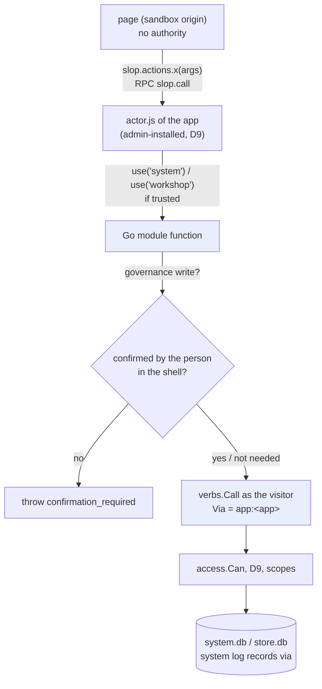
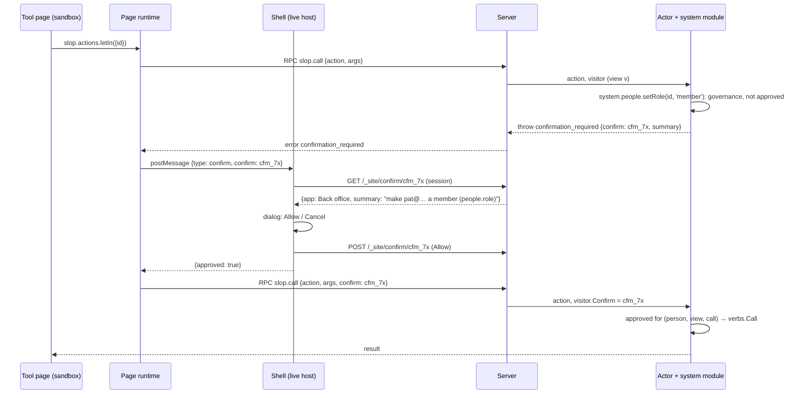

# Tools as apps: design and implementation guide for interns

This guide explains a change to slop v3 and how to build it. The change moves the platform's tools out of the server and into apps: the back office (people, grants, mounts, policy, model budgets) and a Workshop (reviewing an agent's work by pointing at it, then publishing it). To make that safe, apps gain a new kind of capability: **Go modules** that an admin explicitly trusts an app with. Their functions act as the person using the app, go through the platform's normal checks, and leave an audit trail naming the app.

The guide assumes you know Go and JavaScript but nothing about slop. Part I explains the parts of slop v3 you need, with file references. Part II states the problem. Part III designs the primitives. Part IV designs the two apps. Part V covers security, the implementation plan phase by phase, and tests.

> [!summary]
> - **One layering for every tool.** A page in a sandboxed iframe holds no authority. It calls an action of its app's actor. The actor's code was installed by an admin, and it reaches the platform only through Go modules the admin trusted the app with. Each module function calls one of the platform's verbs as the visiting person.
> - **Eight small primitives.** A module registry with per-app trust; a `system` module; a `workshop` module; a `system:` reactor selector; inspect previews; `log.wait`; draft instances; shell confirmation for governance writes. None of them knows about the Workshop or the back office.
> - **Two first apps.** The Workshop (threads anchored to elements of a store's snapshot, an agent loop, publishing by moving `main`) and the back office (the existing React UI, whose API calls become one actor action).

---

## Part I — slop v3 in the detail you need

### 1. What slop v3 is

slop v3 is one Go binary, `slop`, that is a web server and its own command-line client. The server hosts **apps**: small web applications made of HTML and JavaScript, optionally with server-side JavaScript. People visit them in browsers; coding agents build and change them through the CLI with a token. Repository: `/home/manuel/code/wesen/2026-10-31--slop-v3`, module `github.com/go-go-golems/slop`. The design of v3 itself is ticket SLOP3-001 (`ttmp/2026/11/01/SLOP3-001-…/design-doc/01-…md`); read its sections 3 to 7 for more depth than this part gives.

### 2. The five nouns

The data model has five nouns. Every feature either is one of them or decides what someone may do with them.

- **Store.** A directory `stores/<id>/` with one SQLite file, `store.db`. It holds JSON **documents** at paths (`threads/t1`), **files** in a versioned tree (`index.html`), the app's own SQL tables, and a numbered **log** of commits. File bytes live once, by SHA-256, in a shared blob directory. Code: `pkg/store/store.go` (schema at the top), `pkg/store/turn.go`.
- **App.** A store whose tree contains `app.json`. Code: `pkg/apps/manifest.go`. A store either runs its own tree as an app or names another store as its app and holds only data (an **instance**). Claude Blocks works this way: the store `blocks` holds the code; `ws-lobby` and `ws-team` are instances of type `blocks`.
- **Mount.** A host and a path pattern pointing at a store, or at a parameter naming stores (`/b/:id`). Code: `pkg/system/mounts.go` (`BestMount`).
- **Person.** A signed-in user (`usr_…`) or a guest (`vis_…`). A person's **audience** is computed per request: `guest`, `member`, `subscriber` or `admin`. Code: `pkg/access/check.go` (`AudienceOf`).
- **Grant.** A **level** on one store for a subject: a person or an audience (`@guest`, `@member`, `@subscriber`). Levels are ordered `view` < `interact` < `admin` < `owner`. Code: `pkg/system` (grants), `pkg/access/check.go` (`Level`, `Can`).

Global state lives outside the stores, in `system.db` (`pkg/system/migrations/001_init.sql`): people, sessions, tokens, stores, grants, links, mounts, the policy matrix, LLM access and usage, secrets, Stripe state, and the **system log** (`_log`, `_changes`). Every change to that state is recorded there, with who made it and through which entry point (`via`).

### 3. The access check

Every access question goes through `Checker.Can(ctx, principal, store, need, what, hidden)` in `pkg/access/check.go`. It computes the principal's level on the store in four steps:
1. the owner holds `owner`, and an admin holds `admin` on every store;
2. otherwise, the highest matching grant;
3. capped by audience (guests at most `interact`);
4. capped by the token's scopes.

It then compares that level with the level needed. Each step appends a line to a trace that `explain.can` returns. You will not change this function: the new modules call verbs, and the verbs call it.

### 4. Verbs: the single list of operations

Every operation of the platform is a **verb**, a Go value registered in a table (`pkg/verbs/verb.go`):

```go
type Verb struct {
	Name      string // "grant.set"
	Doc       string
	Args      []Arg  // name, type, position, required
	Scope     Scope  // read, write or admin: what a token needs
	AdminOnly bool   // the person must be an admin
	Run func(ctx context.Context, e *Env, p *access.Principal, a Args) (any, error)
}
```

There are 76 verbs. The CLI (`slop grant set notes @member interact`), the HTTP API (`POST /api/v1/grant.set`) and `slop eval` are generated from the table, so an agent and the back office already run identical code. From Go, a verb is called with `verbs.Call(ctx, env, principal, name, args)` (`pkg/verbs/verb.go:214`). It checks the token scope, `AdminOnly`, that guests do not write, and the required arguments, then runs the verb. Verbs that change `system.db` record the principal's `Via` in the system log. The "via app:backoffice" audit entries of this design come from there.

The verbs this design wraps, with their arguments (from the source):

| Verb | Scope | Admin only | Arguments (`*` required) |
|---|---|---|---|
| `people.ls` | read | yes | `kind` (user or guest) |
| `people.role` | admin | yes | `id*`, `role*` |
| `grant.ls` / `grant.set` / `grant.rm` | read / write / write | | `store*`, `subject`, `level` |
| `mount.ls` / `mount.set` / `mount.rm` / `mount.undo` | read / write | `mount.set` yes | `host`, `path`, `store`, `storeParam`, `type`, `createApp` |
| `policy.ls` / `policy.set` | read / admin | | `app*`, `capability*`, `audience*`, `value*` |
| `llm.ls` / `llm.set` / `llm.usage` / `llm.reset` | read / admin | | `subject`, `value`, `budget` |
| `explain.can` | read | | `store*`, `level`, `subject`, `path`, `op` |
| `log.system` | read | | `limit` |
| `store.ls` / `store.meta` | read | | `all`; `id*` |
| `snap.ls`, `ref.ls` | read | | `store*` |
| `ref.move` | write | | `store*`, `ref*`, `n*` |
| `files.ls` / `files.cat` | read | | `store*`, `at`, `path` |
| `files.push` | write | | `store*`, `files*`, `blobs`, `message`, `ref`, `prune`, `snapshot` |
| `log.show` | read | | `store*`, `after`, `limit` |

### 5. Hosts, views and the page runtime

The server answers four kinds of host (`pkg/config/config.go`, `Hosts`):

| Kind | Example | Serves |
|---|---|---|
| main | `slop.localhost:18300` | the built-in back office, sign-in, `/api/v1` |
| live | `apps.localhost:18300` | apps for visitors, with sessions and guests |
| static | `site.localhost:18300` | files only, no cookies |
| sandbox | `s<label>.sbx.localhost:18300` | the app pages themselves |

On a live host, a mount path serves the **shell** (`pkg/server/assets/shell.js`): a title bar and an iframe. The shell asks `POST /_site/views` for a **view** of the store; the server checks access and returns a URL on a **sandbox origin** and a secret. The origin's label is an HMAC of the store and the app (`Server.label` in `pkg/server/views.go:65`). So every store+app pair has its own origin and cannot read another's storage or call the platform with someone's cookies. The page runs there, with the **page runtime** injected (`web/runtime/src`, built into `pkg/server/assets/claude.js`). The runtime implements the claude.ai artifact contract, `claude.use(name)`, over two channels of the view: an event stream (`GET /_rt/events`) and an RPC endpoint (`POST /_rt/rpc`). The RPC methods are listed in `Server.rpcTable` (`pkg/server/views.go`).

Two facts about the page side matter for this design:

- A page reaches its app's server code with `const slop = await claude.use("slop"); await slop.actions.name(args)`. That is the RPC method `slop.call` (`Server.rpcSlopCall`, `pkg/server/actors.go:54`). It turns the view's principal into a **visitor** (`VisitorOf`) and calls the actor.
- The shell can ask the person things the page cannot fake, because it runs on the live host's origin, outside the page's iframe. It already does this for consent (`case "consent"` in `shell.js`) and downloads.

### 6. Actors and turns

An app with `actor.js` has server code. While a store runs the app, the server keeps one goja runtime for that store, owned by one goroutine that takes events from an inbox (`pkg/actor/actor.go`). Each event (an action, an HTTP route, a reactor event, an alarm) is a **turn**: one SQLite transaction on the store (`Store.Do`, `pkg/store/turn.go`). An `await` on real I/O ends the turn; the code after the `await` runs in a new turn, posted as a continuation event (`Actor.io`). A rejected root promise rolls its turn back.

The handler receives `ctx`; `ctx.visitor` describes who the event acts for (`actor.Visitor`: `id`, `audience`, `level`, `guest`, …). For reactors and alarms, the visitor is the store itself (`store:<id>`), and the person who pays, and on whose behalf the event acts, is the store's owner (`Visitor.Payer`).

### 7. What actors can `use()` today

`Actor.module(name)` in `pkg/actor/modules.go` is the catalog:

```go
func (a *Actor) module(name string) goja.Value {
	switch name {
	case "sql", "db", "files", "room", "alarm", "time", "log", "stores":
		// always available: the store's own data, rooms, timers, read aliases
	case "fetch", "secrets", "sample", "platform":
		// policy capabilities: null unless app.json declares them and the
		// policy matrix allows them for some audience; each call checks the
		// turn's visitor (Actor.need)
	}
	return goja.Null()
}
```

`platform` (`pkg/server/platform.go`) is the precedent for this design. It maps three operations (`stores.create`, `mounts.set`, `grants.set`) to verbs. It builds a principal for the visitor with `Via: "app:" + a.App()` and calls `verbs.Call`. The design generalises exactly that.

### 8. Reactors and the log

A **reactor** is a handler under `on:` in `defineActor`, keyed by a selector: `doc:<glob>`, `file:<glob>`, `table:<name>`, `ref:<name>`, `snapshot`, `schema` or `*`. `Manager.onCommit` queues a reactor event after each commit. `Actor.react` (`pkg/actor/manager.go:664`) reads the store's log from each reactor's cursor, a row in `_cursors` with `source = 'self'`. It calls the handler for matching commits and moves the cursor in the same transaction, so each commit is handled exactly once. The `source` column exists so that a cursor can follow another log; this design uses it for the system log.

### 9. App versions and `app_ref`

A store runs the snapshot of its app that a ref points at. `Kernel.Running` (`pkg/kernel/apps.go:35`) reads the store's meta `app_ref`, which is set to `main` when the store is created (`pkg/store/store.go:113`). It resolves that ref on the app store and **activates** the store when the snapshot changed: migrations run, `setup` runs, and `smoke` must pass, or the store keeps running its previous version. No verb changes `app_ref` today. The draft instances of this design are a verb that does.

### 10. Decision D9 and the policy matrix

- **D9: only admins push app code.** Writing the tree of a store that contains `app.json` requires the person to be an admin (`needCodeRight`, `pkg/verbs/mounts.go:201`). So every line of actor code on a server was installed by an admin. This design relies on that: trusting an app with a module means trusting code an admin installed.
- **The policy matrix** (`app_policy`, `pkg/system/policy.go`) is app × capability × audience for `assets`, `sample`, `user.email`, `fetch`, `secrets` and `platform`. Changing a cell restarts the app's actors.

---

## Part II — The problem

### 11. Tools baked into the server

slop v3 has one tool, the back office: a React app embedded in the binary (`web/admin`, served at `/` on the main host by `pkg/server/admin.go`). slop-computer v2 also had a **Workshop**, in which:

1. an agent pushes a version of a page;
2. a person opens it in a preview, switches to pick mode and clicks an element. A script in the preview (`bridge.js`) reports the element's selector, text, box and computed styles;
3. that becomes a **thread** anchored to the version and the element;
4. the agent, blocked in `slop comments wait`, receives the thread, changes the files and pushes a new version with `--reply`;
5. nothing is public until someone routes a version.

Both tools are server code. Each new tool, or each variant of one, would be more server code, reviewed and deployed with the binary. The aim of this ticket is that tools become apps: pushed, versioned and replaced like any other app, possibly written by agents, in several variants.

### 12. What a tool app needs that apps cannot do today

| A tool needs to… | Today |
|---|---|
| read and change people, grants, mounts, policy, budgets | only `platform` (three operations), policy-gated per audience |
| list stores, snapshots and refs; push files to another store; move `main` | nothing |
| show a private snapshot of another store in a preview, with pick mode | snapshot URLs exist, but the sandbox host serves them to anonymous visitors only, and there is no pick script |
| let an agent wait for a new comment | `log.show` is one-shot |
| run an app's draft against a scratch store | `app_ref` exists, but no verb sets it |
| react when people or grants change | reactors follow only the store's own log |
| make a person confirm a dangerous change made through an app | nothing |

### 13. Why not expose system data as a store

An app could be given a "system store" whose documents are the grants and roles, editable with the ordinary `db` capability. Every invariant that verbs enforce would then have to be re-implemented as validation of document writes:
- who may grant on which store;
- audience caps;
- owners only from creation;
- links never lowering a level;
- telling open views when a level changes;
- D9 and the audit log.

The `db` capability's path rules are far too coarse for that. The design therefore keeps verbs as the only way to change the platform, and gives trusted apps Go functions that call them.

---

## Part III — The primitives

### 14. Overview



The eight primitives:

| # | Primitive | New code |
|---|---|---|
| 1 | Module registry and trust | `pkg/actor/registry.go`, `pkg/system/modules.go`, migration `003_app_modules.sql`, verbs `app.trust`, `app.untrust`, `app.modules` |
| 2 | The `system` module | `pkg/server/modsystem.go` |
| 3 | The `system:` reactor selector | `pkg/actor/manager.go` (react), `pkg/system/system.go` (log follower) |
| 4 | The `workshop` module | `pkg/server/modworkshop.go` |
| 5 | Inspect previews | `pkg/server/preview.go`, `pkg/server/assets/bridge.js`, migration (previews table), verb `preview.url` |
| 6 | `log.wait` | `pkg/verbs/stores.go` |
| 7 | Draft instances | verb `app.follow` in `pkg/verbs/actors.go` |
| 8 | Shell confirmation | `pkg/server/confirm.go`, `shell.js`, `web/runtime/src` (slop.call), verb `confirm.approve` |

### 15. Primitive 1: the module registry and trust

**Declaration.** An app lists the Go modules it needs in `app.json`:

```json
{ "title": "Back office", "actor": "actor.js",
  "slop": { "modules": ["system"] } }
```

`apps.Manifest.Slop` gains `Modules []string`. They are validated against the registry's names when the manifest is parsed: an unknown module makes the manifest broken, as an unknown capability does.

**Registry.** Modules are compiled into the server. The actor package defines what a module is; the server registers the ones that need verbs. The names an app may declare are listed in `apps.Modules` beside `apps.Platform`, because `apps.Parse` validates them and cannot import the server. As built (W1), the tier is not a field of `Module`: what matters per function is whether it writes (from the verb's scope) and whether it needs confirmation (a flag on each function):

```go
// pkg/actor/registry.go
type Tier string

const (
	TierRead       Tier = "read"       // reads only
	TierPublishing Tier = "publishing" // stores, files, refs, mounts, grants
	TierGovernance Tier = "governance" // roles, policy, budgets, secrets, comps
)

// A Module is a Go module an app's actor can use() once an admin has
// trusted the app with it.
type Module struct {
	Name string
	Doc  string
	Load func(a *Actor) goja.Value // builds the JS object for one actor
}

// Manager gains:
//   Modules map[string]Module
//   Trusted func(ctx context.Context, app, module string) bool
```

`Actor.module(name)` gains a final case. It returns `Load(a)` if three things hold: the name is in `Manager.Modules`, the manifest declares it, and `Trusted(app, name)` is true. Otherwise it returns `null`.

**Trust.** A new table in `system.db`:

```sql
-- pkg/system/migrations/003_app_modules.sql
CREATE TABLE app_modules (
  app TEXT NOT NULL,          -- the app store
  module TEXT NOT NULL,
  granted_by TEXT NOT NULL,
  granted_at INTEGER NOT NULL,
  PRIMARY KEY (app, module));
```

Three verbs manage it. All are admin-only, and all are logged in the system log as `Change{Kind: "module", Key: app+"/"+module}`:

| Verb | Scope | What it does |
|---|---|---|
| `app.trust <app> <module>` | admin | trust an app with a module; restarts the app's actors |
| `app.untrust <app> <module>` | admin | withdraw it; restarts the app's actors |
| `app.modules [<app>]` | read | the registry (name, doc) and, per app, which modules it declares and which it is trusted with |

Trust belongs to the app store, not to a version: pushing a new version keeps it. That is safe because only admins push app code (D9).

Trust is deliberately not a cell of the policy matrix. An app holding `policy.set` through the `system` module could otherwise grant itself anything. Trust is set from the CLI or another trusted tool, by a person who is an admin, and every change is audited.

**Calls run as the visitor.** A verb-backed module function builds a principal from the turn's visitor:

```go
// pkg/server/modules.go (shared by system and workshop)
func (s *Server) actAs(a *actor.Actor, write bool) *access.Principal {
	v := a.Visitor()
	person := v.ID
	if strings.HasPrefix(person, "store:") {      // reactor or alarm: nobody behind it
		if write {
			a.Throw("permission_denied", "a module write needs a person; reactors and alarms may only read")
		}
		person = v.Payer                          // reads act as the store's owner
	}
	pp, err := s.Sys.Person(ctx, person)
	if err != nil { a.Throw("permission_denied", "no person to act as") }
	return &access.Principal{Kind: kindOf(pp), Person: &pp, Via: "app:" + a.App()}
}
```

The verb then applies every ordinary check to that person. A member using the back office app gets `permission_denied: people.role is for admins`, exactly as from the CLI. The system log records `via app:backoffice`, so the back office's Activity view reads "role of Pat: pending → member, by Ada via app:backoffice".

**Functions return promises.** A module function runs its verb through `Actor.IO`: the turn commits, the verb runs on another goroutine, and the promise settles in a continuation turn that keeps the visitor. A verb that writes the actor's own store would otherwise wait for the turn's own transaction. Code therefore writes `await system.people.list()`.

**Token scopes carry over.** When the visitor came with a token (an agent calling `slop call`), `actAs` builds a token principal with that token's scopes. A token without the `admin` scope cannot reach `policy.set` through an app either.

**Results are curated.** Module functions return what the verbs return, which is what the CLI shows: tokens without secrets, people without sessions. They never return raw rows of `system.db`.

### 16. Primitive 2: the `system` module

The module is a table from JavaScript names to verbs. Each entry gives:
- which verb it calls;
- how positional arguments map to the verb's arguments;
- its tier;
- whether it needs confirmation (primitive 8).

| JavaScript | Verb | Tier | Confirm |
|---|---|---|---|
| `people.list({kind})` | `people.ls` | read | |
| `people.setRole(id, role)` | `people.role` | governance | yes |
| `grants.list(store)` | `grant.ls` | read | |
| `grants.set(store, subject, level)` | `grant.set` | publishing | |
| `grants.remove(store, subject)` | `grant.rm` | publishing | |
| `links.list(store)` / `links.create(store, level)` / `links.revoke(id)` | `link.ls` / `link.new` / `link.rm` | read / publishing | |
| `mounts.list(host)` | `mount.ls` | read | |
| `mounts.set(host, path, store, opts)` | `mount.set` | publishing | |
| `mounts.remove(host, path)` / `mounts.undo(host, path)` | `mount.rm` / `mount.undo` | publishing | |
| `policy.list(app)` | `policy.ls` | read | |
| `policy.set(app, capability, audience, value)` | `policy.set` | governance | yes |
| `llm.list()` / `llm.usage(person)` | `llm.ls` / `llm.usage` | read | |
| `llm.set(subject, value, budget)` / `llm.remove(subject)` / `llm.reset(person)` | `llm.set` / `llm.rm` / `llm.reset` | governance | yes |
| `subs.list(person)` / `subs.grant(person, until, note)` / `subs.revoke(id)` | `sub.ls` / `sub.grant` / `sub.revoke` (`id` is a `cmp_…` comp) | read / governance | grant, revoke |
| `secrets.list(app)` / `secrets.set(app, name, value)` / `secrets.remove(app, name)` | `secret.ls` / `secret.set` / `secret.rm` | read / governance | set, remove |
| `stores.list()` / `stores.meta(id)` | `store.ls` (all) / `store.meta` | read | |
| `apps.list()` / `apps.status(store)` / `apps.logs(store)` / `apps.restart(store)` / `apps.modules(app)` | `app.ls` / `app.status` / `app.logs` / `app.restart` / `app.modules` | read / publishing | |
| `explain(store, level, subject)` | `explain.can` | read | |
| `log(limit)` | `log.system` | read | |
| `call(verb, args)` | any verb above | that verb's | that verb's |

The module has no function for `app.trust`, and `call` refuses it: an app trusted with `system` cannot widen its own trust or any other app's.

`call` exists for the back-office port (section 23). The existing React UI calls verbs by name, so one generic action replaces its HTTP client. `call` refuses any verb not in the table.

Argument mapping works as follows. If a function is called with exactly one plain object, and its entry has more than one positional name, the object is the verb's argument object. Otherwise positional arguments are assigned in order. So `system.grants.set('notes', '@guest', 'view')` and `system.grants.set({store: 'notes', subject: '@guest', level: 'view'})` are the same call.

Example, the back office's actor:

```js
const system = use('system');          // null unless an admin ran: slop app trust backoffice system

defineActor({
  actions: {
    verb(ctx, { name, args }) { return system.call(name, args || {}); },   // a promise: the action resolves with it
    async pending(ctx)        { return (await system.people.list({ kind: 'user' })).filter(p => p.role === 'pending'); },
  },
});
```

### 17. Primitive 3: the `system:` reactor selector

A tool's pages should update when someone changes a grant from the CLI. Reactors follow their store's log; this primitive lets an app trusted with the `system` module also follow the system log.

- **Selector.** `system:<kind>`, where `<kind>` is a `Change.Kind` of the system log (`person`, `grant`, `mount`, `policy`, `llm`, `link`, `store`, `token`, `comp`, `secret`, `module`, `billing`, `binding`) or `*`. The handler receives `{rev, at, principal, via, summary, changes: [{kind, key, op, before, after}]}`.
- **Cursor.** A row in the store's `_cursors` with `source = 'system'`. A new reactor starts at the system log's current head; it does not replay history.
- **Delivery.** `system.DB` gets `LogHead()` and `LogAfter(rev, limit)`. After every transaction that wrote to `_log`, `system.DB` calls an `OnLog` hook. The actor manager then queues a reactor event for every running actor that has `system:` selectors and whose app is trusted with `system`. When an actor starts, it queues one reactor event so that it catches up.
- **Exactly once.** As for store reactors, the cursor moves in the same transaction as the handler's writes.

```js
on: {
  'system:grant'(ctx, c) { db.doc('ui/changed').set({ rev: c.rev, at: c.at }); },  // pages subscribe to ui/changed
}
```

### 18. Primitive 4: the `workshop` module

These are the functions a review or publishing tool needs, all called as the visitor:

| JavaScript | Verb | Tier |
|---|---|---|
| `stores()` / `stores({all: true})` | `store.ls` (visible stores; every store for admins with `all`) | read |
| `snapshots(store)` | `snap.ls` | read |
| `refs(store)` | `ref.ls` | read |
| `files(store, at)` | `files.ls` | read |
| `read(store, at, path)` | `files.cat` | read |
| `log(store, after, limit)` | `log.show` | read |
| `push(store, files, {ref, message})` | `files.push` (with `ref`, default `draft`) | publishing |
| `moveRef(store, ref, n)` | `ref.move` | publishing |
| `publish(store, n)` | `ref.move` with `ref: "main"` | publishing |
| `follow(store, ref)` | `app.follow` (primitive 7) | publishing |
| `status(store)` | `app.status` (includes the ref it follows) | read |
| `preview(store, at, parent)` | `preview.url` (primitive 5) | read |

`push` defaults to the `draft` ref so that a tool cannot publish by accident: mounts serve `main`, and only `publish` moves it. D9 still applies: pushing a tree that contains `app.json` needs an admin visitor.

### 19. Primitive 5: inspect previews

A preview shows a snapshot of a store inside a tool's page, with the pick script that turns a click into an anchor. Three constraints decide the design:

1. A preview must never run on a host that holds a session cookie (main or live). It must run on a sandbox origin.
2. A preview of a private store must not be readable by anyone else.
3. Pages written for a site root use absolute paths (`/_slop/page.js`, `/_data/…`). A preview must therefore be served at the root of its origin, not under a path prefix.

So each preview gets **its own sandbox origin**, and its unguessable label is the capability:

```text
preview.url(store, at, parent)  →  http://p<label>.sbx.localhost:18300/
label   = "p" + 24 hex characters from crypto/rand (stored in the previews table)
```

- `preview.url` (verb, read scope) checks that the caller may read the store (`Can … view`) and resolves `at` (a ref or a snapshot number; default `draft`, else `main`) to a snapshot number `n`. It inserts a row into a new `previews` table: `label, store, n, person, parent, expires_at` (one hour). As built (W5), the label is random rather than an HMAC: it is stored anyway, so it needs only to be unguessable.
- On every request, the sandbox host checks the row's expiry and that its person may still read the store, so losing access ends the preview.
- The sandbox host, on a request whose label starts with `p`, looks up the row and checks the expiry. It serves the snapshot's files at the root, as the static host does: `/` gives the entry page, `/a/b.css` gives `a/b.css`, and directories give their `index.html`.
- HTML responses get three tags injected at the start of the head: a boot block `{"mode": "preview", "parentOrigin": "<parent>"}`, a stub `window.claude = {use: () => Promise.resolve(null)}` (a preview has no view), and `<script src="/_slop/bridge.js">`. `bridge.js` is v2's `pkg/render/assets/bridge.js`, copied.
- Every response carries `Content-Security-Policy: frame-ancestors <parent> <main> <live hosts>` and `Cache-Control: private, no-store`. `frame-ancestors` applies to every ancestor, not only the direct parent: a preview sits in the tool's sandbox frame, which sits in a shell on the live or main host, so those origins must be listed too. No other sandbox origin may frame it.
- `parent` must be an origin of this server (a sandbox origin, the main host or a live host), and `preview.url` refuses others. The tool passes its page's `location.origin`.

The bridge's message protocol (from v2's `web/workshop/src/preview/bridge-protocol.ts`), between the tool page and the preview:

| Direction | Message | Meaning |
|---|---|---|
| tool → preview | `{slop: 1, type: "pick", on}` | enter or leave pick mode |
| tool → preview | `{slop: 1, type: "pins", pins: [{id, n, selector, fx, fy, resolved, title}], focus}` | draw comment pins |
| preview → tool | `{type: "pick", selector, tag, text, fx, fy, box, styles}` | the element clicked in pick mode |
| preview → tool | `{type: "pins", found, missing}` | which pins matched an element |
| preview → tool | `{type: "ready", title}` / `{type: "nav", href}` | loaded; a same-site link was followed |

Previews of apps with capabilities show their files only. `claude.use` resolves to `null` there, because a preview has no view. Running an app's draft for real is primitive 7.

### 20. Primitive 6: `log.wait`

`log.wait <store> --after <rev> [--timeout 55]` (read scope, needs `view` on the store) returns the store's commits after `rev` as soon as there is at least one. After the timeout (at most 300 seconds) it returns an empty list. It subscribes to the kernel's commit feed for that store before reading the log, so that a commit between the read and the subscription is not missed.

The agent loop of the Workshop is then:

```text
rev=$(slop log show workshop -o json | jq '.[-1].rev')
while true; do
  slop log wait workshop --after "$rev" -o json > new.json     # blocks until someone comments
  rev=$(jq '.[-1].rev // empty' new.json || echo "$rev")
  slop docs ls workshop threads -o json                          # read the open threads
done
```

### 21. Primitive 7: draft instances

`app.follow <store> <ref>` (write scope, admin only) sets the store's meta `app_ref`. `Kernel.Running` already honours it, so the next request activates the store at that ref's snapshot of its app, with its migrations, `setup` and `smoke`. A scratch instance runs the journal's draft against its own data, without touching the live instance:

```text
slop store new journal-scratch --app journal --type journal
slop app follow journal-scratch draft
```

It is admin-only because it runs app code that is not on `main`.

`app.status` shows the ref a store follows. Moving `main` (publishing) activates every instance that follows `main`.

### 22. Primitive 8: shell confirmation for governance writes

A tool page that an admin has open can, through its actor, change roles and policy as that admin. An injection bug in a tool would then let an attacker do the same. Confirmation adds a step that only the person can take: it happens in the shell, which runs outside the page's iframe on the live host.



Rules:

- A **confirmation** is a server-side record with these fields:
  - `id`, the person and the view;
  - the call's hash, `sha256(verb + canonical JSON of args)`;
  - the summary text and the app's title;
  - `approved`, and an expiry (two minutes).

  The server writes the summary from the verb and its arguments, never the page.
- An approval is valid for the same person, view and call hash until it expires. The first use does not consume it. An action that makes two governance calls first fails on the first, is confirmed and retried, then fails on the second, is confirmed and retried again, and then both pass.
- The runtime retries transparently: the app's promise resolves with the retried result, or rejects with `confirmation_declined`.
- Calls made directly by a person (CLI, HTTP, eval, the built-in back office) are not confirmed: the person is the one acting. Confirmation guards against app code acting for a person.
- From the CLI, `slop call backoffice letIn …` fails with `confirmation_required` and prints the summary and id. The person may run `slop confirm approve <id>` and repeat the call. The verb `confirm.approve` checks that the confirmation belongs to the calling person.

---

## Part IV — The two first apps

### 23. The back office as an app

The existing back office (`web/admin`) is a React app whose every button calls `call(verb, args)` in `web/admin/src/api.js`, which posts to `/api/v1/<verb>`. The app version replaces that one function:

```js
// web/admin/src/api-app.js (used when building the app)
let slop = null;
export async function session() {
  slop = await claude.use('slop');
  const user = await claude.use('user');
  const me = user ? await user.me() : null;
  return { signedIn: !!me && me.level !== 'view', person: { name: me?.name, role: me?.audience === 'admin' ? 'admin' : me?.audience } };
}
export async function call(verb, args = {}) {
  try { return await slop.actions.verb({ name: verb, args }); }
  catch (e) { const err = new Error(e.message); err.code = e.code; err.trace = e.trace; throw err; }
}
```

- `web/admin/build.mjs` gains an `--app <dir>` mode. It bundles with `api-app.js` and writes `index.html`, `app.js`, `styles.css`, `app.json` and `actor.js` into `apps/backoffice/`.
- `app.json`: `{"title": "Back office", "actor": "actor.js", "capabilities": {"user": {"scopes": ["profile"]}}, "slop": {"modules": ["system"]}}`.
- `actor.js`: the `verb` action of section 16, plus a `system:*` reactor that bumps `ui/changed` so the page reloads its tables.
- Deployment: `slop push apps/backoffice --store backoffice`, then `slop app trust backoffice system`, then `slop mount set apps.localhost:18300 /admin backoffice`. No grants are needed: admins hold `admin` on every store, and nobody else can open it.
- The built-in back office stays at `/` on the main host for now, as the recovery path. A later change can shrink it to a safe page (revoke tokens, untrust an app, fix a mount).

### 24. The Workshop app

**Data.** Threads are documents in the Workshop's own store:

```json
// threads/<id>
{
  "store": "boutique", "n": 5,
  "anchor": { "selector": "section.tiers > div:nth-of-type(2)", "tag": "div", "text": "Friend 5 €/mo …",
              "fx": 0.52, "fy": 0.31, "box": [412, 380, 212, 180], "styles": { "background-color": "rgb(35, 64, 216)" } },
  "status": "open",
  "comments": [
    { "by": "usr_…", "agent": false, "text": "white text is hard to read on this blue", "at": 1793570000000, "n": 5 },
    { "by": "usr_…", "agent": true,  "text": "darker blue, AA contrast", "at": 1793570300000, "n": 6 }
  ],
  "createdAt": 1793570000000, "updatedAt": 1793570300000
}
```

Rules: `threads` is readable at `view` and written only by the actor (`write: "admin"`), so every change goes through an action that validates it.

**Actions** (`apps/workshop/actor.js`):

| Action | Level | What it does |
|---|---|---|
| `overview()` | admin | stores with their refs (`main`, `draft`), latest snapshots, open thread counts |
| `snapshots({store})` | admin | `workshop.snapshots` + `workshop.refs` |
| `preview({store, n, parent})` | admin | `workshop.preview` |
| `comment({store, n, anchor, text})` | admin | new thread |
| `reply({thread, text, n, agent})` | admin | add a comment; `n` is the snapshot that answers it |
| `resolve({thread, open})` | admin | close or reopen |
| `publish({store, n})` | admin | `workshop.publish`; adds a system comment to the store's open threads |
| `follow({store, ref})` | admin | `workshop.follow` (run a draft on a scratch instance) |

**Screens** (the page, `apps/workshop/index.html` + `app.js`):

```
┌ Workshop ──────────────────────────────────────────────────────────────────────┐
│ STORE         KIND               DRAFT  MAIN  OPEN  LAST                       │
│ boutique      static site          #5    #3    1    pi · "featured tier blue"  │
│ journal       app · actor          #3    #2    0    pi · "tags"                │
└────────────────────────────────────────────────────────────────────────────────┘

┌ Workshop ▸ boutique ─────────────────────────────── draft #5 ▸ main #3 ─────────┐
│ SNAPSHOTS        │ preview #5           [⊕ pick]             │ THREADS  1 open   │
│ ● #5 draft  pi   │ ┌──────────────────────────────────────┐   │ ① .tiers …(2)     │
│ ○ #4        pi   │ │  (the snapshot, on its own origin,   │   │ Ada: white text … │
│ ○ #3 main ◀ live │ │   with pins ① drawn by bridge.js)    │   │ pi → #6: darker … │
│                  │ └──────────────────────────────────────┘   │ [Reply] [Resolve] │
│ [Publish #5]     │                                            │                   │
└──────────────────┴────────────────────────────────────────────┴───────────────────┘
```

**The agent's side.** An agent with a token (acting as its person) uses only generic commands:

```text
slop log wait workshop --after <rev>                    # a thread was added or changed
slop docs ls workshop threads -o json                   # read open threads
slop push ./boutique --store boutique --ref draft -m "darker blue"
slop call workshop reply '{"thread":"th_8k2","n":6,"agent":true,"text":"darker blue, AA contrast"}'
```

**Deployment:** `slop push apps/workshop --store workshop`, then `slop app trust workshop workshop`, then mount it at `/workshop` on the live host.

---

## Part V — Security, plan and tests

### 25. Threat model

| Threat | Mitigation |
|---|---|
| An app grants itself power | Modules need trust, set only by an admin person through `app.trust`; trust is not a policy cell; every trust change is audited |
| A tool page is compromised (injection) | The page holds no authority; its actor needs trust; governance writes need a confirmation the page cannot draw or approve; previews run on other origins |
| A tool reads secrets | Module results are verb results: no token secrets, no session data, no secret values (`secret.ls` lists names) |
| A member uses an admin tool | Each call runs as the visitor; verbs refuse non-admins; the tool is mounted without grants |
| A preview reaches a session | Previews are served only on sandbox origins with per-preview unguessable labels, `frame-ancestors` limited to the requesting tool, one-hour expiry |
| A reactor acts with nobody behind it | Module writes refuse when the visitor is a store (reactors, alarms) |
| An audit gap | The principal's `Via` is `app:<app>`; the system log records it for every change |

### 26. Implementation plan

Each phase ends with its tests passing, a commit, and a diary step.

| Phase | Content | Exit test |
|---|---|---|
| **W1** | Registry (`pkg/actor/registry.go`), `Manifest.Slop.Modules`, `app_modules` + verbs `app.trust/untrust/modules`, `actAs` + verb-module builder (`pkg/server/modules.go`), restart on trust change | an untrusted app's `use('system')` is null; trusted, it is an object; untrusting restarts |
| **W2** | `system` module (`pkg/server/modsystem.go`) | as an admin visitor, `people.setRole` works and the system log says `via app:<app>`; as a member it fails with the verb's error; a reactor's write is refused; `call` refuses an unlisted verb |
| **W3** | `system:` selector, `system.DB` log follower and hook | a `system:grant` reactor runs once per `grant.set` from the CLI, and its cursor survives a restart |
| **W4** | `workshop` module, `log.wait`, `app.follow` | push to `draft` does not change what the mount serves; `publish` does; `log.wait` returns on a commit and times out empty; a scratch instance follows `draft` and runs its migration |
| **W5** | Inspect previews: `previews` table, `preview.url`, sandbox route, `bridge.js`, injection, CSP | a private store's preview is served only on its label; expired labels 404; HTML carries the bridge; CSP names the parent |
| **W6** | Confirmations: `confirm.go`, RPC `confirm` field, runtime retry, shell dialog, `/_site/confirm`, verb `confirm.approve` | a governance call fails with `confirmation_required`, succeeds after approval for the same call, fails for a different call; the CLI path works |
| **W7** | The back-office app (`apps/backoffice`, `build.mjs --app`) | Playwright: an admin lets in a member, grants a comp, toggles a policy cell (with a confirmation), and finds each in Activity with `via app:backoffice` |
| **W8** | The Workshop app (`apps/workshop`) | Playwright: an admin comments on an element of a draft snapshot; an agent (CLI) waits, pushes a new draft and replies; the admin publishes and the mount serves it |

### 27. Testing approach

- Go integration tests in `pkg/server/w*_test.go`, using the existing harness: `newHarness`, `h.call`, `h.site`, `openView`, `rpc` and `openStream`, in `pkg/server/p0_test.go`, `p2b_test.go`, `p4_test.go` and `p5_test.go`. An actor test pushes an app with `app.json` and `actor.js` through `files.push`, opens a view as the person under test, and calls an action through the `slop.call` RPC.
- The runtime's retry is tested in `web/runtime/test` where it can be, and otherwise in Playwright.
- Playwright scripts live in the ticket's `scripts/`, run against a demo server, and close the browser in `finally`.

### 28. File reference

Existing files to read first:

| File | Why |
|---|---|
| `pkg/actor/modules.go` | `use()`; where the registry plugs in |
| `pkg/actor/manager.go` | `Manager` hooks, `allowed`, `onCommit`, `react`, `selects` |
| `pkg/actor/actor.go` | turns, `Visitor`, `ctxObject` |
| `pkg/server/platform.go` | the verb-backed module pattern |
| `pkg/server/actors.go` | `rpcSlopCall` (where `confirm` enters) |
| `pkg/verbs/verb.go` | `Verb`, `Call` |
| `pkg/verbs/mounts.go` | `needCodeRight` (D9) |
| `pkg/system/system.go` | `Log`, `Change`, `Tx` |
| `pkg/kernel/apps.go` | `Running`, `app_ref` |
| `pkg/server/site.go`, `sandbox.go`, `views.go` | serving, sandbox origins, labels |
| `pkg/server/assets/shell.js` | the shell's messages and dialogs |
| `web/runtime/src/caps.ts`, `transport.ts` | the `slop` namespace, RPC |
| `web/admin/src/api.js`, `build.mjs` | the back office's API client and build |
| slop-computer `pkg/render/assets/bridge.js` | the pick script to copy |

New files:

| File | Phase |
|---|---|
| `pkg/actor/registry.go` | W1 |
| `pkg/system/modules.go`, `pkg/system/migrations/003_app_modules.sql` | W1 |
| `pkg/server/modules.go` | W1 |
| `pkg/server/modsystem.go` | W2 |
| `pkg/server/modworkshop.go` | W4 |
| `pkg/server/preview.go`, `pkg/server/assets/bridge.js`, `pkg/system/migrations/004_previews.sql` | W5 |
| `pkg/server/confirm.go` | W6 |
| `apps/backoffice/*`, `web/admin/src/api-app.js` | W7 |
| `apps/workshop/*` | W8 |
| `pkg/server/w1_test.go` … `w6_test.go` | each phase |

### 29. Decisions and open questions

Decided here:

- Trust is per app store and set only through `app.trust`, never through the policy matrix.
- Module writes need a person; reactors and alarms may only read.
- `workshop.push` writes to `draft` unless told otherwise.
- Previews get one origin each, with an unguessable label and a one-hour expiry.
- Governance writes made through apps need a confirmation in the shell.

Open:

- Whether `platform` should become a registry module (trusted rather than policy-gated). It stays as it is in this ticket, to keep P6's behaviour.
- Whether the contract's `comments` capability, which pages call (`comments.create`) but v3's server does not implement, should be backed by the Workshop's threads.
- When to shrink the built-in back office to a safe page.
