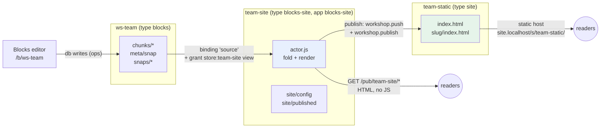

# Blocks publishing: design and implementation guide for interns

## 1. What this document is for

A person writes pages in Claude Blocks, the Notion-like editor that runs as a slop app at `/b/<workspace>`. Today the only way to show those pages to someone else is to grant them access to the workspace, which opens the full editor: the sidebar, the history panel, the Ask Claude panel, and the raw operation log underneath. This ticket adds two ways to publish a workspace as ordinary web pages:

- **The live reader.** A store of type `blocks-site` reads a workspace and serves its pages as plain HTML, with no editor and no JavaScript. Every request shows the workspace as it is now.
- **Static publishing.** The same pages, rendered once, are pushed as files into a static store. A static host serves that snapshot until someone publishes again. This is the editorial path: what visitors see changes only when an editor decides.

By the end of this document you should be able to explain how a workspace is stored, how the server turns that storage into pages, why the reader lives in its own store, who is allowed to publish what, and which files implement each part. Sections 2 to 4 build the background in dependency order. Section 5 is the design. Sections 6 to 10 are the server changes, the implementation plan, the API reference, the file reference and the manual test procedure.

The design is built from parts that already exist in slop v3: stores, apps, actors, bindings, grants, mounts, the trusted `workshop` module from SLOP3-002, and the unchanged Blocks source. It adds one app (`apps/blocks-site`) and two small server changes.

## 2. The slop v3 parts you need

This section introduces each slop v3 concept that the design depends on. Each subsection ends with the exact API or file you will use.

### 2.1 Stores, documents, files and refs

A **store** is the unit of everything in slop v3: one SQLite database with an id (`ws-team`, `team-site`), an optional **type** (`blocks`, `blocks-site`) and an optional **app** it runs. A store holds two kinds of data:

- **Documents**, addressed by slash paths with an even number of segments (`chunks/c-ucm0pbw-wv8ldp-0`, `meta/snap`). A document has a JSON body and a version. Apps read and write documents through the page runtime's `db` capability or, on the server, through an actor's `use('db')`.
- **Files**, organised in snapshots. A push replaces the working tree and takes a numbered **snapshot** (`#7`). A **ref** is a name pointing at a snapshot. `main` is what mounts serve. `draft` is where review tools push. Moving `main` is publishing.

Every write is a **commit** with a monotonically increasing **rev**. `Store.Head()` returns the latest rev (`pkg/store/store.go`), and `Store.Log(after, limit)` lists commits after a rev (`pkg/store/files.go`).

### 2.2 Apps, instances and store types

An **app** is a store whose main snapshot contains an `app.json` manifest and the app's files. An **instance** is another store that names the app (`store new team-site --app blocks-site --type blocks-site`). The instance holds the data; the app store holds the code. Several instances share one app.

The manifest (`pkg/apps/manifest.go`) declares the page entry (`index.html` by default), the capabilities the page may use, an optional `actor` script, and under `slop.modules` the trusted Go modules the actor asks for. Only admins may push a tree that contains `app.json` (decision D9 of SLOP3-001), so installing an app is an admin act. Creating an instance of an installed app is not: any member may run `store new <id> --app <app>` (`store.new`, `pkg/verbs/stores.go`) and becomes the owner of the new store.

### 2.3 Hosts and mounts

The server answers on several host names, each with a role (`slop server hosts` lists them):

| Host role | Demo name | What it serves |
|---|---|---|
| main | `slop.localhost:18300` | the API (`/api/v3/...`), sign-in, the CLI's endpoint |
| live | `apps.localhost:18300` | apps in the shell, with sessions (cookies) |
| static | `site.localhost:18300` | files of `main` snapshots, as an anonymous guest, no cookies |
| sandbox | `*.sbx.localhost:18300` | the app pages inside the shell's iframe, one origin per view |

A **mount** maps a host and path to a store: `mount set site.localhost:18300 /wsite wsite`. A **param mount** maps a path pattern to whichever store a path segment names: `mount set apps.localhost:18300 /b/:id --storeParam id --type blocks --createApp blocks` serves any store of type `blocks` at `/b/<id>`, and offers signed-in members to create one. Mounts are admin-only (`mount.set`). A param mount is what lets members publish without asking an admin each time: the admin sets the pattern once, and members create stores that match it.

When a request reaches a mount, the server resolves it to `system.Match{Mount, Params, Rest, Base}` (`pkg/system/mounts.go`). `Rest` is the path below the mount without a leading slash; `Base` is the request path the mount matched, without a trailing slash. For `GET /pub/team-site/getting-started`, `Base` is `/pub/team-site` and `Rest` is `getting-started`.

### 2.4 Persons, grants and levels

A **principal** is whoever makes a request: a person (`usr_...`), an anonymous visitor (`vis_...`), a token, or a store acting as itself (`store:<id>`). A **grant** gives a subject a **level** on a store: `view < interact < admin < owner`. Subjects are a person id, `@guest` (everyone, signed in or not), `@member`, or `store:<id>`. `grant set ws-team store:team-site view` lets the store `team-site` read `ws-team`.

The **audience** is a person's role on the whole server (`guest`, `pending`, `member`, `admin`). The static host serves every request as an id-less guest, so a store is public on the static host exactly when it has `@guest view`.

### 2.5 Actors

An **actor** is server-side JavaScript that belongs to an instance. It runs in goja, a JavaScript interpreter written in Go, one runtime per running store (`pkg/actor/actor.go`). The app's manifest names the script (`"actor": "actor.js"`), and the script calls `defineActor` once:

```js
defineActor({
  actions: { async publish(ctx, args) { ctx.need('admin'); /* ... */ } },
  http: {
    'GET /': { level: 'view', run(ctx, req) { return { html: '<h1>Hi</h1>' }; } },
    'GET /:page': { level: 'view', run(ctx, req) { return { html: '...' + req.params.page }; } },
  },
});
```

The facts about actors that matter here:

- **Turns.** Every action call, HTTP request or reactor event is one **turn**. Turns on one actor run one at a time, and a turn's JavaScript is interrupted after `TurnLimit` (5 seconds, `pkg/actor/actor.go`). `Date.now()` returns the turn's start time.
- **Memory survives between turns.** The goja runtime lives as long as the store is running, so a module-level variable is a cache. It is not durable: a restart or a new app version clears it.
- **`require`.** `actor.js` can `require('./lib/fold.js')` any `.js` or `.json` file in the app's tree (CommonJS: `module`, `exports`, `require`; `requirer` in `pkg/actor/actor.go`). A file that ends in a browser-style IIFE `(function (root) { ... })(typeof window !== "undefined" ? window : globalThis)` runs unchanged and sets a global.
- **HTTP routes.** When a request on a mount matches one of the actor's `http` keys, the actor answers instead of the shell (`serveActorRoute`, `pkg/server/actors.go`). Patterns are `METHOD /a/:b/*`; literal segments beat `:params`. The route's `level` is checked against the visitor before the turn starts (`public` skips the check; the default is `view`). A route returns `{status, headers, html | text | json | body}` (`toRes`, `pkg/actor/manager.go`). Actor routes are served on the live host (visitor from the session cookie) and on the static host (always a guest).
- **`ctx`.** A turn's context has `ctx.visitor` (`{id, name, audience, level, scopes}`), `ctx.store` (`{id}`), `ctx.need(level)`, and `ctx.fail(code, message)`.

### 2.6 Bindings: an actor reading another store

An actor reads its own store with `use('db')`. To read another store it uses a **binding**, an alias the instance's admin points at a target store, plus a grant on the target:

```sh
slop bind set team-site source ws-team          # admin on team-site, view on ws-team
slop grant set ws-team store:team-site view     # admin on ws-team
```

Inside the actor, `use('stores').open('source')` returns a handle on the target (`storesModule`, `pkg/actor/modules.go`). The handle checks, at open time, that `store:team-site` has `view` on `ws-team`, and offers synchronous reads:

| Call | Returns |
|---|---|
| `h.id` | the target store id |
| `h.docs.get(path)` | `{exists, path, id, version, data()}` |
| `h.docs.query(coll, {filters, order, desc, limit})` | an array of the same; `limit` 0 means all |
| `h.files.text(path)`, `h.files.list()` | files of the target's `main` |
| `h.log(after)` | up to 100 commits after a rev |
| `h.call(action, args)` | calls an action on the target's actor (async) |

The binding is the publishing decision. Two people must agree: the admin of the site store creates the alias, and the admin of the workspace grants the read. A guest of the site never gets a read on the workspace; the guest only receives what the site's actor chooses to render.

### 2.7 Trusted Go modules and the workshop module

SLOP3-002 added **trusted modules**: Go functions an admin lets an app's actor call, as the visiting person. The app asks for them in `app.json` (`"slop": {"modules": ["workshop"]}`), and an admin trusts the app with `slop app trust blocks-site workshop`. Until then `use('workshop')` returns `null`.

The `workshop` module (`pkg/server/modworkshop.go`) wraps verbs a publishing tool needs. Each call runs the verb's own permission checks against the visitor (`actAs`), so an actor cannot do more than the person who triggered the turn:

| JS call | Verb | Notes |
|---|---|---|
| `w.push(store, files, {message})` | `files.push` | `files` is `[{path, text}]` or `[{path, data}]`; moves `draft` by default; needs admin on `store` |
| `w.publish(store, n)` | `ref.move` with `ref: "main"` | publishing |
| `w.refs(store)`, `w.snapshots(store)` | `ref.ls`, `snap.ls` | reading |

Module calls are asynchronous: they return promises, and an `async` action or route awaits them (`Actor.IO`).

## 3. Claude Blocks: what a workspace is

Claude Blocks is a single-page app (`web/blocks/src` in slop-computer, deployed unchanged by SLOP3-001's `scripts/07-build-blocks-pinup.sh`). To render its pages elsewhere you need three things: the language its content is written in (Hypha), the shape of a page in that language, and the way the workspace stores it.

### 3.1 Hypha: a tree of cells built by one op per line

A Blocks workspace is a **Hypha kernel**: a tree of named paths whose leaves are **cells**. Every change is an **op**, one line of Hypha text:

```text
page_p7sq.title = "FOOBAR"          a literal value
page_p7sq.ui.1024 is p "foobar"     an element: kind p at index 1024, its text prop set positionally
page_p7sq.ui.1024.text = "foobar"   a prop of that element
total = price * qty                 a formula: recomputes when price or qty change
page_p7sq -                         remove a subtree
```

The kernel (`class Kernel`, `hypha.js`) keeps `cells` (leaf path to cell), `kids` (branch path to child segments), a `log`, a `clock`, and `seen`, the set of op ids already applied. `K.receive({id, peer, clock, text, at})` parses and applies one op unless its id is in `seen`. `K.batch(fn)` defers recomputation until `fn` returns. `K.restore(checkpoint, tag)` loads a checkpoint (one op per cell, plus stamps). `K.children(path)` lists child segments in a stable order; numeric segments sort numerically.

Each op carries a **peer**, `"<u>:<role>"`, for example `ucm0pbw:you`. The part before the colon identifies the person who wrote it; the role is `you` for the person and something else for an agent working on their behalf.

### 3.2 Pages and blocks

A **page** is a top-level path that is a branch, not a cell, and is not one of the reserved names (`desk sys clock spaces theme fn lib jobs ws`). Its cells:

| Path | Meaning |
|---|---|
| `<page>.title` | the title (a literal, or a formula whose value is shown) |
| `<page>.icon` | one emoji |
| `<page>.parent` | the id of the parent page; a sub-page is a page with a parent |
| `<page>.order` | an optional number that orders siblings; otherwise the clock of the first write ("born") |
| `<page>.ui.<n>` | the page body: element `n`, in numeric order |

An element (a **block**) is a branch with a kind at `.k` and props at named children: `page.ui.1024.k = "p"`, `page.ui.1024.text = "..."`. A block's own child blocks sit at numeric children (`page.ui.1024.0`, `page.ui.1024.1`): a bullet with nested bullets, a toggle's hidden content, the `col`s of a `columns` block.

The block kinds a reader must handle are the ones the editor's slash menu offers under *Basic blocks*, plus the display-only *Live* blocks:

| Kind | Props | Notes |
|---|---|---|
| `p`, `text` | `text` | a paragraph of prose |
| `h1`, `h2`, `h3` | `text` | headings |
| `bullet`, `numbered`, `todo` | `text`, `done` (todo) | list items; consecutive items form one list |
| `quote` | `text` | |
| `callout` | `text`, `icon`, `tone`, `bg` | a boxed note with an emoji |
| `code` | `text` | |
| `divider` | | |
| `fold` | `title`, `open` | a toggle; its child blocks are hidden until opened |
| `columns` > `col` | | side-by-side columns, each holding blocks |
| `page` | `of` | a link to a sub-page |
| `toc` | | the page's headings |
| `table` | `of` (a list of records) | |
| `stat`, `progress` | `of`, `label` | a number with a label; a bar for a share |
| `hole` | intent | a slot a Claude has not filled yet |

Every text prop is **prose**: light Markdown (`**bold**`, `*italic*`, `` `code` ``, `~~struck~~`, `[label](https://...)`, `[[page_id]]` mentions) plus `{formula}` spans whose value is computed from the page's scope. Any block may carry `color` and `bg` props naming one of ten colours (`gray brown orange yellow green blue purple pink red`, plus `default`).

### 3.3 How a workspace is stored

The editor does not store the tree; it stores the ops. A workspace store has three document collections, written by the page through the `db` capability (`Net` in `blocks.js`):

```text
chunks/<id>        {by, tab, seq, at, n, ops: [[opId, peer, clock, text, at], ...]}
meta/snap          {id, at, clock, parts, folded: {<chunkId>: [count, lastOpId]}, prev}
snaps/<id>-<i>     {ops: [[peer, clock, text], ...], stamps: [[path, clock, peer], ...]}
```

A **chunk** is a batch of ops one browser tab wrote; a tab appends to its open chunk and starts a new one after 500 ops, 150 kB or five minutes. `by` is the writer's id (`usr_...` or `vis_...`). A **checkpoint** (`meta/snap` plus its parts) is a compacted copy of the whole tree, written every 3000 ops; `folded` records, per chunk, how many of its ops the checkpoint already contains.

This is the live data from the demo workspace `ws-team`, one chunk with five ops:

```json
{ "path": "chunks/c-ucm0pbw-wv8ldp-0",
  "body": { "by": "usr_e41fab4c0f7e823ae90df3cd", "tab": "wv8ldp", "n": 5, "at": 1793572410313,
    "ops": [
      ["omvyep7sr0ybnl", "ucm0pbw:you", 1, "page_p7sq.title = \"\"", 1793572403643],
      ["omvyep7ss1mh75", "ucm0pbw:you", 2, "page_p7sq.ui.1024 is p \"\"", 1793572403644],
      ["omvyep9vy2cfxj", "ucm0pbw:you", 3, "page_p7sq.title = \"FOOBAR\"", 1793572406350],
      ["omvyepc3i418z9", "ucm0pbw:you", 5, "page_p7sq.ui.1024.text = \"foobar\"", 1793572409214],
      ["omvyepcr35tz8z", "ucm0pbw:you", 6, "page_p7sq.ui.2048 is p \"\"", 1793572410063] ] } }
```

Folded, these ops give one page, `page_p7sq`, titled *FOOBAR*, with a paragraph *foobar* and an empty paragraph.

## 4. The fold: from documents to a tree

**Folding** is replaying the stored ops into a fresh kernel. The editor does it in `Net.load` (`blocks.js`); the reader must do exactly the same, or published pages would differ from what the editor shows. The algorithm:

```text
fold(source):
  K = new Hypha.Kernel()
  base = null; folded = {}
  snap = source.docs.get("meta/snap")
  if snap exists and snap.id and snap.parts:
      parts = [source.docs.get("snaps/" + snap.id + "-" + i) for i in 0 ..< snap.parts]
      if every part exists:
          cp = {clock: snap.clock or 0, ops: concat(part.ops), stamps: concat(part.stamps)}
          for [peer] in cp.ops: ensurePeer(K, peer)
          K.restore(cp, snap.id)                      # op ids are "<snap.id>:<i>"
          base = snap; folded = snap.folded or {}
  chunks = source.docs.query("chunks",
             base ? {filters: [{field: "at", op: ">=", value: base.at - 15 min}]} : {})
  fresh = []
  for doc in chunks:
      c = doc.data(); f = folded[doc.id]
      for (o, i) in c.ops:
          skip unless o is an array and o[3] is a string
          skip if f and (i < f[0] - 1 or (i == f[0] - 1 and o[0] == f[1]))   # already in the checkpoint
          skip if o[0] in K.seen                                             # duplicate
          skip unless owns(c.by, o[1])                                       # forged peer
          fresh.push({id: o[0], peer: o[1], clock: o[2], text: o[3], at: o[4]})
  sort fresh by (clock, peer)
  K.batch(() => for d in fresh: ensurePeer(K, d.peer); K.receive(d))
  return K
```

Three details deserve attention.

**Ownership.** A chunk's `by` is the id of the person who wrote it; a peer id is chosen by the browser. Without a check, anyone with write access to the workspace could write ops under another person's peer. `owns(by, peer)` accepts an op only when the peer's user part is the hash of the chunk's writer: `roleOf(peer).u === "u" + hash32(by).toString(36)`, where `hash32` is 32-bit FNV-1a. For `ws-team`: `hash32("usr_e41fab4c0f7e823ae90df3cd")` in base 36 is `cm0pbw`, so the peer `ucm0pbw:you` is accepted. A chunk without `by` is accepted as is, which matches the editor.

**The checkpoint margin.** Chunks older than the checkpoint are already folded into it, but a chunk can be written to after the checkpoint was taken. The query takes every chunk whose `at` is no older than fifteen minutes before the checkpoint, and `folded` skips the ops it already contains.

**Order.** Ops from different tabs interleave. Sorting by `(clock, peer)` before applying gives every replica the same result; the kernel's stamps (`[clock, peer]` per path) decide which of two concurrent writes to the same path wins.

The fold depends on the kernel and on the block kinds' positional props. `blocks-kit.js` registers those at load time (`H.POS.p = ["text"]`, `H.CONTAINERS.add("bullet")`, ...): without it, `page.ui.1024 is p "foobar"` would not set `text`. The reader therefore loads `hypha.js`, `fruit.js` and `blocks-kit.js`, in that order, exactly as the editor's `index.html` does. All three are free of DOM access at load time. This was checked in Node (`scripts/01-load-blocks-libs.mjs`) and is checked in goja by the B1 test.

## 5. Design

### 5.1 Overview



There are three stores. The **workspace** (`ws-team`) is unchanged: the editor writes ops into it and nothing in this design writes to it. The **site** (`team-site`) is an instance of the new `blocks-site` app. Its actor reads the workspace through the binding `source`, folds it, and answers HTTP requests with rendered pages. Its own documents hold the site's configuration and the record of static publications. The **static store** (`team-static`) is an ordinary store of files; the site's `publish` action pushes rendered pages into it, and a static-host mount serves its `main`.

A request to the live reader goes through these steps:

```mermaid
sequenceDiagram
  participant B as Browser
  participant S as Server (live host)
  participant A as team-site actor
  participant W as ws-team store
  B->>S: GET /pub/team-site/getting-started
  S->>S: resolve mount /pub/:id → team-site; match route GET /:page
  S->>S: visitor level ≥ view? (@guest view)
  S->>A: turn: http GET /:page {params: {page}, base: "/pub/team-site"}
  A->>W: stores.open("source") (checks store:team-site view)
  A->>W: rev()
  alt rev changed since the cached fold
    A->>W: docs.get("meta/snap"), docs.get("snaps/…"), docs.query("chunks")
    A->>A: fold → kernel → site model
  end
  A->>A: render page → HTML string
  A-->>S: {html, headers: {CSP, Cache-Control}}
  S-->>B: 200 text/html
```

### 5.2 Decisions

Each decision below names the alternative that was rejected and why.

**The reader is a separate store, not a second view of the workspace.** An alternative is a mount that serves the workspace store itself through a different app. That would require `@guest view` on the workspace, and `view` on the workspace lets a visitor open the editor and read every document, including the full op history with deleted text. A separate store keeps the workspace private: guests get `view` on `team-site`, and only the site's actor, as `store:team-site`, reads `ws-team`.

**Rendering happens on the server, in the actor.** The alternative is a page that fetches the ops and renders in the browser. That sends the raw log to every reader, the same privacy problem. Server rendering sends only the HTML of the published pages, and makes pages readable without JavaScript and by crawlers.

**The reader uses the editor's own kernel, vendored unchanged.** `apps/blocks-site/vendor/` holds copies of `hypha.js`, `fruit.js` and `blocks-kit.js` with a `SHA256SUMS` file matching upstream. The fold (section 4) is ported line by line into `lib/fold.js`; its behaviour must match `Net.load`.

**The renderer is new code, not the editor's renderer.** The editor draws blocks with Fruit's virtual DOM (`R.p`, `R.bullet` in `blocks-kit.js`), and `Blocks.toHTML` can print that as HTML. Reusing it was rejected for three reasons. The editor's markup is interactive: a toggle is a `<button>` whose children are absent until clicked, a to-do is a `role="checkbox"` button. Colours are passed as `style` objects, which `toHTML` drops. And the prose tokenizer `Blocks.tokens` is not reentrant: it shares one global regular expression across its recursive calls, so `tokens("Some **bold**")` never returns: the inner call resets `lastIndex` to 0 and the outer loop matches the same `**bold**` again (`scripts/01-load-blocks-libs.mjs` reproduces it). `lib/render.js` walks the same tree and prints static HTML: a toggle is `<details>`, a to-do is a list item with a check glyph, colours are classes. It has its own tokenizer, with the same grammar and a fresh regular expression per call.

**The reader serves HTML with no script, and says so in its CSP.** Every reader response carries `Content-Security-Policy: default-src 'none'; style-src 'unsafe-inline'; img-src https: data:; form-action 'self'; base-uri 'none'; frame-ancestors 'none'`. The live host is the origin that holds session cookies. Prose is escaped by construction, and links are limited to `http`, `https` and `mailto`, but if an escaping bug ever slipped through, the policy still forbids any script from running.

**The fold is cached in actor memory and keyed on the workspace's rev.** Each request asks the source for its head rev (a new `rev()` on the stores handle, section 6.2). If it equals the cached rev, the cached kernel and site model are reused. Otherwise the actor folds again. Incremental folding (applying only new chunks) is a later optimisation; correctness first.

**Links are absolute in the live reader and relative in static output.** The live reader knows the URL it was reached at through a new `req.base` (section 6.1), so it prints `/pub/team-site/getting-started`. Static output cannot know where it will be mounted, so it prints relative links (`getting-started/` from the home page, `../getting-started/` from a page), and each page is written as `<slug>/index.html`. The static host already redirects `/s/team-static/getting-started` to the slash form when `getting-started/index.html` exists (`serveStatic`, `pkg/server/site.go`).

**The site's administration is a JS-free page served by the same actor.** The shell would show the app's `index.html` only for paths no actor route claims, and the reader claims `/` and `/:page`. Rather than special-casing paths, the actor serves `GET /_site` (an admin-only page with two forms) and accepts `POST /_site` (save settings) and `POST /_publish` (publish). Literal route segments beat `:page`, and slugs never start with `_`. The session cookie is `SameSite=Lax` (`pkg/server/auth.go`), so a cross-site form post arrives without a session, as a guest, and fails the `admin` level check before the actor runs. The same operations are actions (`configure`, `publish`, `status`) for the CLI.

### 5.3 The live reader

**Routes.** The actor declares these routes:

| Route | Level | Answer |
|---|---|---|
| `GET /` | view | the home page |
| `GET /:page` | view | the page whose slug or id is `:page`; a page id redirects (302) to its slug; the home page's slug redirects to `/` |
| `GET /_site` | admin | the settings and publishing page |
| `POST /_site`, `POST /_publish` | admin | form posts; answer with a 303 back to `/_site` |

**The site model.** After a fold, `lib/site.js` builds the model every page render reads:

```text
site(K, config):
  all      = top-level branches of K that are not cells and not reserved      # Pages.list
  parent   = Pages.parent semantics: a parent that exists, cycle-safe (24 steps)
  pages    = config.root ? [p in all where config.root in chain(p)] : all
  order    = sort pages by born (order cell, else first clock of title/ui)
  slug(p)  = slugify(title(p)) or p, made unique in born order ("intro", "intro-2")
  home     = config.home if published, else config.root, else first root page
  return {pages, title(p), icon(p), parent(p), kids(p), roots, chain(p), slug(p), bySlug, home}
```

`config.root` narrows a site to one page and its descendants. This is how `ws-team` can publish its *Handbook* section while the rest of the workspace stays internal. A page outside the scope is a 404, and a `[[mention]]` of it renders as plain text, without a link and without its title.

**Page layout.** A page is one HTML document:

```text
<header>  site title (links home)                              [admin bar, admins only]
<nav>     the page tree: roots and their kids
<main>    breadcrumb (chain)
          <h1> icon title </h1>
          blocks (section 5.4)
          "Pages in this section": the page's sub-pages
<footer>  "Published from Claude Blocks"
```

The stylesheet (`lib/style.js`) is inlined, follows the system colour scheme, and is the same for the live reader and static output.

**Caching headers.** Live pages answer `Cache-Control: private, no-cache` (they may contain the admin bar, and they change with every edit). Static output is cached by the static host's own rules.

### 5.4 Rendering blocks

`lib/render.js` walks `<page>.ui` with `F.kidsOf` and `F.kindOf`, reads props with `F.prop(K, q, name, env)` (which evaluates formulas), and prints HTML strings. `env` is the minimal environment `{app: page, al: new Map(), depth: 0}`; it supplies the scope formulas resolve against.

```text
blocks(K, parent):
  out = ""; items = kidsOf(K, parent); i = 0
  while i < len(items):
      kind = kindOf(K, items[i])
      if kind in {bullet, numbered, todo}:            # a run of the same list kind is one list
          run = longest run of items with this kind
          out += <ul|ol class=kind> + [li(K, q) for q in run] + </ul|ol>
      else:
          out += block(K, items[i])
      advance
  return out

block(K, q):  p|text -> <p>prose</p> (empty paragraphs are skipped)
              h1|h2|h3 -> <h2|h3|h4 id=anchor>      (the page title is the only <h1>)
              quote -> <blockquote>; code -> <pre><code>; divider -> <hr>
              callout -> <aside class="callout">icon + prose + children</aside>
              fold -> <details [open]><summary>title</summary>children</details>
              columns -> <div class=cols> + <div class=col>children</div>... </div>
              page -> <a class=pagelink href=link(of)>icon title</a> (unpublished: plain text)
              toc -> <nav class=toc> links to the heading anchors </nav>
              table -> <table> columns = union of record keys </table>
              stat -> <div class=stat><b>value</b> label</div>; progress -> <progress> + label
              anything else (hole, slider, button, program, ...) -> its child blocks only
  every block: color/bg props -> classes c-<color> / bg-<color>; child blocks follow inside
```

**Prose.** `prose(K, q, text)` tokenizes with the Blocks grammar and prints:

| Token | HTML |
|---|---|
| text | escaped text |
| `**b**`, `*i*`, `~~s~~` | `<strong>`, `<em>`, `<s>` (recursively) |
| `` `c` `` | `<code>` |
| `[label](url)` and bare URLs | `<a href rel="noopener noreferrer nofollow">`; only `http`, `https`, `mailto` (the grammar admits nothing else) |
| `[[page]]` | a link with the page's icon and title if the page is published; otherwise the escaped name |
| `{expr}` | the formatted value (`F.fmt`); an error prints `—`, a value waiting on a hole prints `…` |

Formulas are evaluated with `Blocks.valueOf(K, q, src, env)`. A formula can read any cell in the workspace, including cells on unpublished pages. That is the author's choice, the same as in the editor: the published page shows the value the author placed in it.

### 5.5 Static publishing

The `publish` action renders every page of the site with relative links and pushes the result into a static store through the workshop module:

```js
async publish(ctx, { to, live }) {
  ctx.need('admin');
  const w = use('workshop');                         // null until: slop app trust blocks-site workshop
  if (!w) ctx.fail('unavailable', 'this app is not trusted with the workshop module');
  const { site } = current(ctx);                     // the cached fold
  const files = render.staticFiles(site);            // [{path: 'index.html', text}, {path: 'intro/index.html', text}, ...]
  const snap = await w.push(to, files, { message: `Blocks: ${site.pages.length} pages from ${site.source}` });
  if (live) await w.publish(to, snap.n);
  db.doc('site/published').set({ to, n: snap.n, live: !!live, at: Date.now(), by: ctx.visitor.id, pages: site.pages.length });
  return { to, n: snap.n, live: !!live, files: files.length };
}
```

Two modes cover the two ways people work. **Publish now** (`live: true`) pushes and moves `main` in one step. **Push a draft** (`live: false`) only moves `draft`; the editor then opens the static store in the Workshop (`/workshop`), previews the draft on its own origin, comments if needed, and publishes there. Because the module acts as the visitor, `files.push` requires the visitor to be an admin of the static store. The site's own `admin` level is not enough: publishing to a store needs authority over that store.

The push replaces the store's whole tree (`files.push` prunes by default), so a page deleted from the workspace disappears from the static site on the next publication.

### 5.6 Who can do what

| Step | Command | Required |
|---|---|---|
| install the app | `slop push apps/blocks-site --store blocks-site` | server admin (D9) |
| trust it with the workshop module | `slop app trust blocks-site workshop` | server admin |
| reader mount (once) | `slop mount set apps.localhost:18300 /pub/:id --storeParam id --type blocks-site` | server admin |
| static mount (once) | `slop mount set site.localhost:18300 /s/:id --storeParam id --type site` | server admin |
| create a site | `slop store new my-notes-site --app blocks-site --type blocks-site` | member; becomes owner |
| point it at a workspace | `slop bind set my-notes-site source my-notes` | admin of the site, view on the workspace |
| allow the read | `slop grant set my-notes store:my-notes-site view` | admin of the workspace |
| make it public | `slop grant set my-notes-site @guest view` | admin of the site |
| create a static store | `slop store new my-notes-static --type site`, `slop grant set my-notes-static @guest view` | member |
| publish | the *Publish* form on `/pub/my-notes-site/_site`, or `slop call my-notes-site publish '{"to":"my-notes-static","live":true}'` | admin of the site and of the static store |

The four admin steps happen once per server. Every row below them is something a member does alone for workspaces they own. A member who is only a contributor on a shared workspace cannot publish it: the `grant set` on the workspace needs its admin.

### 5.7 What is exposed

A reader of a site sees the rendered HTML of the pages in the site's scope, at the time of the request. A reader does not see the op log, earlier versions of a text, deleted pages, pages outside the scope (not even their titles), who wrote what, or the editor. A reader does see the values of formulas the author placed on published pages, including values computed from unpublished cells. The site's admin page shows the source workspace id and the last publication; it is admin-only.

## 6. Server changes

Two small changes make the app possible. Both are general, not Blocks-specific.

### 6.1 `req.base`: the URL a route was reached at

`actor.Req` (`pkg/actor/manager.go`) gains `Base string json:"base"`, set from `res.m.Base` in `serveActorRoute` (`pkg/server/actors.go`). A route can then print absolute links (`req.base + '/' + slug`) and redirects (`{status: 302, headers: {Location: req.base + '/'}}`) that work whatever the mount path is.

### 6.2 `rev()` on a store handle

The handle from `use('stores').open(alias)` gains `rev()`, returning the target's `Store.Head()`. It is the cheapest way to answer "has the bound store changed since I last read it?", which any actor that caches a derived view of another store needs.

## 7. Implementation plan

Each phase ends with a test that must pass before the next starts. Commit after each phase; record it in the diary.

### Phase B1: libraries and server changes

1. Add `Req.Base` and the handle's `rev()`.
2. Vendor `hypha.js`, `fruit.js`, `blocks-kit.js` into `apps/blocks-site/vendor/` with `SHA256SUMS` and a README naming the upstream path.
3. Write `lib/blocks.js` (loads the vendor files, returns `{H, F, B}` from `globalThis`), `lib/fold.js` (section 4), `lib/site.js` (section 5.3) and `lib/render.js` with `lib/style.js` (section 5.4).
4. A Node harness, `scripts/02-render-fixture.mjs`, loads the libraries as the actor would and renders a fixture workspace to HTML files for inspection.
5. **Exit test:** `TestBlocksSiteLibs` (`pkg/server/b1_test.go`) runs the libraries in an actor (goja), folds a fixture with a checkpoint, folded chunk ops and a forged op, and checks the rendered HTML block by block; it also reads `req.base` and `rev()`.

### Phase B2: the live reader

1. `apps/blocks-site/app.json` and `actor.js` with the reader routes, the fold cache, the CSP and cache headers, scope (`root`) and home.
2. **Exit test:** `TestBlocksSiteReader`: a workspace with pages; a site bound to it; a guest without a grant gets 404; with `@guest view` the guest gets the home page and a sub-page; an edit to the workspace shows on the next request; the response contains no op ids and no text that was overwritten; a page outside `root` is 404; the CSP header is present.

### Phase B3: static publishing and the admin page

1. `configure`, `status`, `publish` actions; `GET /_site`, `POST /_site`, `POST /_publish`.
2. **Exit test:** `TestBlocksSitePublish`: untrusted app gets `unavailable`; trusted, an admin publishes live and the static store's `main` holds `index.html` and `<slug>/index.html` with relative links; a draft publication leaves `main` alone; a member who is not admin of the static store gets `permission_denied`; the form post as a guest is refused.

### Phase B4: deployment, member self-publishing, end to end

1. `scripts/03-deploy-blocks-site.sh`: install, trust, mounts; a demo site for `ws-team`.
2. `scripts/04-blocks-site-e2e.mjs` (Playwright): an editor writes a page in Blocks, the reader shows it, the editor publishes from `/_site`, the static host serves the snapshot; a member creates a workspace, a site and a static store with the CLI only and publishes.
3. Screenshots for the diary.

## 8. API reference

### 8.1 `app.json`

```json
{
  "title": "Blocks site",
  "type": "blocks-site",
  "actor": "actor.js",
  "capabilities": { "db": {} },
  "slop": { "modules": ["workshop"] }
}
```

### 8.2 Actions

| Action | Args | Level | Returns |
|---|---|---|---|
| `status` | | view | `{source, rev, pages: [{id, slug, title, parent}], home, config, published}` |
| `configure` | `{title?, home?, root?, to?}` | admin | the new config |
| `publish` | `{to?, live?}` (`to` defaults to `config.to`) | admin | `{to, n, live, files}` |

### 8.3 Documents in the site store

| Path | Body |
|---|---|
| `site/config` | `{title, home, root, to}`; all optional; `title` defaults to the home page's title |
| `site/published` | `{to, n, live, at, by, pages}` of the last publication |

### 8.4 Static output

```text
index.html                 the home page
<slug>/index.html          every other page
```

Links between pages are relative; there are no other files (the stylesheet is inline).

## 9. File reference

| File | Role |
|---|---|
| `apps/blocks-site/app.json` | manifest |
| `apps/blocks-site/actor.js` | routes, actions, fold cache |
| `apps/blocks-site/lib/blocks.js` | loads the vendored Blocks libraries |
| `apps/blocks-site/lib/fold.js` | the fold (port of `Net.load`) |
| `apps/blocks-site/lib/site.js` | pages, parents, slugs, scope, home (port of `Pages`) |
| `apps/blocks-site/lib/render.js` | blocks, prose, layout, admin page, static files |
| `apps/blocks-site/lib/style.js` | the stylesheet |
| `apps/blocks-site/vendor/*` | `hypha.js`, `fruit.js`, `blocks-kit.js` from slop-computer `web/blocks/src`, unchanged |
| `pkg/actor/manager.go` | `Req.Base` |
| `pkg/actor/modules.go` | `rev()` on a store handle |
| `pkg/server/actors.go` | sets `Base` |
| `pkg/server/b1_test.go` … `b3_test.go` | phase tests |
| upstream `web/blocks/src/blocks.js` | `Net.load` (fold), `Pages`, `Markdown.page` (the reference walk) |
| upstream `web/blocks/src/blocks-kit.js` | prose grammar, `numberLabel`, block kinds' positional props |
| upstream `web/blocks/src/hypha.js` | `Kernel`: `receive`, `restore`, `batch`, `children`, `cells` |

## 10. Trying it by hand

With the demo server running (`slop3` tmux session, `SLOP_CREDENTIALS` set to the admin's credentials):

```sh
slop push apps/blocks-site --store blocks-site
slop app trust blocks-site workshop
slop mount set apps.localhost:18300 /pub/:id --storeParam id --type blocks-site
slop mount set site.localhost:18300 /s/:id --storeParam id --type site

slop store new team-site --app blocks-site --type blocks-site
slop bind set team-site source ws-team
slop grant set ws-team store:team-site view
slop grant set team-site @guest view
open http://apps.localhost:18300/pub/team-site/

slop store new team-static --type site
slop grant set team-static @guest view
slop call team-site publish '{"to":"team-static","live":true}'
open http://site.localhost:18300/s/team-static/
```

Edit a page at `/b/ws-team`, reload the reader: the change is there. Reload the static site: it is not, until you publish again.

## 11. Open questions and later work

- **Images.** Covers and uploaded images live in the workspace's asset store, which guests of the site cannot read. A later phase can copy referenced assets into the static store and proxy them in the reader.
- **Incremental fold.** Apply only chunks changed since the cached rev, when a workspace grows large enough for a full fold to matter.
- **Push instead of poll.** The reader refolds on request. A cross-store reactor (the site reacting to the workspace's commits) would let it refold ahead of requests and could republish a static site automatically.
- **Per-page publication.** `root` scopes a site to a subtree. A `published` checkbox per page would need a page property the editor shows; Blocks has page properties, so this is possible without changing the editor.
- **The upstream tokenizer.** `Blocks.tokens` never returns for any text holding a bold, italic or struck span (`scripts/01-load-blocks-libs.mjs`). Whether the editor reaches that path in the browser is checked in phase B4; either way it should be reported upstream, and this ticket does not change vendored files.
