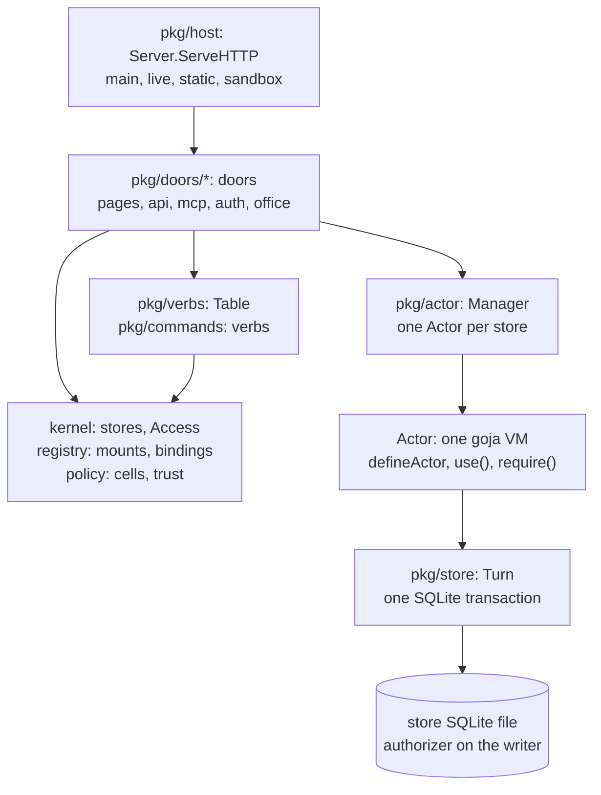
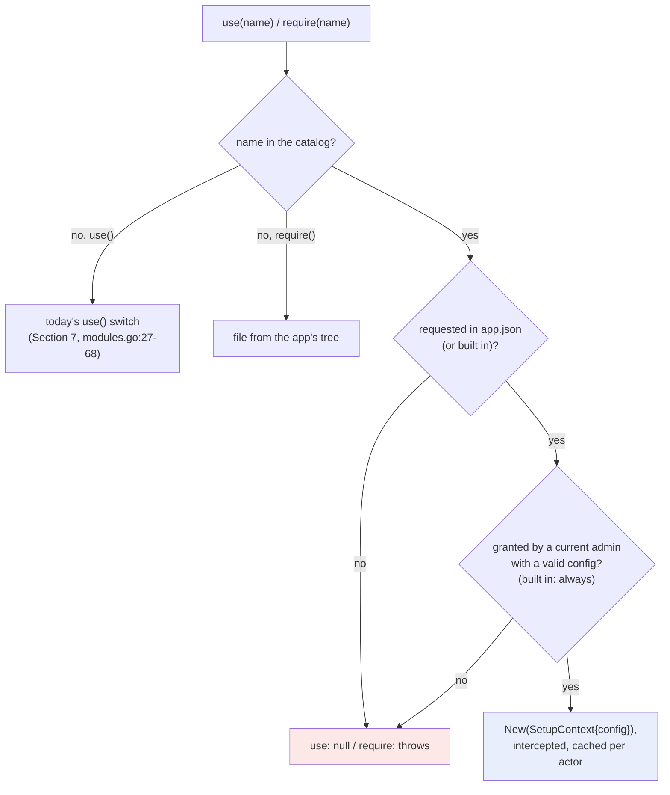
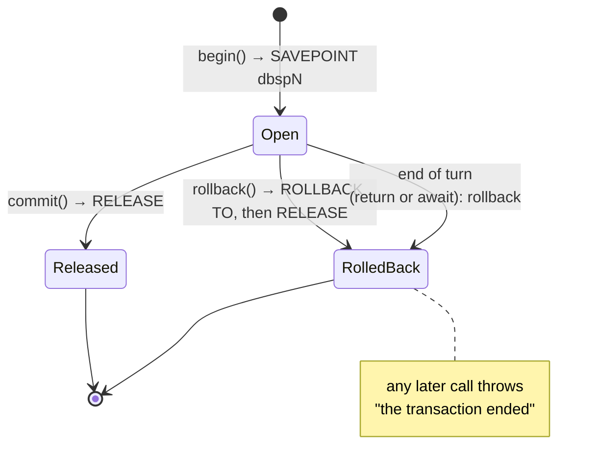
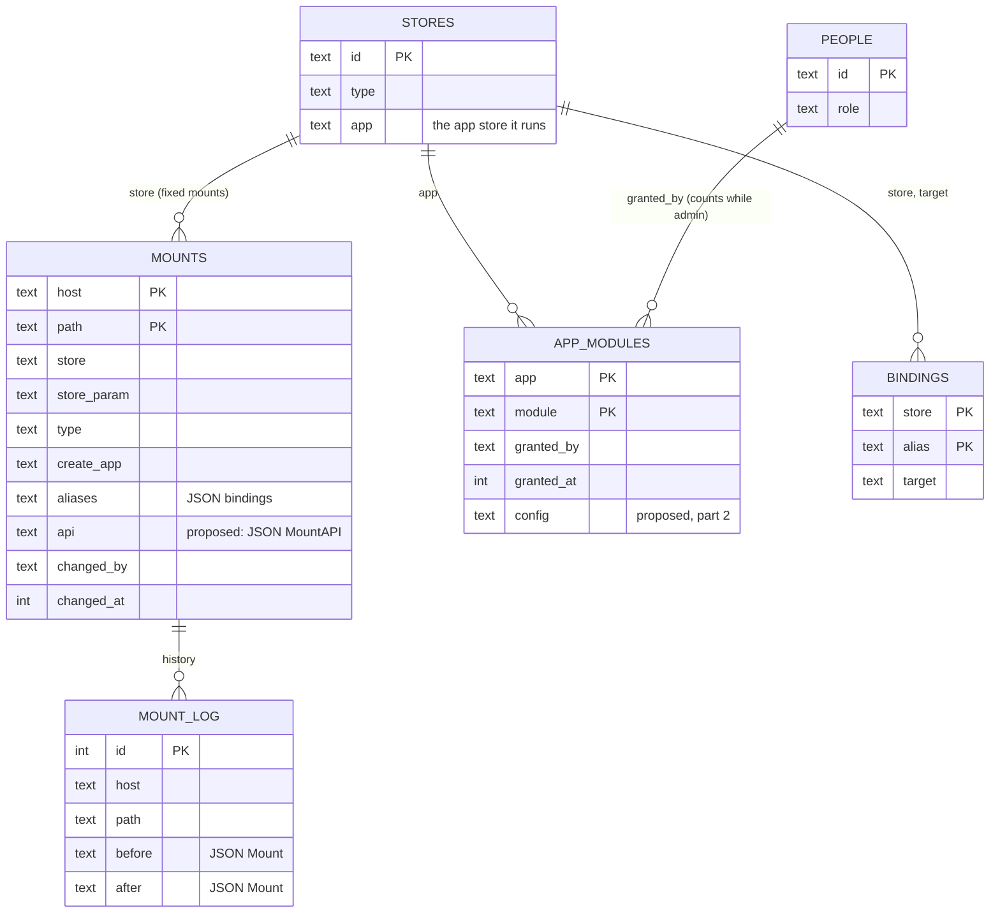
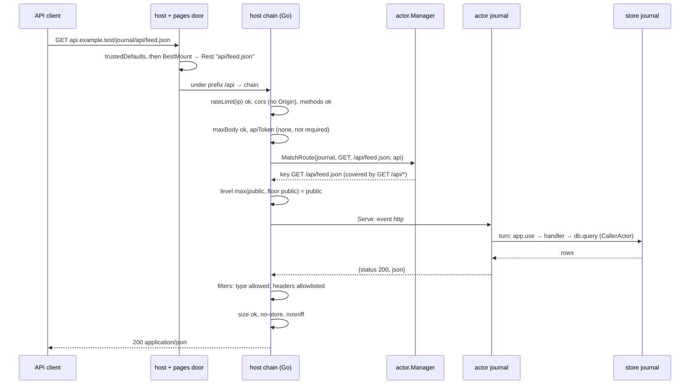

# Intern guide: per-app modules, the database module and mount-scoped HTTP endpoints

## Executive summary

slop runs small web applications on **stores**. A store is a SQLite database with a versioned file tree. An application may have server-side JavaScript, its **actor**, which runs in a goja runtime inside the slop process and reaches the outside world only through objects that `use(name)` returns. This ticket adds two such objects and the policy that bounds the second one:

1. **`database`**: go-go-goja's database API (`query`, `exec`, `begin`, `configure`, `close`), implemented on the actor's own turn, so that every statement passes slop's SQL authorizer as the actor. It has no way to name another database.
2. **`express`**: an express-style route builder (`app.get(p).public().handle(fn)`) that compiles into the route table actors already have. It has no `static`, `listen` or `mount`.
3. **A mount API policy**: the mount that exposes the store says which routes may be served, the minimum level per route, the host middlewares that run before the actor does any work, and which content types and headers may leave.

Nothing described as *proposed* exists yet. Current behaviour is cited with repository-relative `path:line` references, checked at `origin/main` `639a68c`. The research behind the design is in SLOP3-011 (diary Steps 1–9) and in the vault report *PROJECT REPORT - slop v3 - Per-App Modules - Safe Database and HTTP Endpoints for Sandboxed Actors - A Technical Deep Dive*.

The guide has five parts:

- **Part I** teaches the parts of slop that this work touches, in dependency order, and follows one HTTP request through every layer.
- **Part II** explains the go-go-goja pieces the design borrows from, and why slop reimplements them instead of importing them.
- **Part III** is the design, with decision records.
- **Part IV** is the implementation plan, phase by phase and file by file, with pseudocode and tests.
- **Part V** is the API and file reference.

Open decisions, risks and a glossary close the document.

---

# Part I — The system

## 1. What slop is

slop is a server that hosts applications made of stores. The README states it in one sentence: "slop is a computer made of stores" (`README.md:3`). A store holds documents, files with snapshots and refs, and SQL tables. An **app** is a store whose file tree contains `app.json`. It has pages, which run in the browser, and optionally an actor, which runs on the server with one turn at a time per store. **Mounts** put stores on hosts. **Grants** and **audiences** decide who may view, interact with or administer a store. One table of **verbs** serves the command line, the HTTP API and MCP.

The server is one Go process (`cmd/slop serve`). Figure 1 shows the layers this guide is concerned with, from an HTTP request down to SQLite. The package names are the real ones. The layering is enforced by a test (Section 12).



*Figure 1. The layers on the path of an actor's HTTP route. A door is slop's name for an entry point package (`pkg/doors/<name>`).*

## 2. Stores

### 2.1 What a store holds

A store is one SQLite file at `<data>/stores/<id>` (`pkg/kernel/kernel.go:87`). It contains two kinds of tables:

- **Kernel tables** have names that begin with `_`: `_meta`, `_docs` (documents), `_files` (the file tree and uploads), `_log` and `_changes` (the commit log), `_snapshots`, `_snapshot_files`, `_refs`, `_migrations`, `_cursors` and `_alarms` (`pkg/store/store.go:20-49`).
- **App tables** are created by the app's migrations (`sql/*.sql` in its tree). A name counts as an app name when it does not begin with `_`, `sqlite_` or `slop_` (`pkg/store/sqlpolicy.go:21-24`).

The store opens one writer connection and a pool of read-only connections. The writer carries the SQL authorizer and the `slop_*` SQL functions (`pkg/store/store.go:57-59, 88-100`). The readers are opened with `mode=ro` and no authorizer (`store.go:106`).

### 2.2 Turns and commits

Every change to a store happens inside a **turn**, which is one SQLite transaction on the writer. `Store.Do` runs a function as a turn:

```go
// pkg/store/turn.go:70-78 (Do) and 81-124 (doLocked), abridged
func (s *Store) Do(ctx context.Context, who Who,
	fn func(t *Turn) error) (*Commit, error)
// doLocked:
//   BEGIN IMMEDIATE
//   t := &Turn{caller: CallerKernel, Rev: max(_log.rev)+1, ...}; s.cur = t
//   err := fn(t)            -> on error or panic: ROLLBACK
//   t.caller = CallerKernel
//   changes := t.allChanges() -> one "table" change per app table written
//   INSERT INTO _log ...; COMMIT
//   return &Commit{Store, Rev, Changes, ...}
```

Two details matter for this ticket. While a turn runs, `s.cur` points at it, and the authorizer reads the turn's **caller kind** from there. And every app table the turn wrote becomes a `table` change in the commit (`turn.go:127-141`). Actors can react to those changes (Section 6.5).

### 2.3 Caller kinds and the SQL authorizer

SQLite calls the authorizer while it prepares each statement on the writer. slop's authorizer decides by the caller kind of the turn in progress (`pkg/store/sqlpolicy.go:9-16, 52-140`):

| Caller kind | Who | Power |
|---|---|---|
| `kernel` | slop's own code; default when no turn or between statements | everything except writing app tables |
| `actor` | `actor.js` through `Turn.Query`/`Turn.Exec` | read all; write app tables; `SAVEPOINT` |
| `migration` | `sql/*.sql` at activation | DDL on app names, FTS5 |
| `admin-read` | `slop sql query` | read everything |
| `admin-write` | `slop sql exec --write` | write app tables |

`Turn.Query` and `Turn.Exec` set the caller kind for the duration of one statement and restore it afterwards (`pkg/store/turn.go:189-220`). `Turn.Query` returns rows as maps and fails beyond 10,000 rows (`turn.go:216, 307-308`). Outside those two calls, statements on the writer run as `kernel`, because `Store.Do` starts every turn with that kind (`turn.go:85`).

For the non-kernel callers, the authorizer denies the following (`sqlpolicy.go:73-139`):

- statements on the `temp` schema;
- writes to kernel tables;
- DDL, except by migrations;
- `TRANSACTION` (`BEGIN`, `COMMIT`);
- `ATTACH` and `DETACH`;
- every action it does not list.

The writer also sets `SQLITE_LIMIT_ATTACHED` to 0 (`store.go:93`). A denial surfaces in actor code as an error with code `actor_error` and SQLite's "not authorized" message. The test action `hijack() { sql.run('DELETE FROM _docs') }` expects exactly that (`pkg/host/actors_test.go:37, 116`).

The design document's authorizer table (`doc/design/slop-v3.md` §5.4) says `SAVEPOINT` is denied to the actor and that functions are allowlisted. The code allows both for the actor (`sqlpolicy.go:77-78, 127-131`). When the two disagree, the code is what runs.

## 3. Apps and `app.json`

An app is a store whose tree has `app.json`. `apps.Parse` reads it (`pkg/apps/manifest.go:52-83`):

```go
// pkg/apps/manifest.go:19-37
type Manifest struct {
	Title, Page, NotFound, Actor, Type string // Actor: the server entry, actor.js
	Slop Slop    `json:"slop"`
	Caps rt.Caps `json:"-"` // the "capabilities" block, claude.ai artifact contract
}
type Slop struct {
	Reads    map[string]Read // read aliases
	Fetch    []string        // origins the actor may request
	Secrets  []string        // secret names the actor may read
	Platform []string        // stores.create, mounts.set, grants.set
	Modules  []string        // Go modules, once an admin trusts the app with them
}
```

The `capabilities` block uses the claude.ai artifact contract's names (`pkg/rt/manifest.go:39-40`), and `slop` holds slop's own extensions. `apps.Parse` rejects an unknown `slop.platform` entry and any `slop.modules` name outside `apps.Modules = {system, workshop}` (`manifest.go:45-49, 67-76`).

A store **runs** an app at a snapshot number. The kernel records this as `Running{Store, App, N, Manifest, Active, Failed}` (`pkg/kernel/apps.go:20-27`). `App` is the store that holds the code. It may be the store itself, or another store such as `journal`, shared by every store of type `journal`. Only an admin may push to a store whose tree holds `app.json` (`pkg/store/files.go:427-428`, decision D9). Every line of actor code on a server was therefore installed by an admin.

## 4. Hosts and mounts

### 4.1 Hosts

The configuration names four kinds of host (`pkg/config/config.go:17-22`):

- the **main** host, for the back office, sign-in and `/api/v1`;
- **live** hosts (a list), for apps with sessions;
- **static** hosts (a list), for files only, with no sessions;
- the **sandbox** domain, which gives each store and app pair its own origin `s<label>.<sandbox>`.

`Config.HostKind` classifies a request's `Host` header (`config.go:127-140`).

### 4.2 Mounts

A mount maps a host and a path pattern to a store:

```go
// pkg/registry/mounts.go:14-27
type Mount struct {
	Host           string    // a live or static host
	Path           string    // /guestbook, /r/:store, /docs/*
	Store          string    // a fixed store
	StoreParam     string    // or the path parameter naming it
	Type           string    // with StoreParam: the store type required
	CreateApp      string    // live hosts: offer to create a store of this app
	CreateAudience string    // who may create: member, subscriber or admin
	Aliases        []Binding // bindings for each store the mount creates
	ChangedBy      string
	ChangedAt      int64
}
```

`BestMount` picks the mount for a request path (`mounts.go:208-256`). Literal segments beat `:params`, which beat a trailing `*`, and among equals the longer pattern wins. **A mount matches its path and everything below it.** The match yields `Rest`, the path below the mount without a leading slash, and `Base`, the matched prefix without a trailing slash. For a mount `/journal`, the request `/journal/feed.json` gives `Rest = "feed.json"` and `Base = "/journal"`.

A `StoreParam` mount such as `/pub/:id` serves any store whose id appears in that segment. If the mount sets `Type`, the store's type must match (`pkg/doors/pages/site.go:40-54`). A `StoreParam` mount without `Type` can therefore serve every store. Section 25 depends on this.

Mounts live in `system.db`'s `mounts` table (`pkg/sysdb/migrations/001_init.sql:152-162`, plus `aliases` from `010_mount_aliases.sql`). Every change is recorded in `mount_log` as JSON of the whole `Mount` before and after (`001_init.sql:163-170`, `pkg/registry/mounts.go:182-198`). `mount.undo` restores the previous value by re-inserting it with an explicit column list (`mounts.go:145-180`). Only a platform admin may set a mount: `mount.set` is `AdminOnly: true, Action: authz.PlatformAdmin` (`pkg/commands/mounts.go:36-37`), and `checkMount` accepts only live or static hosts (`mounts.go:140-144`).

## 5. Bindings

A binding gives a store a name for another store:

```go
// pkg/registry/bindings.go:15-22
type Binding struct {
	Store, Alias, Target string
	Assets bool   // the actor may read the target's uploaded files
	Prefix string // also maps <alias>/... into the store's pages' db path space
	Level  string // ceiling for that mapping
}
```

An actor opens a binding with `use('stores').open(alias)`. Every call through the returned handle decides again, in the calling turn, whether `store:<id>` may read the target (`pkg/actor/modules.go:561-686`, the `fresh` closure at `576-586`). This is the model for any reach outside the app's own store: a slop object that an admin controls, checked again on every call. The `database` module of this ticket deliberately does not reach other stores. Bindings remain the way to do that.

## 6. The actor

### 6.1 Building an actor

The actor manager (`pkg/actor/manager.go:28-53`) keeps one `Actor` per store, keyed by store id, built on first use by `Manager.Get` (`manager.go:140-195`). `build` creates the runtime and runs `actor.js` (`pkg/actor/actor.go:157-209`):

```go
// pkg/actor/actor.go:157-209, abridged
a := &Actor{..., vm: goja.New()}           // one VM per store
g.Set("defineActor", func(obj) { a.def = obj })
g.Set("use", func(name string) goja.Value { return a.module(name) })
g.Set("require", a.requirer(files, entry))  // CommonJS over the app's tree
g.Set("console", ...); Date.now = __slopNow // the turn's clock
timer := time.AfterFunc(TurnLimit, func() {
	a.vm.Interrupt("actor.js took too long to load")
})
a.vm.RunScript(entry, src) // top level: use(), require(), defineActor
a.readShape()              // copy group keys and route options to Go
```

The scripts come from the app's snapshot. Only `.js`, `.json` and `.sql` files under 4 MiB are loaded (`manager.go:120-127`). `require` loads `.js` and `.json` files from that tree only. A bare name such as `require("database")` is treated as the tree path `database.js`, because names without `./` or `../` are paths from the root and `.js` is appended (`actor.go:258-300`, especially `263-270`).

`defineActor` takes an object with up to five groups: `actions`, `on`, `every`, `alarms` and `http`. `readShape` records each group's keys (`actor.go:212-218`). It also records each action's `requires` level, where an action without one needs `admin` (`:219-241`), and each route's `level` and `audience` (`:242-254`). A route's `level` defaults to `view` and is not validated at load: an unknown string makes the route unreachable instead of failing the load.

If `build` fails, the manager records the error per store and app version in `m.broken`. Later `Get` calls fail at once with "the actor is broken", until the store is restarted with `Restart(id)` or a new version arrives (`manager.go:171-174, 185-194, 261-271`). `RestartApp(app)` stops the actors but does not clear `m.broken` (`manager.go:249-259`).

### 6.2 Events and the inbox

An actor handles one **event** at a time. The kinds are `action`, `http`, `alarm`, `reactor`, `setup` and `cont` (a continuation) (`pkg/actor/actor.go:76-89`, `manager.go:398, 498, 634, 723, 902`). Events wait in the store's inbox. The inbox refuses a new event, other than a continuation, when 256 are queued, with `unavailable: the actor is busy` (`pkg/actor/inbox.go:7, 31-36`). A caller waits for an event's result for at most `CallTimeout` (60 s) (`actor.go:34, 750-776`).

### 6.3 A turn per event

Each event runs as a turn:

```go
// pkg/actor/actor.go:375-401, abridged
a.st.Do(ctx, who, func(t *store.Turn) error {
	a.cur = &turn{t: t, ev: ev}; defer func() { a.cur = nil }()
	timer := time.AfterFunc(TurnLimit, func() {
		a.vm.Interrupt("turn took longer than 5s")
	})
	defer func() { timer.Stop(); a.vm.ClearInterrupt() }()
	v, err := ev.run(a, ctxObj)     // the handler
	...                              // a rejected root promise rolls the turn back
	return nil                       // -> COMMIT
})
```

`TurnLimit` is 5 s (`actor.go:32`). Its interrupt applies in three places: while `actor.js` loads (`actor.go:195`), around each turn (`:384`), and around the activation hooks `setup` and `smoke` (`manager.go:407`). Three interrupted or panicked turns within a minute mark the actor broken (`actor.go:403-405, 507-520`). The code sets no memory limit.

The handler receives `ctx`. It carries `visitor` (alias `principal`), `store`, `app`, `event`, and the accessors `now`, `rev` and `storage`, plus the functions `need(level)`, `needAudience(aud)`, `fail(code, msg)` and `log` (`actor.go:524-573`).

### 6.4 Asynchronous I/O

A handler that awaits real I/O, such as `fetch` or `time.sleep`, ends its turn at the `await`. `Actor.io` starts the work on a goroutine and returns a promise. When the work finishes, `continueWith` queues a `cont` event that resumes the parked handler in a new turn (`actor.go:473-505`). The code before the `await` therefore commits in one transaction and the code after it in another. A promise that is already settled does not end the turn, because goja runs its job queue before the handler call returns.

### 6.5 Reactors and alarms

`on: {'table:posts'(ctx, commit) {...}}` runs once per commit that wrote the table `posts`, in order, from a cursor. `every: {digest: {every: '1h', run}}` is an alarm. The journal example uses both (`apps/examples/journal/actor.js:82-100`). Reactors depend on Section 2.2: a commit lists the app tables it wrote only because the actor's writes went through the authorizer, which records them. A module that wrote through a separate connection would also bypass reactors.

## 7. `use(name)` and the four kinds of names

`Actor.module` is the catalog of what an actor can reach (`pkg/actor/modules.go:27-68`):

| Kind | Names | Non-null when |
|---|---|---|
| built in | `sql`, `db`, `files`, `alarm`, `storage`, `time`, `log`, `stores` | always |
| declared, then checked by policy | `fetch`, `secrets` | declared in `app.json` and on for some audience; each call checks the visitor |
| provided by a door | `room`, `sample`, `platform` | the door's loader returns non-nil |
| trusted | `system`, `workshop` | registered, in `slop.modules`, trusted by an admin |

Provided names come before trusted ones (`pkg/actor/registry.go:21-31, 59-68`). The actors door installs both kinds (`pkg/doors/actors/modules.go:32-46`). A module the app may not use is `null`, which is the contract's rule for undeclared capabilities (`modules.go:24-26`).

`use()` usually runs while `actor.js` loads, before any visitor exists. For policy-checked names it therefore asks whether the policy is on for *any* audience (`allowedAny`, `manager.go:81-91`). The real check happens on each call, against the turn's visitor (`need`, `manager.go:95-99`).

Two names need care in this work. slop's `use('db')` is the **document** API, not SQL. go-go-goja registers its SQL module under both `database` and `db` (`go-go-goja/modules/database/database.go:570-573`). slop's new module is therefore only `database`. The other name is `sql`, which already exists. It has a different API (`all`, `one`, `run`, `transaction`) and encodes array arguments as JSON strings (`modules.go:144-168`).

## 8. The policy matrix and trusted modules

The policy matrix has one cell per app, capability and audience. It covers seven capabilities (`assets`, `sample`, `user.email`, `fetch`, `secrets`, `platform`, `stores`) and five audiences (`guest`, `member`, `subscriber`, `admin`, `store`) (`pkg/policy/policy.go:20-30`). A cell that is on for a group reaches the audiences inside it (`policy.go:46-53`).

A **trust** lets an app use a Go module. The `app.trust` verb is admin-only. It refuses a module the app does not declare, writes a row `app_modules(app, module, granted_by, granted_at)`, and restarts the app's actors (`pkg/commands/actors.go:79-98`, `pkg/sysdb/migrations/003_app_modules.sql`). A trust counts only while its granter is still an admin:

```go
// pkg/policy/modules.go:56-57
SELECT 1 FROM app_modules m LEFT JOIN people p ON p.id = m.granted_by
WHERE m.app = ? AND m.module = ? AND (m.granted_by = 'system' OR p.role = 'admin')
```

A trust has no configuration. The admin's only decisions are booleans, either a policy cell or a trust row. The configuration that exists, such as `slop.fetch` origins, is written by the app's author.

## 9. Actor HTTP routes, end to end

This section follows one request through every layer. It is the running example of the guide.

The journal app declares one route (`apps/examples/journal/actor.js:75-80`):

```js
http: {
  'GET /feed.json': { level: 'public', run(ctx) {
    const items = sql.all("SELECT id, title, author, published_at FROM posts"
      + " WHERE status = 'published' ORDER BY published_at DESC LIMIT 20");
    return { status: 200, json: { title: 'Journal', updated: ctx.now, items } };
  } },
},
```

The source has the query on one line; it is split here to fit the page. The deployment script mounts the store `journal` at `/journal` on the live host (`scripts/deploy-apps.sh:62`). A browser without a session requests `GET https://<live>/journal/feed.json`:

1. **Host.** `Server.ServeHTTP` classifies the host as live and calls `trustedDefaults`. This sets `Content-Security-Policy: frame-ancestors 'none'`, `X-Content-Type-Options: nosniff` and `Referrer-Policy: same-origin`, plus `Strict-Transport-Security` under https (`pkg/host/host.go:157-198`).
2. **Reserved paths.** `serveLive` first handles `/_slop/` (slop's assets), `/_s/` (store files) and `/_site/` (sign-in and site calls). Only other paths reach actor routes (`pkg/doors/pages/live.go:154-171`).
3. **Mount.** `s.resolve` runs `BestMount`, giving `Rest = "feed.json"` and `Base = "/journal"`. `sitePrincipal` finds no cookie and returns `nil` (`live.go:82-101, 172-176`).
4. **Match.** `serveActorRoute` calls `MatchRoute(ctx, "journal", "GET", "/feed.json")` (`pkg/doors/pages/actors.go:128-137`). That call **builds the actor first** if it is not running (`pkg/actor/manager.go:572-576`). It then scores each `http` key. A literal segment counts 2, a `:param` 1, and a trailing `*` binds the rest, possibly empty. The strictly highest score wins, `*` methods match any method, and `GET` routes answer `HEAD` (`manager.go:578-629`). `GET /feed.json` scores 2.
5. **Access.** The level is `public`, so no check applies. For other levels, a visitor with nothing gets 404 and one with too little gets 403. An `audience` is checked next (`actors.go:138-156`).
6. **Request object.** The body is read through `io.LimitReader(r.Body, 1<<20)`. A larger body is **silently truncated** (`actors.go:157`). Only four headers are forwarded: `content-type`, `accept`, `user-agent`, `referer` (`actors.go:158-166`). The handler sees `Req{Method, Path, Base, Params, Query, Headers, Body}` (`manager.go:537-545`).
7. **Turn.** `Manager.Serve` queues an `http` event and waits (`manager.go:632-646`). The turn runs `run(ctx, req)`. `sql.all` calls `Turn.Query(store.CallerActor, …)`, which the authorizer allows (`modules.go:175-179`).
8. **Result.** `toRes` maps the returned `{status, headers, json|html|text|body|asset}` to `Res` (`manager.go:648-682`).
9. **Response.** `serveActorRoute` copies **every** header the handler set (`actors.go:190-192`) and sets `Content-Type` from the result. It defaults `Cache-Control` to `no-store`, makes a `public` cache header private unless anyone may read the store (`:196-201`), sets `nosniff` (`:202`), and writes the response.

```text
HTTP/1.1 200 OK                                  (derived from the code, not captured)
Content-Type: application/json
Cache-Control: no-store
Content-Security-Policy: frame-ancestors 'none'
Referrer-Policy: same-origin
X-Content-Type-Options: nosniff

{"items":[...],"title":"Journal","updated":1762390000000}
```

On a static host, `serveActorRoute` is called with a `nil` principal after checking that guests may read the store, so only `public` routes can answer there (`pkg/doors/pages/site.go:83-90`). This is inferred from the code.

Three facts from this trace shape the design:

- Matching builds the actor (step 4), so anything that must cost the actor nothing runs before `MatchRoute`.
- The body is truncated (step 6).
- Response headers are not filtered (step 9).

## 10. Pages, views, `grantedCaps` and `rpcTable`

An app's HTML runs in an iframe on a sandbox origin. A **view** is one opened page. `grantedCaps` decides per view which capabilities the page's runtime may use (`pkg/doors/pages/views.go:91-133`). Each runtime method is a row in `rpcTable` with an authorization action, such as `slop.call` → `authz.ActorCall` (`views.go:552-579`). A page calls its actor's actions through `slop.call`. This ticket changes nothing on the page side. It is described here so that you know where page-side module functions would go later: as rows in `rpcTable`, or as actor actions.

## 11. Verbs

A **verb** is one platform operation. Most are written as typed definitions:

```go
// pkg/verbs/def.go:75-110 (Def), pkg/commands/mounts.go:36-64 (an example)
verbs.Def[MountSetIn, MountSetOut]{
	Name: "mount.set", Doc: "...",
	Scope: verbs.Write, AdminOnly: true, Action: authz.PlatformAdmin,
	Run: func(r verbs.Req, in MountSetIn) (MountSetOut, error) { ... },
}.Verb()
```

`Def.Verb()` derives the arguments and a JSON Schema from the input struct, and the output schema from the output type. Decoding refuses unknown arguments, including unknown fields in nested structs, through `json.Decoder.DisallowUnknownFields` (`def.go:113-133`). Field tags set the name, the description, enums and the CLI position (`def.go:10-17`). Verbs are grouped in `pkg/commands`, each group bound to a small environment, for example `mountVerbs(mountEnv{k, cfg})` (`pkg/commands/commands.go:24-56`).

Every door reaches the same table:

- The **CLI** turns each verb `group.name` into `slop group name` (`cmd/slop/cmds/root.go:49-66`). `mount.set` is `slop mount set`.
- The **HTTP API** serves `GET /api/v1/verbs` and `POST /api/v1/{verb}` on the main host (`pkg/doors/api/api.go:21-26`).
- **MCP** lists the table as tools (`pkg/doors/mcp/mcp.go:136-153`).

A new verb added to a group function appears in all three without further work.

## 12. Package layering

`internal/archtest/deps_test.go` enforces which packages may import which. A forbidden import fails the test, and the allowed list may only shrink (`deps_test.go:1-4, 66-67`). The rules that constrain this ticket are:

- `pkg/registry`, `pkg/policy` and `pkg/kernel` are domains. They may not import `net/http`, goja, `pkg/caps`, `pkg/actor` or any door (`deps_test.go:38`). A mount API policy type in `pkg/registry` must therefore be plain data and validation.
- `pkg/actor` is the runtime. It may not import `pkg/caps` (`:40`), but it may import domains, as it already does for bindings.
- Only the host builds doors, and doors import no other door except `pkg/doors/web` (`:43, 59-64`). HTTP middleware implementations belong in `pkg/doors/pages`, the door that serves actor routes.
- `pkg/commands` is imported by no door, domain or runtime (`:45`).

Run it with `go test ./internal/archtest/`.

---

# Part II — go-go-goja background

go-go-goja (`/home/manuel/code/wesen/go-go-golems/go-go-goja`, tag `v0.10.7`) is a library of native modules and runtime plumbing for goja. slop does not depend on it: `go.mod` lists only upstream goja `v0.0.0-20251103141225-af2ceb9156d7`. This part covers the four pieces the design borrows from, and why slop borrows their APIs but not their code. All references in this part are to the go-go-goja repository.

## 13. `NativeModule` and the registry

A module implements `Name()`, `Doc()` and `Loader(*goja.Runtime, *goja.Object)` (`modules/common.go:28-32`). Modules register themselves from `init()` into a process-wide `DefaultRegistry`, and `Registry.Enable` installs each loader into a `goja_nodejs` `require.Registry` (`common.go:86-98`). The registry holds **one instance per name**, and every runtime's loader closes over that instance. `DBModule.Configure` assigns the instance's connection (`modules/database/database.go:241-257`), so a `configure()` in one runtime changes the connection of every other runtime that uses the default `database`. That follows from reading the code. It means the plain registry cannot carry configuration per app.

## 14. The database module's JavaScript API

The API slop will offer is go-go-goja's, so that scripts written for go-go-host or xgoja keep working:

| Function | go-go-goja behaviour |
|---|---|
| `configure(driver, dsn)` | opens any database; refused when preconfigured (`database.go:241-257`) |
| `query(sql, ...args)` | rows as objects, `[]` when none (`:278-314, 495-526`) |
| `exec(sql, ...args)` | `{success, rowsAffected, lastInsertId}` (`:322-353, 528-536`) |
| `begin()` | `{query, exec, commit, rollback}` (`:361-462`) |
| `close()` | closes a connection the module owns (`:261-271`) |

The TypeScript declaration is at `database.go:138-190`. Arguments are **flattened** one level: `query(sql, [1, 2])` binds two parameters (`flattenArgs`, `database.go:558-568`). Rows have no cap, and a row that fails to scan is skipped (`:504-514`). The default registration is `New()` with `allowConfigure: true` (`:117-128, 570-573`), so as registered it opens any file the process can reach.

## 15. express's route builder

go-go-goja's express module builds routes in stages (`modules/express/auth_builders.go:278-341`):

```js
app.get("/hello/:name").public()
  .handle((ctx, res) => res.json({ hi: ctx.params.name }));
app.post("/items").auth(express.user()).allow("items.create").handle(fn);
```

- `app.get(p)`, and likewise `post`, `put`, `patch`, `delete`, `all` and `route(method, p)`, returns a stage that offers `name`, `public` and `auth` (`express.go:182-198`, `auth_builders.go:283-302`).
- `.public()` goes straight to the handler stage.
- `.auth(spec)` leads to a policy stage with `resource`, `csrf`, `audit`, `rateLimit` and `allow(action)`, where the action is an **action name** such as `"items.create"`, not a level (`auth_builders.go:304-326`).
- `.handle(fn)` registers the planned route with the host (`:328-341`).
- The old form `app.get(p, handler)` throws (`express.go:190-192`).

The handler is called as `fn(ctx, res)`, where `ctx` is an **envelope**: `request` (method, url, path, query, params, every header, cookies, session, IP, parsed body, raw body), `auth`, `actor`, `body`, `params`, `resources`, `action`, `routeName` and `resource(name)` (`pkg/gojahttp/planned_dispatch.go:197-214`, `request_response.go:16-68`). `res` offers `status`, `set`, `type`, `json`, `send`, `html`, `redirect` and `end`, and writes directly to the live `http.ResponseWriter` inside the owner call (`request_response.go:86-125`, `planned_dispatch.go:35-53`). A handler that returns a value instead of using `res` has it rendered: a string goes to `send`, which sniffs a leading `<` as HTML, and anything else becomes HTML through the ui.dsl renderer (`pkg/gojahttp/host.go:255-266`, `request_response.go:168-178`).

The module also exports `user`, `agent`, `sessionUser`, `oauth`, `anyOf`, `resource` and `rateLimit` (`express.go:89-110`). On `app` it defines:

- `mount(prefix, http.Handler)` (`express.go:168-181`);
- `static(prefix, dir)`, which is `http.FileServer(http.Dir(dir))` (`express.go:199-205`, `pkg/gojahttp/host.go:94-96`);
- `staticFromAssetsModule` and `spaFromAssetsModule`;
- `listen`, which **already throws**: "app.listen is not supported by the xgoja Express module" (`express.go:229-231`).

## 16. runtimeowner and runtimebridge

A goja runtime may be used by one goroutine at a time. go-go-goja expresses that rule with an owner: `RuntimeOwner{Call, Post, WaitIdle, Shutdown, IsClosed}` (`pkg/runtimeowner/types.go:21-27`). Modules look the owner up per VM: `runtimebridge.Store(vm, RuntimeServices{LifetimeContext, Loop, Owner})` and `Lookup(vm)` (`pkg/runtimebridge/runtimebridge.go:26-30, 140-161`). `CurrentOwnerContext(vm)` returns the context of the owner call in progress (`:191-201`).

An asynchronous module creates a promise, works on a goroutine, and settles the promise with `PostWithCustomContext`, which needs only `Owner.Post` (`modules/fetch/fetch.go:222-251`, `runtimebridge.go:83-105`). `database` is synchronous and only reads `CurrentOwnerContext` (`database.go:221-238`). express contains a small adapter between two owner interfaces (`modules/express/express.go:69-87`). In v0.10.7 the engine interrupts a VM only while closing the runtime (`pkg/engine/runtime.go:130-144`).

## 17. Why slop reimplements instead of importing

### Decision: implement `database` on the turn, not with go-go-goja's `DBModule`

- **Context:** go-go-host reuses `DBModule` with `WithPreconfiguredDB(handle)`. That handle must satisfy `QueryExecer`, whose methods return `*sql.Rows` and `sql.Result` (`database.go:17-20, 78-86`).
- **Options considered:**
  - Pass the store's writer connection.
  - Pass a second connection.
  - Wrap `Turn` in a type that implements `QueryExecer`.
  - Implement the API on `Turn`.
- **Decision:** Implement the API on `Turn.Query` and `Turn.Exec` as caller `actor`.
- **Rationale:**
  - The writer used outside `Turn.Query`/`Exec` runs as `kernel`, which may write every kernel table (Section 2.3). App SQL would run with kernel authority.
  - A second connection has no authorizer at all, as the read pool shows (`store.go:106`).
  - `Turn` returns maps, not `*sql.Rows`, so it cannot be wrapped as a `QueryExecer`.
  - `begin()` would call `BeginTx` inside a transaction that is already open. SQLite rejects that, and the authorizer denies `TRANSACTION` to the actor.
  - Writing through `Turn` also keeps reactors working (Section 6.5).
- **Consequences:** slop owns about 150 lines of module code and keeps go-go-goja's API and TypeScript. No go-go-goja import is needed, so the goja version bump is off this path.
- **Status:** accepted (SLOP3-011).

### Decision: implement express as a builder over slop's route table

- **Context:** go-go-goja's express needs a `*gojahttp.Host`. That host owns the response writer, serves host directories, and has its own identity builders.
- **Options considered:**
  - Import it and configure it.
  - Fork it.
  - Write a builder with the same surface that compiles into slop's routes.
- **Decision:** Write the builder, without `static`, `mount`, `listen` or `auth`.
- **Rationale:**
  - slop's routes answer by returning a value from a turn that commits first (Section 9). gojahttp writes the response from inside the VM call.
  - slop's identity is the visitor and the visitor's level.
  - The request object would carry cookies and every header, which slop withholds.
- **Consequences:** The builder's `.allow()` takes a slop level (`view`, `interact`, `admin`, `owner`), which differs from go-go-goja's `.allow(action)`. A script written for go-go-host must fail loudly where it differs (Sections 23.3 and 23.4).
- **Status:** accepted (SLOP3-011).

Two further reasons apply to both modules. Importing go-go-goja v0.10.7 moves slop's goja from `20251103` to at least `20261103` (`go-go-goja/go.mod:16`), because Go takes the highest required version. And go-go-goja's TypeScript for express declares `static`, `mount` and `auth` (`modules/express/typescript.go:10-60`), which slop will not have. slop therefore writes its own declarations, adapted from go-go-goja's.

---

# Part III — The design

## 18. Scope

The scope of this part and its implementation plan is as follows.

**In scope (part 1):**

- the `database` module;
- the `express` module;
- `require()` resolution for both;
- the mount API policy, with route allowlist, floors, a fixed host middleware chain (`rateLimit`, `cors`, `apiToken`, body limit), and response and request rules on API mounts;
- the verbs to set and review it.

**Described but deferred (part 2):**

- the general module type and catalog;
- grants with `config_json`;
- go-go-goja imports such as `fetch` through an egress proxy, bleve and a virtual `fs`;
- `verifyHmac`, metering and custom token scopes.

**Unchanged:**

- mounts without an API policy;
- `http:` routes on them;
- pages.

## 19. Module classes

Every module belongs to one of three classes, which say where its safety comes from:

- **`data`** modules touch nothing outside the VM. Examples are go-go-goja `path`, `crypto`, `events`, `time` and `yaml`.
- **`own`** modules reach only the app's own store, or memory the actor owns. `database` and `express` are `own`. They add an API over the turn and over the route table, and no new path to data.
- **`scoped`** modules reach outside the store only through a slop backend that an admin controls and that checks every call. Examples are `stores` through bindings, or `fetch` through an egress proxy.

A Go module runs with the slop process's privileges. The per-store VM isolates JavaScript from JavaScript, and nothing else. Safety therefore comes from the class, not from the VM. That is why `database` takes no DSN and `express` has no `static`.

## 20. The module type and grants with configuration (part 2, proposed)

Part 1 adds `database` and `express` as built-in names, pending the decision in Section 33. Part 2 generalizes this to a catalog. The shapes are given here so that part 1's code does not block them.

```go
// proposed: pkg/actor/catalog.go
type Class string // "data" | "own" | "scoped"

type CatalogModule struct {
	Name  string
	Class Class
	Doc   string
	// Config points to a zero config struct; its JSON Schema is generated.
	Config     any
	TypeScript string // .d.ts text shown to authors and agents
	New        func(SetupContext) (goja.Value, error)
}

type SetupContext struct {
	// Actor: VM, Turn, IO, Visitor, Need, AfterCommit (modules.go:70-129)
	Actor *Actor
	App   string
	Store string
	// Config: the grant's configuration, decoded strictly before use.
	Config json.RawMessage
}
```

```sql
-- proposed: pkg/sysdb/migrations/011_app_module_config.sql
ALTER TABLE app_modules ADD COLUMN config TEXT NOT NULL DEFAULT '{}';
```

### Decision: module configurations are Go structs, decoded strictly

- **Context:** xgoja declares a `ConfigSchema` that nothing validates, and decodes configurations with plain `json.Unmarshal`, so a misspelled key is silently ignored (SLOP3-011 diary, Step 9).
- **Options considered:**
  - Add a JSON Schema validator dependency.
  - Use Go structs with strict decoding.
- **Decision:** Each module's configuration is a Go struct with a `Validate() error` method, decoded with `DisallowUnknownFields` as `verbs.Def` decodes arguments (`pkg/verbs/def.go:113-133`). Its JSON Schema is generated with `invopop/jsonschema`, already a dependency (`go.mod:9`), for display only.
- **Rationale:** This adds no dependency, gives one source of truth, and reuses the same error messages as verbs.
- **Consequences:** `app.trust` gains a `config` argument that is validated before it is stored. The admin's configuration is the only one that applies, and the manifest may only suggest one.
- **Status:** proposed.

Figure 2 shows how a module name will resolve once part 2 exists. In part 1 only the "built in" branch is new.



*Figure 2. Module resolution. The effective set is catalog ∩ manifest request ∩ admin grant, and the configuration is the grant's.*

## 21. The `database` module

### 21.1 Semantics

`database` is go-go-goja's API with slop's semantics underneath:

- **`query(sql, ...args)`** runs `Turn.Query(caller, sql, flat(args)…)`, where `caller` is `actor`, or `actor-read` when the module is read-only. It is limited to 10,000 rows, and to fewer if configured.
- **`exec(sql, ...args)`** runs `Turn.Exec(caller, …)` and returns `{success: true, rowsAffected, lastInsertId}`.
- **`begin()`** opens `SAVEPOINT dbsp<N>` and returns a handle `{query, exec, commit, rollback}`. `commit()` runs `RELEASE dbsp<N>`. `rollback()` runs `ROLLBACK TO dbsp<N>`, then `RELEASE dbsp<N>`.
- **`configure()`** throws `permission_denied`. The module is always this store's own database.
- **`close()`** does nothing, because the turn owns the connection.

The savepoint prefix `dbsp` differs from `sql.transaction`'s `sp<N>` (`modules.go:197-198`), so the two never collide.

### 21.2 The savepoint handle's lifecycle



*Figure 3. A savepoint handle. An open handle never survives its turn.*

A handle may not span an `await` on real I/O, because the await ends the turn (Section 6.4). At the end of every turn's closure, before it returns to `Store.Do`, the actor rolls back every handle that is still open. No new store hook is needed: the closure at `actor.go:375-401` is the actor's own code.

While a handle is open, document writes through `db` or `storage` throw `conflict`. The turn records document changes in memory as they happen (`turn.go:127-141`), so rolling `_docs` back under it would leave change events for writes that never committed. The vault report *One Object Model*, §9.4, explains this for `storage`. slop's existing `sql.transaction` has the same exposure. Fixing it there is out of scope, and noted in Section 34.

### 21.3 A read-only option

`exec` alone cannot enforce read-only: `Turn.Query` runs any statement, including `UPDATE` or `INSERT … RETURNING`. Read-only is therefore a new caller kind, `actor-read`, that the authorizer treats as `actor` minus writes. Its savepoints stay allowed, because they are harmless without writes.

### Decision: array arguments follow go-go-goja

- **Context:** go-go-goja flattens an array argument into positional parameters (`database.go:558-568`). slop's `sql` turns arrays and objects into JSON strings (`pkg/actor/modules.go:161-163`).
- **Options considered:**
  - Follow slop's `sql`.
  - Follow go-go-goja.
  - Reject arrays.
- **Decision:** `database` flattens one level, as go-go-goja does. Objects are still encoded as JSON strings, and `true`/`false` become 1/0 as in `sql`.
- **Rationale:** The module exists to run scripts written against go-go-goja's API. `sql` stays as it is.
- **Consequences:** The two modules differ for array arguments, and the API reference says so. A nested array (`[[1, 2]]`) becomes one JSON string, as in `sql`.
- **Status:** proposed.

## 22. `require()` resolution

### Decision: catalog names resolve before tree files

- **Context:** Scripts written for go-go-goja call `require("database")` and `require("express")`. Today a bare name loads `database.js` from the app's tree (`actor.go:263-277`).
- **Options considered:**
  - Tree first.
  - Catalog first.
  - A prefix such as `slop:database`.
- **Decision:** A small set of reserved names (`database`, `express`) resolves to the same object `use(name)` returns. If `use(name)` would return `null`, `require` throws `not_found: database is not available to <app>`. Other names keep today's behaviour.
- **Rationale:** This matches `goja_nodejs`, where native modules resolve before `node_modules`. No app in the repository has a root `database.js`, `express.js`, `db.js` or `http.js`. A `require` that returned `null` would fail far from its cause.
- **Consequences:** An app with a root `express.js` would need `require("./express.js")`. Relative paths are unaffected.
- **Status:** proposed.

## 23. The `express` module

### 23.1 Shape

`require("express")` and `use("express")` return `{app}`. `app()` returns the app object, and every call returns the same per-actor app.

```js
const db = require("database");
const app = require("express").app();

app.use((ctx, res, next) => next()); // app middleware, runs in the turn

app.get("/api/feed.json").public().handle((ctx, res) => res.json(
  db.query("SELECT id, title FROM posts WHERE status = 'published' LIMIT ?", 20)));

app.post("/api/items").allow("interact").handle((ctx, res) => {
  const r = db.exec("INSERT INTO items(title) VALUES (?)", ctx.body.title);
  res.status(201).json({ id: r.lastInsertId });
});
```

### 23.2 Compilation into the route table

### Decision: builder routes are merged into `def.http` before `readShape`

- **Context:** `MatchRoute` reads `a.groups["http"]` and `a.routes` (`manager.go:578-591`). `Serve` calls `a.fn("http", key)`, which reads `a.def.http[key].run` (`actor.go:717-741`).
- **Options considered:**
  - A second route table consulted by `MatchRoute`.
  - Merging the builder's routes into the definition object.
- **Decision:** While `actor.js` loads, the builder records routes in Go. After `RunScript`, and before `readShape`, `build` writes each one into `a.def.http` as `{level, audience, run}`, creating `http` when it is absent. A key that `http:` already defines is a load error.
- **Rationale:** `MatchRoute`, `Serve`, `fn`, `toRes` and `serveActorRoute` stay unchanged. Builder routes and `http:` routes are one table, governed by one policy.
- **Consequences:** `.handle()` after load throws (`invalid_state: routes register only while actor.js loads`). The route table is fixed after load, so it can be listed for review.
- **Status:** proposed.

The builder follows go-go-goja's stages. `handle` is reachable only after `public()` or `allow()`, so every route states who may call it:

| Builder call | Route table | Note |
|---|---|---|
| `app.get(p)` and the like | key `"GET p"` | same pattern syntax as `http:` |
| `app.all(p)` | key `"* p"` | `*` matches any method |
| `.public()` | `level: "public"` | raised by the mount floor (Section 26) |
| `.allow(level)` | `level` | `view`, `interact`, `admin`, `owner` |
| `.audience(group)` | `audience` | after `.allow()` or `.public()` |
| `.handle(fn)` | `run` | `fn(ctx, res)`, may be async |

Levels and audiences are validated when the route registers. That is stricter than `http:`, whose levels are not checked at load (Section 6.1).

### 23.3 The handler's `ctx` and `res`

`ctx` is the actor's own `ctx` object (Section 6.3) plus the request fields:

- `ctx.request` holds `{method, path, base, query, headers}`, where `headers` contains only the forwarded headers.
- `ctx.params` holds the route parameters.
- `ctx.body` is the parsed JSON body when `content-type` is `application/json`, or the raw string otherwise.
- `ctx.rawBody` is the raw string.

The go-go-goja fields slop does not have (`cookies`, `ip`, `session`, `auth`, `actor`, `resources`, `resource()`) are accessor properties that throw `not_supported` with the reason. Reading `ctx.cookies` therefore fails at the line that reads it.

`res` **buffers**. It records a status, the headers set with `set` and `type`, and one body from `json`, `send`, `html`, `redirect` or `end`. A second body call throws. When the handler returns, or its promise settles, the route's `run` returns `{status, headers, json | text | html | body}` to `toRes`.

`send(string)` always means `text/plain` unless `type()` was set. It does not sniff a leading `<` as go-go-goja does. A handler that leaves `res` unused and returns a string is treated as `send(string)`. One that returns any other value throws `not_supported`, because go-go-goja would render that value through ui.dsl and slop has no such renderer.

### 23.4 What does not exist

`static`, `staticFromAssetsModule`, `spaFromAssetsModule`, `mount`, `mountHandler` and `listen` are not defined on `app`. Neither are `user`, `agent`, `sessionUser`, `oauth`, `anyOf`, `resource` and `rateLimit` on the module, nor `.auth()`, `.resource()`, `.csrf()`, `.audit()` and `.rateLimit()` on builders. Calling an undefined property in JavaScript throws `TypeError: … is not a function`, which is loud enough. For the names a go-go-host script is most likely to use (`static`, `listen`, `auth`), the module defines functions that throw `not_supported` with a sentence naming slop's alternative, for example: "use the mount's API policy and .allow(level) instead of .auth()". A later opt-in `static(prefix)` could serve files from the store's own snapshot, never from a host directory.

## 24. The mount API policy

### 24.1 The prefix is the mount

A mount already assigns a host and a path to a store, only an admin sets it, and actor routes already match below it (Section 4.2). Assigning an app an API subpath is therefore a mount, and the prefix needs no new mechanism. Within a mount, an optional `prefix` narrows where API routes live, for example `/api` below `/journal`.

### Decision: the HTTP policy lives on the mount

- **Context:** The same app may be mounted twice, for example as a public read API and an internal write API. A per-app module configuration cannot express that.
- **Options considered:**
  - Policy in the app's module grant.
  - Policy on the mount.
  - Both.
- **Decision:** An optional `api` block on `Mount`. A mount without it behaves exactly as today.
- **Rationale:** Mounts are admin-owned and already the place where an app is exposed. `mount_log` and `mount.undo` already version them.
- **Consequences:** The policy applies to all of a mount's actor routes, whether declared in `http:` or by the builder. Existing deployments are unaffected until an admin adds `api`.
- **Status:** proposed.

### 24.2 The proposed type

```go
// proposed: pkg/registry/api.go (data and validation only: no net/http, no goja)
type MountAPI struct {
	// below the mount; "" = the whole mount
	Prefix string `json:"prefix,omitempty"`
	// allowlist of route keys: "GET /api/*"
	Routes []string `json:"routes"`
	// minimum level per route pattern
	Floors []Floor `json:"floors,omitempty"`
	// floor where none matches; default "view"
	DefaultMin string `json:"defaultMin,omitempty"`
	// host middlewares (Section 27)
	Middleware []Middleware `json:"middleware,omitempty"`
	// default application/json, text/plain
	ResponseTypes []string `json:"responseTypes,omitempty"`
	// default content-type, accept, user-agent, referer
	ForwardHeaders []string `json:"forwardHeaders,omitempty"`
	// default 1 MiB, at most 8 MiB
	MaxBodyBytes int64 `json:"maxBodyBytes,omitempty"`
	// default 4 MiB, at most 32 MiB
	MaxResponseBytes int64 `json:"maxResponseBytes,omitempty"`
}

type Floor struct {
	Route    string `json:"route"`              // same syntax as Routes
	Min      string `json:"min,omitempty"`      // public|view|interact|admin|owner
	Audience string `json:"audience,omitempty"` // a group the visitor must be in
}

type Middleware struct {
	Name   string          `json:"name"`   // rateLimit | cors | apiToken
	Config json.RawMessage `json:"config"` // decoded strictly by Name
}

// proposed field on the existing type:
type Mount struct {
	// ... existing fields ...
	API *MountAPI `json:"api,omitempty"`
}
```

An example, as `mount.set` would receive it:

```json
{
  "host": "api.example.test", "path": "/journal", "store": "journal",
  "api": {
    "prefix": "/api",
    "routes": ["GET /api/*", "POST /api/items"],
    "floors": [ {"route": "GET /api/feed.json", "min": "public"},
                {"route": "POST /api/*", "min": "interact"} ],
    "middleware": [
      {"name": "rateLimit", "config": {"per": "ip", "limit": 120, "window": "1m"}},
      {"name": "cors", "config": {"origins": ["https://journal.example.org"]}},
      {"name": "apiToken", "config": {"required": false}}
    ],
    "responseTypes": ["application/json", "text/plain"]
  }
}
```

### 24.3 Validation rules

`ValidateAPI(*MountAPI) error` runs in `checkMount` and rejects the following:

1. A `prefix` that is not empty and not a valid mount path (`registry.ValidMountPath`, `mounts.go:67-92`), or that contains `:` or `*`.
2. A `routes` entry that is not `"METHOD /pattern"`, where the method is `GET`, `HEAD`, `POST`, `PUT`, `PATCH`, `DELETE`, `OPTIONS` or `*`, and the pattern consists of literal segments, `:param` segments and an optional final `*`.
3. A `routes` entry whose pattern is not under `prefix`.
4. An empty `routes` list. A mount with an `api` block and no routes serves no actor route, so the admin should remove the block instead.
5. A floor whose `route` is invalid by rule 2, whose `min` is not a known level, or whose `audience` is not an audience group.
6. A middleware with an unknown `name`, a `config` that does not decode strictly into that middleware's struct, or a config that fails its `Validate()`.
7. A `responseTypes` entry that is not a media type. `text/html` is allowed, and implies the sandbox rule of Section 28.
8. A `forwardHeaders` entry that is `cookie`, `authorization`, `proxy-authorization` or `set-cookie`, compared case-insensitively.
9. Byte limits outside `(0, ceiling]`.

`api` is accepted on live hosts only, because static hosts serve guests only.

### 24.4 Persistence

The `api` block is stored as JSON in a new `mounts.api` column. `mount_log` stores the whole `Mount` as JSON, so history and `mount.undo` carry the new field once the three SQL statements that list columns include it (Section 31, phase 3).

```sql
-- proposed: pkg/sysdb/migrations/011_mount_api.sql
ALTER TABLE mounts ADD COLUMN api TEXT NOT NULL DEFAULT '';
```



*Figure 4. The `system.db` tables involved. `api` and `config` are proposed.*

## 25. The effective route table

The routes a mount serves are the routes the app registers that the mount's allowlist **covers**. An allowlist entry is compared with route **keys**, the patterns the app declared, not with request paths. A wildcard route is therefore allowed only by an entry that covers the whole wildcard.

### Decision: allowlist entries match route keys by containment

- **Context:** `matchPattern(allow, key)` would treat the key as a path. Then `GET /api/:x` would "match" the key `GET /api/*`, although the key serves deeper paths than the entry allows.
- **Options considered:**
  - Match request paths at dispatch only.
  - Match keys by containment.
- **Decision:** `Covers(allow, key)` is true when every request the key can match is also matched by `allow`.
- **Rationale:** A key-level rule can be checked at load and listed for review, and dispatch stays a filter over keys.
- **Consequences:** The pattern helpers move to `pkg/registry` (Section 31, phase 3) so that the actor, the door and the verbs share them.
- **Status:** proposed.

```go
// proposed: pkg/registry/api.go
// Covers reports whether allowlist entry allow ("GET /api/*") covers route key key.
func Covers(allow, key string) bool {
	am, ap := splitKey(allow)
	km, kp := splitKey(key)
	if am != "*" && am != km && !(am == "GET" && km == "HEAD") {
		return false // a "*" key method is covered only by a "*" entry
	}
	as, ks := segs(ap), segs(kp)
	for i, a := range as {
		if a == "*" {
			return true // the rest of the key, including a key "*", is covered
		}
		if i >= len(ks) || ks[i] == "*" {
			return false // the key is shorter, or wider here
		}
		switch {
		case strings.HasPrefix(a, ":"):
			// a parameter covers a literal or a parameter
		case a == ks[i]:
		default:
			return false // a literal covers only the same literal
		}
	}
	return len(as) == len(ks)
}
```

The trailing `*` binds the rest of a path, which may be empty, in both route matching and containment. `GET /api/*` covers the key `GET /api` and serves the path `/api` (`manager.go:608-610`). To allow only paths strictly below `/api/`, an admin writes `GET /api/:first/*`.

### 25.1 Enforcement at dispatch

`MatchRoute` gains the mount's policy. Keys that the policy does not cover are skipped **before** scoring, so a request can only ever reach a covered key:

```go
// proposed: pkg/actor/manager.go
func (m *Manager) MatchRoute(ctx context.Context, storeID, method, p string,
	api *registry.MountAPI) (*Actor, Route, bool) {
	a, err := m.Get(ctx, storeID)
	...
	for _, key := range a.keys("http") {
		// AllowsKey: some Routes entry Covers key
		if api != nil && !api.AllowsKey(key) {
			continue
		}
		... // unchanged scoring
	}
}
```

### 25.2 Enforcement at load, and the union of mounts

An actor belongs to a store, and a store can be served by several mounts. These are the mounts with `Store == id`, and every `StoreParam` mount whose `Type` is empty or equals the store's type (Section 4.2). At load, the builder can only know whether **some** serving mount would serve a route. The check is therefore made against the union:

```go
// proposed: pkg/actor/routes.go, called from build after the merge, before readShape
func (a *Actor) checkRoutePolicies(ctx context.Context) error {
	// fixed mounts + type-matching StoreParam mounts, on all hosts
	mounts := a.m.servingMounts(ctx, a.st.ID)
	if len(mounts) == 0 {
		return nil // not mounted anywhere: nothing to enforce yet
	}
	for _, key := range keysOf(a.def.http) {
		ok := false
		for _, mt := range mounts {
			// a mount without api serves all routes
			if mt.API == nil || mt.API.AllowsKey(key) {
				ok = true
				break
			}
		}
		if !ok {
			return fmt.Errorf("%s is in no API allowlist of %s", key, describe(mounts))
		}
	}
	return nil
}
```

A failure makes `build` return an `actor_error`, which the manager caches as the store's broken state (`manager.go:185-194`). `app.status` and `app.logs` then show the message, for example: `POST /api/admin is in no API allowlist of api.example.test/journal`. The dispatch check of Section 25.1 is the authoritative one. The load check gives early, visible failure when no mount at all would serve a route.

A mount change can invalidate a load result in either direction. `mount.set`, `mount.rm` and `mount.undo` on a mount whose `api` changed must therefore restart the actors of every store the mount can serve, through `Restart(id)`, which also clears `m.broken`. `RestartApp` is not enough, because it leaves the broken cache in place (Section 6.1).

## 26. Level floors

A floor raises the level a route needs on a mount. Levels are ordered `public < view < interact < admin < owner`, and `public` is the route-only value (`pkg/rt/rules.go:14-22`):

```text
floor(mount, key)  = Min of the Floors entry that covers key with the highest score
                     (literal 2, :param 1, as in matching; first wins on ties),
                     else DefaultMin ("view" when unset)
effective level    = max(route.level, floor(mount, key))
effective audience = the route's audience AND the floor's audience (both checked)
```

With `DefaultMin` unset, a route declared `public` is served at `view` unless a floor marks it `public`. **An app cannot make an endpoint public on an API mount by itself.** `serveActorRoute` applies the effective level and audience exactly where it applies the route's today (`actors.go:139-156`).

## 27. The host middleware chain

### 27.1 Where it runs, and why there

Host middlewares are Go code, configured on the mount, run by the pages door. They run before `MatchRoute`, because `MatchRoute` builds the actor (Section 9, step 4). A request they reject costs no actor build, no inbox slot and no turn. The inbox holds at most 256 events per store (Section 6.2), so without a limit in front of it, a flood of requests to one public route makes every other caller of that store wait or fail with `the actor is busy`.

Running before `MatchRoute` means the chain can key only on the mount, the prefix and the request, not on the matched route. Per-route middleware parameters would need a route table that does not require a build. That is either a cache of the last build or a manifest declaration, and both are deferred.

### Decision: a fixed order, configured but not reordered by the policy

- **Context:** Order matters. CORS preflights carry no `Authorization`. A per-visitor rate limit needs the visitor. The body limit should apply before any parsing.
- **Options considered:**
  - The policy list order as execution order.
  - A fixed order.
- **Decision:** slop fixes the order. The policy's list only enables and configures steps.
- **Rationale:** No admin can misorder security steps, and the code has one path to test.
- **Consequences:** A new middleware needs a slot in the order.
- **Status:** proposed.

```text
request on an API mount (path under api.prefix)
1. rateLimit{per: "ip"}       429 + Retry-After when over
2. cors                       answers OPTIONS preflights; else checks Origin
3. methods                    405 for a method no allowed route has
4. maxBody                    413 when the body exceeds MaxBodyBytes
5. apiToken                   Bearer token -> principal; 401 if required
6. rateLimit{per: "visitor"}  keyed by the principal's id, after 5
-- MatchRoute (builds the actor if needed) -> level/audience -> turn:
   app.use chain -> handler -> res
7. response filters           type, header allowlist, size, cache rule
```

### 27.2 Interfaces

```go
// proposed: pkg/doors/pages/apichain.go
type apiCall struct {
	w     http.ResponseWriter
	r     *http.Request
	mount registry.Mount
	api   *registry.MountAPI
	sub   string            // the path below the mount, with a leading slash
	p     *access.Principal // set by sitePrincipal, then possibly by apiToken
	body  []byte            // read by maxBody
}

// A step answers the request itself (true: stop) or lets it continue.
type step func(c *apiCall) (answered bool)

// apiChain builds the steps from the policy, in the fixed order.
func (s *Door) apiChain(api *registry.MountAPI) []step
```

The configuration types live in `pkg/registry`, which has no HTTP. Their implementations live in `pkg/doors/pages`:

| Name | Config (proposed) | Behaviour |
|---|---|---|
| `rateLimit` | `per` (`ip` or `visitor`), `limit`, `window`, `burst` | token bucket per mount and key, in memory |
| `cors` | `origins`, `maxAgeSeconds` | allowed origins; never sends `Allow-Credentials` |
| `apiToken` | `required` | bearer token → principal, using its existing scopes |

The pages door already has the client IP (`s.Web.ClientIP(r)`, used at `live.go:106`). It also has the token lookup that `Sessions.Principal` uses on the main host (`pkg/doors/web/web.go:45-58`). Token scopes are `read`, `write` and `admin` (`pkg/access/principal.go:95-107`). Per-API scopes such as `journal:read` would be a new token feature and are deferred.

CORS never allows credentials. Cross-origin unsafe requests already act as nobody on live hosts (`sitePrincipal`, `live.go:77-85`), so API clients on other origins authenticate with tokens, not cookies.

## 28. Response policy

The response policy applies on API mounts only. After the turn, before writing, the filters run in this order:

1. **Content type.** The result's type, or the `Content-Type` header the handler set, must match `ResponseTypes`. An `{asset}` result is checked with the file's type before it is sent. A mismatch answers 500 `response_type_not_allowed`, and the actor log records the type.
2. **Headers.** Only an allowlist passes from the handler: `cache-control`, `content-type`, `content-language`, `etag`, `last-modified`, `location`, `retry-after`, `link` and `vary`. Everything else is dropped and logged, including `set-cookie`, any `content-security-policy`, framing headers and `access-control-*`, which belongs to `cors`.
3. **Size.** A body over `MaxResponseBytes` answers 500 `response_too_large`.
4. **HTML.** When `text/html` is allowed and the response is HTML, slop sets `Content-Security-Policy: sandbox; default-src 'none'`, the policy store bytes get on trusted hosts (`pkg/doors/pages/storebytes.go:94-101`).
5. **Cache.** The existing private-cache rule and the `no-store` default apply unchanged (`actors.go:196-201`), followed by `nosniff`.

### Decision: non-API mounts keep today's response behaviour in part 1

- **Context:** Today `serveActorRoute` copies all response headers and serves actor HTML on the live host's origin, which other apps on that host share. The live host treats requests from its own pages as same-origin (`live.go:77-101, 128-140`). SLOP3-011 recorded this as an observation to verify.
- **Options considered:**
  - Apply the API response rules to every actor route now.
  - Leave non-API mounts unchanged and decide separately.
- **Decision:** Leave them unchanged in this ticket.
- **Rationale:** An existing app depends on the current behaviour. `blocks-site` serves its pages as actor-route HTML on the live host with its own CSP (`apps/blocks-site/actor.js:31, 137`), mounted at `/pub/:id` (`scripts/deploy-apps.sh:42`). Its settings page posts forms to `/_site` and `/_publish` at level `admin` (`apps/blocks-site/lib/render.js:355-360`, `actor.js:191-210`). A forced `sandbox` CSP without `allow-forms` would block those forms. With `allow-forms`, the document's opaque origin would make the posts cross-origin, so `sitePrincipal` would act as nobody and the `admin` routes would refuse them.
- **Consequences:** The shared-origin question needs its own ticket. API mounts, which are new, start strict.
- **Status:** proposed.

## 29. Request policy

The request policy has three parts:

- **Forwarded headers.** On API mounts the actor sees exactly `ForwardHeaders`, defaulting to today's four. `cookie` and `authorization` are never forwarded (rule 8 of Section 24.3). Identity comes from slop: the site cookie through `sitePrincipal`, or a token through `apiToken`.
- **Query and parameters.** These are unchanged: one value per query key, as today (`actors.go:159-161`).
- **Body.** The body limit is described in the following decision.

### Decision: an over-limit body is rejected with 413

- **Context:** Today a body over 1 MiB is truncated without an error (`actors.go:157`). A handler then parses a prefix of the body.
- **Options considered:**
  - Keep truncating.
  - Reject on API mounts only.
  - Reject on every actor route.
- **Decision:** Reject with 413 `payload_too_large` on every actor route. On non-API mounts the limit stays 1 MiB, and on API mounts it is `MaxBodyBytes`. The check reads `limit+1` bytes and compares.
- **Rationale:** A truncated body is never what a handler wants, and the change is one line.
- **Consequences:** A client that sends more than 1 MiB to a non-API route now gets an error instead of a mangled request. No test or app in the repository depends on truncation.
- **Status:** proposed (needs confirmation, Section 33).

## 30. A request on an API mount, end to end

The journal, rewritten with `database` and `express`, is mounted twice. The page mount is unchanged. The API mount is on a second live host, `api.example.test`, with the policy of Section 24.2.



*Figure 5. The rewritten journal's feed on its API mount.*

A `POST /api/admin` that the app tried to register would have stopped the actor from loading, because no allowlist covers it. A `POST /api/items` from a guest reaches the handler only if the visitor holds at least `interact`, because the floor for `POST /api/*` is `interact`. Otherwise it answers 403, or 404 for a visitor with no access.

---

# Part IV — Implementation plan

Each phase is one pull request with its own tests. The phases are ordered so that each one can merge and ship alone.

## 31. Phases

### Phase 1 — `database`

**Files:**

- `pkg/store/sqlpolicy.go` (edit):
  - add `CallerActorRead = "actor-read"`;
  - in `authorize`, let `actor-read` reach the read branch, the read `PRAGMA`s and `SAVEPOINT` (`:127-131`), but not the write branch (`:79-89`).
- `pkg/actor/database.go` (new):
  - `databaseModule(cfg DatabaseConfig) goja.Value`, `flatParams`, the savepoint handle, `closeSavepoints`;
  - `DatabaseConfig{ReadOnly bool; MaxRows int}`, at defaults until part 2.
- `pkg/actor/modules.go` (edit): `case "database": return a.databaseModule(DatabaseConfig{})` in `module()`.
- `pkg/actor/actor.go` (edit):
  - add a field `savepoints []*savepoint` to `Actor`;
  - in the turn closure (`:375-401`), call `a.closeSavepoints()` after `ev.run` returns without error;
  - in `requirer` (`:262-277`), resolve reserved names (Section 22).
- `pkg/actor/manager.go` (edit): the same `closeSavepoints()` after the `setup` and `smoke` hooks (`:402-415`).
- The document-write guard (edit) goes in `dbModule`'s writers and `storage`'s writers (`pkg/actor/modules.go:293-340`, `storage.go`), which throw `conflict` while `len(a.savepoints) > 0`.

```go
// proposed: pkg/actor/database.go
type savepoint struct {
	name string
	done bool
}

func (a *Actor) databaseModule(cfg DatabaseConfig) goja.Value {
	caller := store.CallerActor
	if cfg.ReadOnly {
		caller = store.CallerActorRead
	}
	o := a.vm.NewObject()
	query := func(call goja.FunctionCall) goja.Value {
		q, args := call.Argument(0).String(), a.flatParams(call.Arguments[1:])
		rows, err := a.turn().t.Query(caller, q, args...)
		a.check(err)
		if cfg.MaxRows > 0 && len(rows) > cfg.MaxRows {
			a.throw(fail("invalid_argument", "more than %d rows", cfg.MaxRows))
		}
		return a.toJS(rows)
	}
	exec := func(call goja.FunctionCall) goja.Value {
		q, args := call.Argument(0).String(), a.flatParams(call.Arguments[1:])
		res, err := a.turn().t.Exec(caller, q, args...)
		a.check(err)
		n, _ := res.RowsAffected()
		id, _ := res.LastInsertId()
		return a.toJS(map[string]any{
			"success": true, "rowsAffected": n, "lastInsertId": id})
	}
	_ = o.Set("query", query)
	_ = o.Set("exec", exec)
	_ = o.Set("begin", func() goja.Value { return a.begin(caller, query, exec) })
	_ = o.Set("configure", func(string, string) {
		a.throw(fail("permission_denied",
			"database is this store's own database; configure() is not available"))
	})
	_ = o.Set("close", func() {})
	return o
}

type jsFunc = func(goja.FunctionCall) goja.Value

func (a *Actor) begin(caller string, query, exec jsFunc) goja.Value {
	t := a.turn().t
	sp := &savepoint{name: "dbsp" + strconv.Itoa(len(a.savepoints)+1)}
	_, err := t.Exec(caller, "SAVEPOINT "+sp.name)
	a.check(err)
	a.savepoints = append(a.savepoints, sp)
	live := func() {
		if sp.done || a.cur == nil || a.cur.t != t {
			a.throw(fail("conflict",
				"the transaction ended (with its turn, or by commit/rollback)"))
		}
	}
	h := a.vm.NewObject()
	_ = h.Set("query", func(c goja.FunctionCall) goja.Value { live(); return query(c) })
	_ = h.Set("exec", func(c goja.FunctionCall) goja.Value { live(); return exec(c) })
	_ = h.Set("commit", func() goja.Value {
		live()
		a.endSavepoint(t, caller, sp, false)
		return a.toJS(map[string]any{"success": true})
	})
	_ = h.Set("rollback", func() goja.Value {
		live()
		a.endSavepoint(t, caller, sp, true)
		return a.toJS(map[string]any{"success": true})
	})
	return h
}

// endSavepoint releases (or rolls back and releases) sp, and every savepoint
// opened after it: SQLite's RELEASE/ROLLBACK TO apply to inner ones too.
func (a *Actor) endSavepoint(t *store.Turn, caller string, sp *savepoint,
	rollback bool) {
	if rollback {
		_, err := t.Exec(caller, "ROLLBACK TO "+sp.name)
		a.check(err)
	}
	_, err := t.Exec(caller, "RELEASE "+sp.name)
	a.check(err)
	a.popSavepointsFrom(sp) // marks sp and inner ones done, removes them
}

// closeSavepoints runs at the end of every turn's closure: open handles roll back.
func (a *Actor) closeSavepoints() {
	if len(a.savepoints) == 0 {
		return
	}
	outer := a.savepoints[0]
	_, _ = a.cur.t.Exec(store.CallerActor, "ROLLBACK TO "+outer.name)
	_, _ = a.cur.t.Exec(store.CallerActor, "RELEASE "+outer.name)
	a.popSavepointsFrom(outer)
}

// flatParams: go-go-goja's flattening (one level), then slop's param mapping.
func (a *Actor) flatParams(args []goja.Value) []any {
	var flat []goja.Value
	for _, v := range args {
		if obj, ok := v.(*goja.Object); ok && obj.ClassName() == "Array" {
			for _, k := range obj.Keys() {
				flat = append(flat, obj.Get(k))
			}
			continue
		}
		flat = append(flat, v)
	}
	return a.params(flat) // modules.go:144-168: numbers, bools → 0/1, objects → JSON
}
```

The turn closure must also clear `a.savepoints` when `ev.run` returns an error. In that case the whole turn rolls back, so the handles are moot, but stale entries must not leak into the next turn.

```go
// proposed: pkg/actor/actor.go, in requirer's req(from, name),
// before the tree lookup
if reservedModule[name] { // {"database": true, "express": true}
	if v := a.module(name); v != nil && !goja.IsNull(v) {
		return v
	}
	panic(a.vm.NewGoError(fail("not_found",
		"%s is not available to %s", name, a.run.App)))
}
```

**Tests:**

- `pkg/store/store_test.go`:
  - `actor-read` may `SELECT` and `SAVEPOINT`;
  - it may not `INSERT`, `UPDATE`, `DELETE` or `INSERT … RETURNING`;
  - `actor` is unchanged.
- `pkg/host/database_module_test.go` (new), with `newHarness`, `store.new`, `files.push`, `actor.call` (`pkg/host/harness_test.go:42-76, 127-178`):
  - `query` returns `[]` for no rows;
  - `exec` returns `rowsAffected`/`lastInsertId`;
  - `query(sql, [1, 2])` binds two parameters;
  - `configure` throws `permission_denied`;
  - `DELETE FROM _docs` fails with `actor_error` (as `hijack` does, `actors_test.go:116`);
  - `ATTACH` fails;
  - `begin/commit` keeps writes and `begin/rollback` discards them;
  - a handle left open is rolled back at the end of the turn;
  - a handle used after `await time.sleep(1)` throws `conflict`;
  - `db.doc().set()` with an open handle throws `conflict`;
  - a reactor on `table:x` fires for writes made through `database.exec`;
  - `require("database")` equals `use("database")`;
  - `require("./database.js")` still loads a tree file.
- `go test ./internal/archtest/` is unchanged.

### Phase 2 — `express`

**Files:**

- `pkg/actor/express.js` (new): the builder, `app.use` chain, the `ctx` envelope, the buffered `res`, and the throwing names. It is written as one function evaluated with `RunString`, as `storage.js` is (`pkg/actor/storage.go:21, 39-47`). It calls one Go hook to register.
- `pkg/actor/express.go` (new):
  - `expressModule()` embeds and calls `express.js` with `register`;
  - `register(method, pattern string, opts goja.Value, run goja.Callable)` validates and records into `a.pending`;
  - `mergeRoutes()` writes into `a.def.http`.
- `pkg/actor/actor.go` (edit):
  - add a field `loading bool`, true during `RunScript` in `build`;
  - after `RunScript`, call `a.mergeRoutes()` before `readShape` (`:196-207`);
  - give `build` a `ctx` parameter for phase 3.
- `pkg/actor/modules.go` (edit): `case "express": return a.expressModule()`.
- `pkg/actor/manager.go` (edit): `matchPattern` moves to `pkg/registry` in phase 3. No change in this phase.

```go
// proposed: pkg/actor/express.go
type pendingRoute struct {
	key, level, audience string
	run                  goja.Callable
}

func (a *Actor) register(method, pattern, level, audience string, run goja.Callable) {
	if !a.loading {
		a.throw(fail("invalid_state", "routes register only while actor.js loads"))
	}
	key := method + " " + pattern
	if !registry.ValidRouteKey(key) {
		a.throw(fail("invalid_argument", "%q is not METHOD /pattern", key))
	}
	if level != "public" {
		if _, ok := rt.ParseLevel(level); !ok || level == "self" {
			a.throw(fail("invalid_argument",
				"%s: level %q is public, view, interact, admin or owner", key, level))
		}
	}
	// access.IsGroup: a proposed helper over sysdb's audience groups
	if audience != "" && !access.IsGroup(audience) {
		a.throw(fail("invalid_argument", "%s: unknown audience %q", key, audience))
	}
	for _, p := range a.pending {
		if p.key == key {
			a.throw(fail("invalid_argument", "%s is registered twice", key))
		}
	}
	a.pending = append(a.pending, pendingRoute{key, level, audience, run})
}

// mergeRoutes writes builder routes into def.http, so readShape, MatchRoute,
// Serve and fn see one table.
func (a *Actor) mergeRoutes() error {
	if len(a.pending) == 0 {
		return nil
	}
	h, _ := a.def.Get("http").(*goja.Object)
	if h == nil {
		h = a.vm.NewObject()
		if err := a.def.Set("http", h); err != nil {
			return err
		}
	}
	for _, p := range a.pending {
		if v := h.Get(p.key); v != nil && !goja.IsUndefined(v) {
			return fmt.Errorf("%s is defined in http: and by express", p.key)
		}
		r := a.vm.NewObject()
		_ = r.Set("level", p.level)
		if p.audience != "" {
			_ = r.Set("audience", p.audience)
		}
		_ = r.Set("run", p.run)
		if err := h.Set(p.key, r); err != nil {
			return err
		}
	}
	return nil
}
```

```js
// proposed: pkg/actor/express.js (outline)
(function (register, notSupported) {
  'use strict';
  const chain = [];
  const app = {
    use(fn) { chain.push(fn); return app; },
    route(m, p) { return needsSecurity(String(m).toUpperCase(), p); },
    static: notSupported('app.static', 'there is no host directory'),
    listen: notSupported('app.listen', 'slop owns the server; mount the store'),
    mount: notSupported('app.mount', 'one store, one route table'),
  };
  for (const m of ['get', 'post', 'put', 'patch', 'delete']) {
    app[m] = (p) => needsSecurity(m.toUpperCase(), p);
  }
  app.all = (p) => needsSecurity('*', p);

  function needsSecurity(method, pattern) {
    const spec = { method, pattern, level: null, audience: '' };
    const handler = {
      audience(g) { spec.audience = String(g); return handler; },
      handle(fn) {
        register(spec.method, spec.pattern, spec.level, spec.audience, compile(fn));
      },
    };
    return {
      name() { return this; },
      public() { spec.level = 'public'; return handler; },
      allow(level) { spec.level = String(level); return handler; },
      auth: notSupported('.auth()', 'use .allow(level); identity comes from slop'),
    };
  }

  function compile(fn) {
    return function run(ctx, req) {          // called by Serve as run(ctx, req)
      const res = newRes();
      const c = envelope(ctx, req);
      let i = 0;
      const next = () =>
        (i < chain.length ? chain[i++](c, res, next) : fn(c, res));
      // the buffered result: {status, headers, json|text|html|body}
      const settle = (out) => res.result(out);
      const v = next();
      return (v && typeof v.then === 'function') ? v.then(settle) : settle(v);
    };
  }
  // newRes(): status, set, type, json, send, html, redirect, end;
  //   one body only; result(out)
  // envelope(ctx, req): ctx + request/params/body/rawBody;
  //   throwing accessors for cookies, ip, session, auth
  return { app: () => app };
})
```

`html()` is allowed in the adapter. The mount's response policy decides whether HTML may leave (Section 28). On non-API mounts it behaves as `{html}` does today.

**Tests:**

- `pkg/host/express_module_test.go` (new), with a live mount and no API policy:
  - `app.get().public().handle()` answers;
  - `.allow("interact")` gives 404 to nobody and 403 to a viewer (as `actors_test.go:136-149`);
  - `res.status(201).json()`;
  - `res.redirect()`;
  - an async handler with `await time.sleep(1)`;
  - `app.use` runs before the handler;
  - a second body call throws;
  - returning an object without `res` throws `not_supported`;
  - `ctx.cookies` throws `not_supported`;
  - `app.static` and `app.listen` throw `not_supported`;
  - `.handle()` inside an action handler throws `invalid_state`;
  - a key defined in both `http:` and the builder breaks the actor, and `app.status` shows the message;
  - an invalid level breaks the actor.

### Phase 3 — the mount API policy

**Files:**

- `pkg/registry/api.go` (new):
  - `MountAPI`, `Floor`, `Middleware`, and the config structs `RateLimitConfig`, `CORSConfig`, `APITokenConfig`, each with `Validate()`;
  - `ValidateAPI`, `ValidRouteKey`, `Covers`, `(*MountAPI).AllowsKey`, `(*MountAPI).Floor(key)`, `(*MountAPI).Defaults()`;
  - `MatchPattern`, moved from `pkg/actor/manager.go:595-629`.
- `pkg/registry/mounts.go` (edit):
  - add `API *MountAPI` to `Mount`;
  - add `api` to `mountCols` and `scanMount` (`:29-43`), to the `SetMount` insert and update (`:119-123`), and to the `UndoMount` re-insert (`:170-172`);
  - add `apiJSON()` next to `aliasesJSON`.
- `pkg/sysdb/migrations/011_mount_api.sql` (new): Section 24.4.
- `pkg/commands/mounts.go` (edit):
  - add `API *registry.MountAPI` to `MountSetIn` (`:237-246`), so strict decoding comes from `verbs.Def`;
  - in `checkMount` (`:140`), call `registry.ValidateAPI` for live hosts only;
  - pass `A *actor.Manager` in `mountEnv` and restart the affected stores after `mount.set`, `mount.rm` and `mount.undo` when `api` changed.
- `pkg/commands/mounts.go` (edit, new verb): `mount.routes {host, path, store?}` returns each served store's route keys with `allowed`, `declaredLevel`, `effectiveLevel` and `audience` (Section 32).
- `pkg/actor/manager.go` (edit):
  - add `MatchRoute(..., api *registry.MountAPI)` (Section 25.1);
  - add `servingMounts(ctx, storeID)`;
  - add `RestartWhere(func(storeID string) bool)`, which iterates `m.actors` and `m.broken` and calls the logic of `Restart`.
- `pkg/actor/routes.go` (new): `checkRoutePolicies` (Section 25.2), called in `build` after `mergeRoutes`.
- `pkg/doors/pages/actors.go` (edit), in `serveActorRoute`:
  - when `res.m.Mount.API != nil`, answer only when `sub` is under the prefix, and otherwise return `false`;
  - pass the policy to `MatchRoute`;
  - apply the effective level and audience (Section 26);
  - read the body with the 413 rule (Section 29), at line `:157`;
  - forward `ForwardHeaders`;
  - run the response filters (Section 28).

```go
// proposed: pkg/doors/pages/actors.go, the policy-aware middle of serveActorRoute
api := res.m.Mount.API
if api != nil && !underPrefix(sub, api.Prefix) {
	return false // not an API path on this mount: pages and the shell answer
}
a, route, ok := s.A.MatchRoute(ctx, res.store, r.Method, sub, api)
if !ok {
	return false
}
vis := s.A.VisitorOf(ctx, p, res.store)
need, aud := route.Level, route.Audience
if api != nil {
	fl := api.Floor(route.Key)
	need = maxLevel(need, fl.Min)
	inGroup := access.Audience(vis.Audience).In(access.Group(fl.Audience))
	if fl.Audience != "" && !inGroup {
		writeAudienceRequired(w, fl.Audience)
		return true
	}
}
// ... the existing level and audience checks with need/aud (actors.go:139-156)
limit := int64(1 << 20)
if api != nil {
	limit = api.MaxBodyBytes
}
body, err := io.ReadAll(io.LimitReader(r.Body, limit+1))
if err != nil || int64(len(body)) > limit {
	writeJSONError(w, 413, "payload_too_large",
		fmt.Sprintf("the body is limited to %d bytes", limit))
	return true
}
```

**Tests:**

- `pkg/registry/api_test.go` (new), table-driven:
  - `Covers`: the cases of Section 25, including `GET /api/:x` versus `GET /api/*` (false), `GET /api/*` versus `GET /api` (true), `*` methods, and `HEAD` under `GET`;
  - `ValidateAPI`: each rule of Section 24.3;
  - `Floor`: specificity and ties.
- `pkg/host/mount_api_test.go` (new):
  - a route outside the allowlist is not served (404);
  - a load-time failure appears in `app.status`;
  - fixing the mount clears it without `app.restart`;
  - a `public` route is raised to `view` without a public floor;
  - a floor's audience;
  - a mount without `api` is unchanged (the existing `TestActors` still passes);
  - two mounts of one store with different allowlists;
  - a `StoreParam` mount with `Type`;
  - `mount.undo` restores `api`;
  - a body over the limit answers 413;
  - a response header `Set-Cookie` is dropped on an API mount;
  - `text/html` is refused unless allowed, and carries `CSP: sandbox` when allowed;
  - `cookie` in `forwardHeaders` is refused by `mount.set`.
- `go test ./internal/archtest/`: `pkg/registry` must not import `net/http`, so the config types use plain Go types such as `time.Duration` parsed from strings, and no `http.Header`.

### Phase 4 — host middlewares

**Files:**

- `pkg/doors/pages/apichain.go` (new): `apiCall`, `step`, `apiChain(api)`, and the fixed order (Section 27).
- `pkg/doors/pages/ratelimit.go` (new):
  - token buckets keyed by `host+path+"|"+key`, protected by a mutex;
  - idle buckets are dropped after twice the window;
  - 429 responses carry `Retry-After`.
- `pkg/doors/pages/cors.go` (new): preflight `OPTIONS` answered with 204, `Access-Control-Allow-Origin` for listed origins only, `Vary: Origin`, and no credentials.
- `pkg/doors/pages/apitoken.go` (new): `Authorization: Bearer` resolved with `People.TokenBySecret` and `PersonAs`, as `web.go:45-58` does, then `p.Kind = access.KindToken` and its scopes. A required but missing or invalid token answers 401 with `WWW-Authenticate: Bearer`.
- `pkg/doors/pages/actors.go` (edit): run the chain before `MatchRoute` when `api != nil`.

**Tests:**

- `pkg/host/mount_api_middleware_test.go` (new):
  - `rateLimit{per: ip, limit: 2}` gives 429 on the third request, and the actor's turn counter does not move (assert with a route that increments a table);
  - a CORS preflight is answered without building the actor (assert `app.status` still shows no actor after a fresh restart);
  - a disallowed `Origin` gets no `Access-Control-Allow-Origin`;
  - a required `apiToken` answers 401 without a token and 200 with `h.tokenFor(..., "read")`, and `ctx.visitor.id` is the token's person;
  - `rateLimit{per: visitor}` keys by person.

### Phase 5 — module type and grants (part 2)

This phase is described in Section 20 and listed here for completeness. Its files are `pkg/actor/catalog.go`, `011` or the next free migration for `app_modules.config`, `pkg/policy/modules.go` (`Trusted` returns the config), `pkg/commands/actors.go` (`app.trust` with `config`), and `pkg/apps/manifest.go` (`apps.Modules` from the catalog). It also covers the interceptor, which re-checks the grant and policy on each call and meters it.

## 32. Verbs and API changes

| Verb | Change | Who |
|---|---|---|
| `mount.set` | new optional `api` (a `MountAPI`) | platform admin (as today) |
| `mount.ls` | rows include `api` | as today |
| `mount.undo` | restores `api` | platform admin |
| `mount.routes` | new: the effective route table of a mount | platform admin, `Scope: verbs.Read` |
| `app.trust` | part 2: optional `config` | platform admin |

```text
slop mount set api.example.test /journal journal --api @journal-api.json
slop mount routes api.example.test /journal
  KEY                    ALLOWED  DECLARED  EFFECTIVE  AUDIENCE
  GET /api/feed.json     yes      public    public
  GET /api/posts/:id     yes      view      view
  POST /api/items        yes      interact  interact
```

`mount.routes` makes the fixed route table reviewable. When a new app version adds a key, the next `mount.routes` shows it. A version that adds a key no mount covers fails to load (Section 25.2), and `app.status` names the key.

## 33. Open decisions

The following decisions are open:

1. **Should `database` and `express` be on by default, or granted?** They reach nothing that `sql` and `http:` do not already reach. This guide assumes they are on by default for every app with an actor in part 1, and part 2 makes them grantable with configuration such as `readOnly`.
2. **Is a module grant per app or per mount?** For HTTP the policy is per mount (Section 24). For other modules, per app is simpler.
3. **Is there a dedicated API host?** The guide assumes a second entry in `hosts.live` (`pkg/config/config.go:19`), which works today. A distinct host kind `api`, with no shell, no sign-in and tokens only, would be a later change to `HostKind` and `checkMount`.
4. **Which host middlewares come first?** The guide proposes `rateLimit`, `cors`, `apiToken` and the built-in body limit. `methods` is derived from the allowlist. `requireContentType`, `verifyHmac` with a named slop secret, and metering come later.
5. **Is the 413 rule applied to every actor route?** Section 29 proposes it. The alternative is API mounts only.
6. **Who approves data-only modules in part 2?** No one, the admin per app, or once per platform.

## 34. Risks

The known risks are these:

- **Absence claims.** Several findings say that something does not exist, for example no reader of a field, or no app that sets a header. They were checked with whole-repository searches at `639a68c` and should be rechecked when the code moves.
- **The shared live origin.** Actor HTML on a live host runs on an origin that the host treats as its own (Section 28). `blocks-site` depends on that. It is outside this ticket and needs its own analysis.
- **`sql.transaction` and documents.** The existing savepoint-based `sql.transaction` lets a rollback undo `_docs` rows whose change events the turn already recorded (Section 21.2). `database` refuses document writes while a handle is open. `sql.transaction` does not.
- **Memory.** No runtime has a memory limit. `MaxRows`, `MaxResponseBytes` and the 10,000-row cap bound what these modules buffer.
- **Semantics slop cannot honour.** Streaming responses, cookies, `req.ip` and `auth()` must throw at the point of use. Silent differences, such as truncation today, are the failure mode to avoid.
- **`fetch` redirects** are followed without checking `slop.fetch` again (`pkg/actor/modules.go:728`, no `CheckRedirect`). This is outside the scope of this ticket, but worth a separate fix.

## 35. Implementation checklist

- [ ] Phase 1: `actor-read` caller kind and authorizer branch, with store tests.
- [ ] Phase 1: `database` module, `flatParams`, savepoint handles, end-of-turn rollback in the turn closure and activation hooks.
- [ ] Phase 1: document-write guard while a handle is open.
- [ ] Phase 1: reserved `require` names.
- [ ] Phase 2: `express.js` builder, `res` buffer, `ctx` envelope, throwing names.
- [ ] Phase 2: `register`, `mergeRoutes`, `loading` flag, the conflict with `http:`.
- [ ] Phase 3: `pkg/registry/api.go` types, validation, `Covers`, floors; `MatchPattern` moved.
- [ ] Phase 3: migration `011_mount_api.sql`; `mountCols`, `SetMount`, `UndoMount` include `api`.
- [ ] Phase 3: `mount.set` with `api`; restart of served stores on change; `mount.routes`.
- [ ] Phase 3: `serveActorRoute`: prefix, filtered `MatchRoute`, floors, 413, forwarded headers, response filters.
- [ ] Phase 3: load-time union check in `build`.
- [ ] Phase 4: `apichain.go`, `rateLimit`, `cors`, `apiToken`, run before `MatchRoute`.
- [ ] Every phase: `go test ./...`, `go test ./internal/archtest/`, `golangci-lint run`.
- [ ] Docs: `doc/design/slop-v3.md` §7 (catalog) and the actor API section list `database` and `express`, plus a `.d.ts` for each module, adapted from go-go-goja's.

---

# Part V — API reference

## 36. `database` (proposed)

| Call | Returns | Errors |
|---|---|---|
| `query(sql, ...args)` | `Array<Record<string, unknown>>` | `actor_error` (SQL, authorizer); `invalid_argument` (over `maxRows`) |
| `exec(sql, ...args)` | `{success: true, rowsAffected, lastInsertId}` | `actor_error`; writes on read-only fail as `actor_error` ("not authorized") |
| `begin()` | `Transaction` | `actor_error` |
| `configure(driver, dsn)` | never returns | `permission_denied` |
| `close()` | `undefined` | none |

`Transaction` methods:

- `query(...)` and `exec(...)` behave as above, and throw `conflict` after the transaction has ended.
- `commit()` returns `{success: true}`, or throws `conflict` if the transaction has ended.
- `rollback()` returns `{success: true}`, or throws `conflict` if the transaction has ended.

The rules for arguments and handles are:

- An array argument is spread into parameters. Objects become JSON text, and booleans become 1 and 0.
- A handle never survives its turn.
- While a handle is open, `db` and `storage` writes throw `conflict`.

Configuration (part 2; part 1 uses the defaults):

| Field | Default | Meaning |
|---|---|---|
| `readOnly` | `false` | statements run as caller `actor-read` |
| `maxRows` | `0` (10,000 cap applies) | fail a `query` that returns more rows |

## 37. `express` (proposed)

**Module:** `require("express")` or `use("express")` returns `{ app(): App }`.

**`App`** has these members:

- `get`, `post`, `put`, `patch`, `delete` and `all`, each taking `(pattern)` and returning `RouteNeedsSecurity`;
- `route(method, pattern)`, which returns `RouteNeedsSecurity`;
- `use(fn(ctx, res, next))`, which returns `App`;
- `static`, `listen` and `mount`, which throw `not_supported`.

**`RouteNeedsSecurity`** has these members:

- `name(string)` returns `RouteNeedsSecurity`;
- `public()` returns `RouteNeedsHandler`;
- `allow(level)` returns `RouteNeedsHandler`, where the level is `view`, `interact`, `admin` or `owner`;
- `auth()` throws `not_supported`.

**`RouteNeedsHandler`** has these members:

- `audience(group)` returns `RouteNeedsHandler`;
- `handle(fn(ctx, res))` registers the route. It throws `invalid_state` after load and `invalid_argument` for a bad key, level or audience.

**`ctx`** is the actor `ctx` (`visitor`, `store`, `app`, `event`, `now`, `rev`, `storage`, `need`, `needAudience`, `fail`, `log`) plus:

- `request`: `{method, path, base, query, headers}`;
- `params`, `body` and `rawBody`;
- the throwing accessors `cookies`, `ip`, `session`, `auth`, `actor`, `resources` and `resource()`.

**`res`** members:

| Member | Effect |
|---|---|
| `status(n)`, `set(name, value)`, `type(t)` | record; return `res` |
| `json(v)` | body `{json: v}` |
| `send(v)` | string → `text/plain` (or the set type); other → `json` |
| `html(s)` | body `{html: s}`; subject to the mount's response policy |
| `redirect([status,] url)` | status (default 302) and `Location` |
| `end()` | empty body |

A second body call throws `invalid_state`.

**Error codes** used by the module:

- `invalid_argument`
- `invalid_state`
- `not_supported`
- `not_found`, from `require` of an unavailable name
- `conflict`

The HTTP statuses on API mounts are:

- 404 or 403, from levels;
- 403 `audience_required`;
- 405, from `methods`;
- 413 `payload_too_large`;
- 401, from `apiToken`;
- 429, from `rateLimit`;
- 500 `response_type_not_allowed` or `response_too_large`.

## 38. Go types (proposed)

```go
// pkg/store
const CallerActorRead = "actor-read"

// pkg/registry
type MountAPI struct{ /* Section 24.2 */ }
type Floor struct{ Route, Min, Audience string }
type Middleware struct{ Name string; Config json.RawMessage }
type RateLimitConfig struct{ Per string; Limit, Burst int; Window string }
type CORSConfig struct{ Origins []string; MaxAgeSeconds int }
type APITokenConfig struct{ Required bool }
func ValidateAPI(api *MountAPI) error
func ValidRouteKey(key string) bool
func Covers(allow, key string) bool
// MatchPattern moves here from pkg/actor (matchPattern)
func MatchPattern(pat, path string) (map[string]string, int, bool)
func (api *MountAPI) AllowsKey(key string) bool
func (api *MountAPI) Floor(key string) Floor
func (api *MountAPI) Defaults() *MountAPI

// pkg/actor
type DatabaseConfig struct{ ReadOnly bool; MaxRows int }
func (m *Manager) MatchRoute(ctx context.Context, storeID, method, p string,
	api *registry.MountAPI) (*Actor, Route, bool)
func (m *Manager) RestartWhere(match func(storeID string) bool)
```

`MountAPI` defaults:

| Field | Default |
|---|---|
| `defaultMin` | `view` |
| `responseTypes` | `application/json`, `text/plain` |
| `forwardHeaders` | `content-type`, `accept`, `user-agent`, `referer` |
| `maxBodyBytes` | 1 MiB (ceiling 8 MiB) |
| `maxResponseBytes` | 4 MiB (ceiling 32 MiB) |

## 39. File reference

Current files and their roles:

| File | Role |
|---|---|
| `pkg/store/turn.go` | `Store.Do`, `Turn.Query`/`Exec`, caller kinds per statement |
| `pkg/store/sqlpolicy.go` | the SQL authorizer |
| `pkg/actor/actor.go` | `build`, `readShape`, `requirer`, turns, `io`, `ctx`, `fn` |
| `pkg/actor/manager.go` | `Get`, broken cache, restarts, `MatchRoute`, `Serve`, `toRes` |
| `pkg/actor/modules.go` | `use()` switch, `sql`, `db`, `stores`, `fetch` |
| `pkg/actor/registry.go` | provided and trusted modules |
| `pkg/actor/storage.go`, `storage.js` | the pattern for a JS-written module |
| `pkg/registry/mounts.go` | `Mount`, persistence, `BestMount` |
| `pkg/commands/mounts.go` | `mount.*` verbs, `checkMount` |
| `pkg/doors/pages/actors.go` | `serveActorRoute` |
| `pkg/doors/pages/live.go` | live host dispatch, `sitePrincipal` |
| `pkg/host/host.go` | host classification, `trustedDefaults` |
| `internal/archtest/deps_test.go` | layering rules |
| `pkg/host/harness_test.go` | the test harness |

What changes, by file (all proposed):

- `pkg/store/sqlpolicy.go`: the `actor-read` caller kind (phase 1).
- `pkg/actor/database.go` (new): the `database` module (phase 1).
- `pkg/actor/actor.go`:
  - end-of-turn savepoint rollback and reserved `require` names (phase 1);
  - the `loading` flag and `mergeRoutes` (phase 2);
  - `checkRoutePolicies` (phase 3).
- `pkg/actor/modules.go`: the `database` and `express` cases, and the document-write guard (phases 1–2).
- `pkg/actor/express.go`, `express.js` (new): the builder (phase 2).
- `pkg/registry/api.go` (new): the policy types, validation, `Covers`, floors and `MatchPattern` (phase 3).
- `pkg/registry/mounts.go`: the `api` field and column (phase 3).
- `pkg/sysdb/migrations/011_mount_api.sql` (new): the `api` column (phase 3).
- `pkg/actor/manager.go`: `MatchRoute` with the policy, `servingMounts`, `RestartWhere` (phase 3).
- `pkg/commands/mounts.go`: `api` on `mount.set`, the restart on change, and `mount.routes` (phase 3).
- `pkg/doors/pages/actors.go`: the prefix, floors, 413, forwarded headers, filters and the chain (phases 3–4).
- `pkg/doors/pages/apichain.go`, `ratelimit.go`, `cors.go`, `apitoken.go` (new): the host middlewares (phase 4).

## 40. Glossary

- **Actor**: an app's server-side JavaScript, one goja runtime per store, built by `pkg/actor`.
- **Alias / binding**: a store's name for another store (`registry.Binding`).
- **App**: a store whose tree has `app.json`. A store *runs* an app at a snapshot number.
- **Audience**: a visitor's group: `guest`, `member`, `subscriber`, `admin`, or `store` for a store acting on its own.
- **Caller kind**: the authority under which a SQL statement is authorized: `kernel`, `actor`, `migration`, `admin-read`, `admin-write`, or the proposed `actor-read`.
- **Covers**: an allowlist entry covers a route key when every request the key can match is matched by the entry.
- **Door**: an entry-point package under `pkg/doors`: pages, api, mcp, auth, office, actors.
- **Event**: one unit of actor work: `action`, `http`, `alarm`, `reactor`, `setup` or `cont`.
- **Floor**: the minimum level a mount imposes on a route.
- **Host middleware**: a Go step that the mount's API policy configures, run before the actor is involved.
- **Level**: `none < view < interact < admin < owner`; `public` exists for routes only.
- **Mount**: a host and path pattern mapped to a store, or to a `:param` naming stores.
- **Route key**: `"METHOD /pattern"`, the key of an entry in the actor's route table.
- **Turn**: one SQLite transaction in which an actor handles one event.
- **Verb**: one platform operation in the verb table, reachable from the CLI, HTTP and MCP.
- **Visitor**: who an event acts for (`ctx.visitor`), with a level and an audience.

## 41. References

- SLOP3-011 diary, Steps 1–9: `ttmp/2026/11/05/SLOP3-011--per-app-modules-admin-selected-per-app-configured-capabilities-for-actors-and-pages/reference/01-diary.md`. Step 9 lists the corrections this guide applies.
- Vault report: *PROJECT REPORT - slop v3 - Per-App Modules - Safe Database and HTTP Endpoints for Sandboxed Actors - A Technical Deep Dive* (go-go-parc, `Projects/2026/11/05/`).
- Vault report: *PROJECT REPORT - slop v3 - One Object Model …* §9.4 (savepoints and documents) and §5 (aliases).
- slop v3 design: `doc/design/slop-v3.md` (§5 SQL for apps, §6 apps and the actor, §7 capabilities).
- go-go-goja v0.10.7: `modules/database/database.go`, `modules/express/{express,auth_builders,typescript}.go`, `pkg/gojahttp/{planned_dispatch,request_response,host}.go`, `pkg/runtimeowner/types.go`, `pkg/runtimebridge/runtimebridge.go`.
- go-go-host `4fa1bf0`: `internal/runtime/runtime.go:86-98` (`WithPreconfiguredDB` in use).
