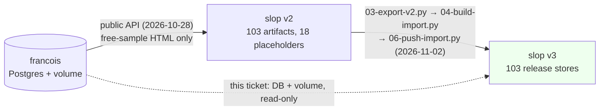
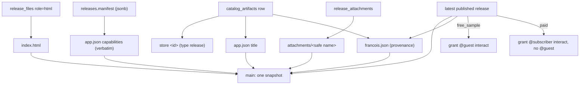
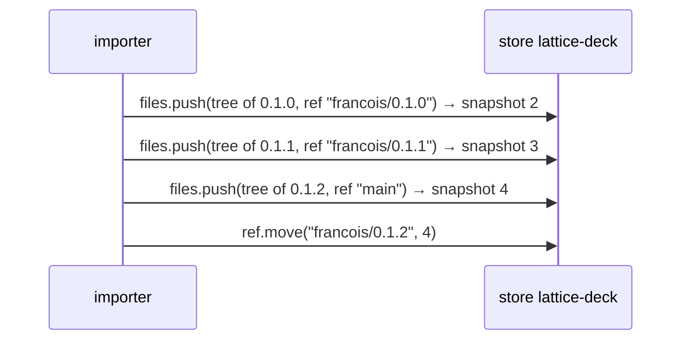
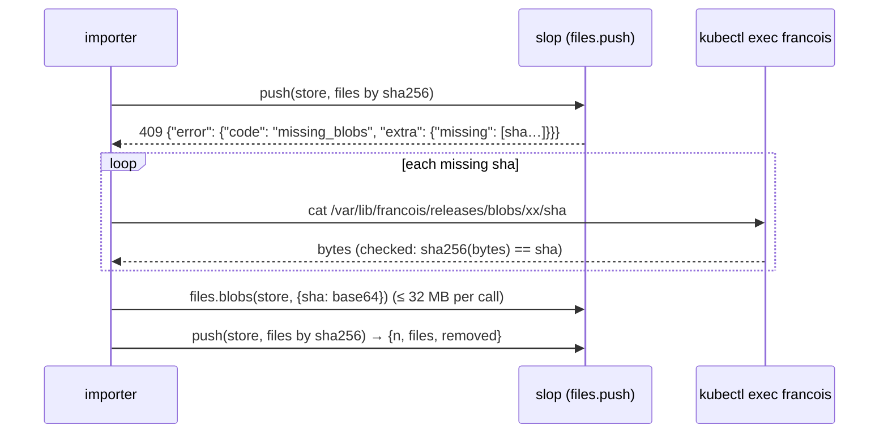

# Intern guide: importing francois's catalog into slop v3 stores

## 1. Executive summary

slop.boutique is a running francois server. It sells and hosts about a hundred HTML applications ("artifacts"), each published as one or more immutable **releases**. slop v3, deployed at slop.yolo.scapegoat.dev, is the successor platform. Every francois artifact already has a slop **store** of type `release`, served at `https://apps.slop.yolo.scapegoat.dev/f/<id>/`. Those stores came from two earlier imports, and both had blind spots:

- **Eight stores hold a placeholder page, not the app.** The first import (SLOP-002, slop v2) read francois through its public API. That API only hands out the HTML of free samples, so paid releases became an ~850-byte placeholder. The v3 cutover (SLOP3-004) copied v2's content as it was.
- **Six stores declare different capabilities from the original.** The v3 cutover kept only the *names* of each release's capabilities and invented their settings. Two apps lost their `db.rules`, which keep each visitor's `chatlog` private. Four lost `sample.images`. Two gained a `profile` scope on `user` they never asked for.
- **Every store is public, including the paid ones.** Each store grants `@guest interact`. Today that exposes only placeholders. Once the real HTML is imported, it would expose paid apps.
- **No store records which francois release it holds,** apart from a free-text snapshot message.

This ticket imports the catalog again, from the authoritative source: francois's Postgres database and its release volume, both read-only. The import writes into the existing stores, so URLs, origins, user data and policies are kept. It is **idempotent**: a store whose tree and grants already match is left alone, so a second run changes nothing. The plan is computed and printed before anything is written.

> [!summary]
> 1. Source of truth: francois's `catalog_artifacts`, `releases`, `release_files` and `release_attachments` tables, plus the blob files under `/var/lib/francois/releases`. Everything is read-only.
> 2. Target: the 103 existing `release` stores on slop.yolo. One `files.push` per store whose tree differs from the desired tree, which is `index.html`, `app.json` (with the francois manifest verbatim), `francois.json` (provenance) and `attachments/…`.
> 3. Access follows francois: free samples stay `@guest interact`. Paid releases become `@subscriber interact`, and older paid releases are not imported into public stores.

## 2. How to read this guide

Sections 3 to 5 are orientation. They cover francois (§3), the cluster (§4) and slop v3 (§5), each only as far as the importer touches it. Section 6 tells the history of the two earlier imports. Section 7 states today's gaps, with the evidence. Sections 8 to 10 are the design: the mapping, access and history decisions, and idempotence. Section 11 gives pseudocode, and §12 is the API reference. Section 13 is the implementation and run plan, and §14 lists what deserves a second look. File paths without a repository prefix are in `go-go-golems/slop-computer`. Paths marked `francois:` are in `go-go-golems/francois` at `origin/main` (`4bab7f1`).

## 3. Orientation: francois

### 3.1 What francois is

francois began as a localhost service that hosts saved Claude artifacts. An artifact is one HTML file that calls the `window.claude` runtime (`sample`, `db`, `room`, `user`, `downloads`, …). francois supplies that runtime with a local Pi model configuration. The deployed instance runs francois's **catalog** mode (`francois: pkg/catalog`), a storefront with accounts, Stripe billing, a creator studio, and per-subscriber hosted **instances** of each app. slop.boutique serves the catalog. Each instance runs on a `*.slop.boutique` subdomain.

The importer cares about four entities. All four live in francois's Postgres database, in `francois: pkg/catalog/store/migrations/001_core.sql` and `006_videos_attachments.sql`:

| Table | One row is | Fields the importer uses |
| --- | --- | --- |
| `catalog_artifacts` | an app in the catalog | `id` (slug), `title`, `description`, `tags`, `visibility` (`listed`/`hidden`) |
| `releases` | an immutable published version of an app | `id` (`rel_…`), `artifact_id`, `version`, `state` (`draft`/`published`/`withdrawn`), `free_sample`, `manifest` (jsonb), `changelog`, `published_at` |
| `release_files` | the release's HTML or its manifest file | `release_id`, `role` (`html`/`manifest`), `name`, `size`, `sha256`, `storage_key` |
| `release_attachments` | an extra download (usually `…-source.zip`) | `release_id`, `name`, `label`, `media_type`, `size`, `sha256`, `storage_key`, `position` |

The `manifest` column is the release's **capability manifest**. It has the same shape as claude.ai's artifact capabilities, for example `{"db": {}, "sample": {"images": true}, "downloads": true}`. It is the contract between the page and the runtime: a capability the manifest does not declare is absent from the page.

### 3.2 Where the bytes live

Release bytes are not in Postgres. `release_files.storage_key` and `release_attachments.storage_key` name a content-addressed file, `blobs/<first two hex>/<sha256>`, under `/var/lib/francois/releases` on the `francois-data` volume (PVC). `francois: pkg/catalog/releases/releases.go` `Blobs.Read` reads the file and refuses it if its SHA-256 does not match the row. The importer applies the same check.

### 3.3 Who may download a release

`francois: pkg/catalog/routes.go:264` `mayDownload` decides who may download a release:

```go
if rel.FreeSample { return true }          // anyone, signed in or not
if p == nil { 401 login_required }
if !entitlement.CanRun(artifact, doc) { 403 plan_required }  // paying / early access
```

Two consequences follow:

- **Access is a property of the release, not of the artifact.** For example, `lattice-deck` 0.1.0 and 0.1.1 are paid, while 0.1.2 is a free sample.
- **The public API cannot export paid HTML.** The download route is `guard(public, noToken, …)`, so an API token gets `401 token_not_allowed`, and there is no studio route for release bytes. This is why the first import produced placeholders (SLOP-002 diary, step 5).

### 3.4 What is not part of "the artifacts"

The importer leaves the following out, on purpose:

- **Instances** (`instances`, `instance_documents`, `instance_assets`, `instance_threads`, `instance_comments`): 99 rows. They hold each subscriber's private data in their copy of an app. Moving it needs a mapping from francois users to slop people, and consent; that is a separate ticket.
- **The storefront:** posts, media, creators and covers. slop already serves a rendered copy at the root of `site.slop.yolo.scapegoat.dev` (store `boutique`, built in SLOP3-004).
- **Billing and accounts.**

## 4. Orientation: the cluster

Both services run on one k3s cluster, managed by GitOps from `wesen/2026-03-27--hetzner-k3s` (checked out at `~/code/wesen/2026-03-27--hetzner-k3s`).

- **kubectl access:** `KUBECONFIG=~/code/wesen/2026-03-27--hetzner-k3s/kubeconfig-k3s-demo-1.tail879302.ts.net.yaml`, over Tailscale. The `kubeconfig-91.98.46.169.yaml` variant hangs from outside, because the public API port is firewalled.
- **francois:** Deployment `francois` in namespace `francois`. Its volume `francois-data` is mounted at `/var/lib/francois`.
- **Postgres:** StatefulSet pod `postgres-0` in namespace `postgres`, with one database per app. francois's database is named `francois`. Inside the pod, `psql -U "$POSTGRES_USER"` connects as the cluster superuser over the local socket, so no password has to leave the cluster.
- **slop:** Deployment `slop` in namespace `slop`. Its image is pinned in `gitops/kustomize/slop/deployment.yaml` (`sha-a3da880` on 2026-11-06). Its configuration is `gitops/kustomize/slop/configmap.yaml`. The **live** host `apps.slop.yolo.scapegoat.dev` runs apps, the **static** host `site.slop.yolo.scapegoat.dev` serves snapshots, and `*.sbx.slop.yolo.scapegoat.dev` are the per-store sandbox origins.

Reading francois without changing it works as follows:

```sh
# metadata: a read-only transaction, so even a mistaken UPDATE fails
kubectl exec -i -n postgres postgres-0 -- sh -c \
  'PGOPTIONS="-c default_transaction_read_only=on" psql -U "$POSTGRES_USER" -d francois -At -f -' < query.sql

# bytes: read one blob out of the running pod, in 4 MiB pieces
kubectl exec -n francois deploy/francois -- sh -c 'tail -c +1 "$0" | head -c 4194304' \
  /var/lib/francois/releases/blobs/58/583a…70e6 > piece-0
```

One `kubectl exec … cat` of a large file is not reliable. In the rehearsal, a 12,848,209-byte attachment arrived as 10,780,672 bytes, with exit status 0. The importer therefore reads in 4 MiB pieces, checks each piece's length, retries a short piece up to four times, and checks the SHA-256 of the whole file before using it.

Neither command writes to francois. The `PGOPTIONS` setting makes every statement in the session read-only. `cat` reads a file through the pod's filesystem.

## 5. Orientation: slop v3

### 5.1 Stores, trees, snapshots and refs

A **store** is one SQLite database. It holds the documents, files, app tables and history of one durable thing (design §4, `doc/design/slop-v3.md`). Its files are in two **zones**: the **tree** is versioned content such as pages and code, and **assets** are what visitors upload. Bytes are kept once, in a shared blob store keyed by SHA-256. The store records only path, hash, size and type (`pkg/store/files.go`).

A **snapshot** freezes the tree at one revision. Snapshots are numbered `1, 2, 3, …` per store (`Turn.Snapshot`, `pkg/store/files.go:183`). A **ref** is a name that points at a snapshot. `main` is the ref that pages serve. `files.push` moves `main` unless it is given another ref, and `ref.move` points any ref at any existing snapshot, which is how a rollback works.

### 5.2 Apps and app.json

A store is an **app** when its tree holds `app.json` (`pkg/apps/manifest.go`):

```json
{
  "title": "Hypercore Studio",
  "page": "index.html",
  "capabilities": { "db": {"rules": [...]}, "sample": {"images": true}, "downloads": true }
}
```

`capabilities` keeps the claude.ai shape, so a francois manifest can be copied in unchanged. `pkg/rt/manifest.go` `ParseManifest` checks it when the version is activated (`pkg/kernel/apps.go:156`) and when a page is served (`pkg/doors/pages/sandbox.go:192`). It accepts `db.rules`, `db.stores`, `user.scopes`, `room.topics`, `sample.images`, `downloads`, `comments` and `files`. If a manifest fails the check, the app does not activate, so the importer checks every manifest before writing anything.

### 5.3 Who may open a store

Access is decided per store from **grants** (`grant.set <store> <subject> <level>`, `pkg/commands/stores.go:223`):

| Subject | Means |
| --- | --- |
| `@guest` | anyone, signed in or not |
| `@member` | any approved signed-in person |
| `@subscriber` | a person with an active subscription (`pkg/billing`) |
| `usr_…`, `store:<id>`, `vis_…` | one person, another store, one visitor |

| Level | Allows |
| --- | --- |
| `view` | reading |
| `interact` | running the app and writing through its rules |
| `admin`, `owner` | managing the store |

A separate **policy** table decides who may use a costly capability in an app. For example, `policy.set <app> sample <audience> on` turns on model calls for one audience. The SLOP3-004 import turned `sample` on for `member`, `subscriber` and `admin` in every release store, and left it off for `guest`.

### 5.4 Mounts and sandbox origins

A **mount** puts stores at URLs. One parameterised mount serves every imported app:

```
mount: host apps.slop.yolo.scapegoat.dev, path /f/:id, storeParam id, type release
→ https://apps.slop.yolo.scapegoat.dev/f/weft/  serves store "weft" (it must be of type release)
```

The mounted page is a shell. It runs the app in an iframe on the store's **sandbox origin**, `s<label>.sbx.slop.yolo.scapegoat.dev`, where `label` is an HMAC of store and app under a server key (`pkg/doors/pages/views.go:69`). Each app therefore has its own browser origin, with its own localStorage and cookies. The sandbox serves `/v/<n>/…`, the files of snapshot `n` (`0` means `main`), in `pkg/doors/pages/sandbox.go:115`.

### 5.5 The HTTP API and the CLI login

Every operation is a **verb** in one table. The HTTP door exposes each one as `POST /api/v1/<verb>` with a JSON body, authenticated by `Authorization: Bearer <token>`. The answer is `{"result": …}` or `{"error": {"code", "message", …}}`. `slop auth login` stores a token per server in `~/.config/slop/credentials.json`. The importer reads that file and never prints the token, the same way SLOP3-004's `06-push-import.py` does. The token used here belongs to an admin and has the scopes `read`, `write` and `admin`.

## 6. History: two earlier imports



1. **SLOP-002 (slop v2), 2026-10-28.** `slop import francois extract|push` read francois's catalog with an admin API token. It wrote each release's HTML, or a placeholder when the API refused, as a v2 artifact version. The diary already names the cause: "There is no studio route for release HTML. So the API source gets HTML only for published free samples" (SLOP-002 diary, step 5). A database source (`DBSource`) was written but never run against production.
2. **SLOP3-004 (cutover to v3), 2026-11-02.** `scripts/03-export-v2.py` exported v2. `04-build-import.py` turned each imported page into a `files.push` manifest, and `06-push-import.py` created store `<id>` of type `release`, granted `@guest interact`, set the `sample` policies and mounted `/f/:id`. The capability mapping in `04-build-import.py` is:

   ```python
   CAP_BLOCK = {"downloads": True, "user": {"scopes": ["profile"]}}
   caps = {c: CAP_BLOCK.get(c, {}) for c in imp["capabilities"] if c != "slop"}
   ```

   v2 had stored only the list of capability names, so the cutover rebuilt each capability's settings from this table. Every setting not in the table became `{}`.
3. **SLOP3-006** replaced 103 exact mounts with the single `/f/:id --type release` mount. It left task `2ghn`, "Import v2 history: older versions of imported artifacts as snapshots", open.

## 7. Current state, with evidence (2026-11-06)

All of the numbers below come from read-only queries on 2026-11-06. The scripts are in this ticket's `scripts/` directory.

**francois** (`01-inventory.sh`):

- **Artifacts:** 104 catalog artifacts, 4 of them hidden (`aasd`, `craftkit-studio`, `polis`, `stackchan-pet-studio`). One, `aasd`, has no release.
- **Releases:** 113 in all, 110 published and 3 withdrawn (all `rag-workbench`). 95 of the published releases are free samples.
- **Bytes:** 113 HTML files (99.5 MB), 113 manifests, and 18 attachments (63.8 MB; the largest is 12.8 MB).
- **Several releases:** five artifacts have more than one release (`lattice-deck`, `lattice-phantasmagoria`, `lattice-rift`, `rag-workbench`, `tabula-workbench`).

**slop.yolo** (`store.ls --all`, `files.ls`, `snap.ls` and `grant.ls` per store):

- There are 112 stores: 103 of type `release` and 9 platform stores (`backoffice`, `blocks`, `blocks-site`, `boutique`, `guestbook`, `journal`, `pinup`, `static-site`, `workshop`).
- Every francois artifact with a release has a store, and there is no extra release store.
- Each release store has exactly one snapshot, with the message `imported from v2 (rel_…)`. In all 103, that release id is the artifact's **latest published** release.

**Comparing the two:**

| Finding | Stores | Evidence |
| --- | --- | --- |
| `index.html` equals the latest release's HTML (by SHA-256) | 95 | e.g. `weft`: `e03146bf…` on both sides |
| `index.html` is a placeholder (730–898 bytes) | 8 | `blockout-studio`, `hypercore-studio`, `kiln-workbench`, `living-comic-studio`, `mimeo`, `no-dom-the-interface-is-a-projection`, `octavo-lab`, `polis`; every one is the artifact's latest release and is paid |
| `app.json` capabilities differ from francois's manifest | 6 | `hypercore-studio`, `living-comic-studio` (lost `db.rules` and `sample.images`); `lattice-arena`, `lattice-arena-ds` (lost `sample.images`, gained `user.scopes: [profile]`); `craftkit-workbench`, `sonnet-new-roman-modular` (lost `sample.images`) |
| Attachments present under `attachments/` | 17 releases' worth | match francois |
| Grants | 103 | all `@guest interact` |
| Older releases missing | 8 published, 3 withdrawn | every older published release is **paid** |

The `db.rules` loss is the most serious finding. francois declares:

```json
{"rules": [{"path": "chatlog", "read": "view", "write": "owner"},
           {"path": "chatlog/{self}", "write": "interact"}]}
```

These rules let every visitor write only their own `chatlog/<id>` entry. With `db: {}`, slop applies its default rules, so the app's data is protected differently from what its author declared.

## 8. Design

### 8.1 Goals and non-goals

Goals:

- **Faithful.** Each store's `main` serves exactly the bytes of the artifact's latest published release, with exactly its declared capabilities.
- **Traceable.** Each store says which francois release it holds, in a machine-readable file and not only in a commit message.
- **Same access as francois.** Free samples stay open to anyone. A paid release can be opened only by subscribers (and admins).
- **Safe to repeat.** A second run plans zero writes. A run that stops halfway can be restarted.
- **Read-only on francois.** The importer never writes to its database or its volume.
- **Keeps what slop already has.** Store ids, origins, mounts, `sample` policies and any documents visitors wrote stay as they are.

Non-goals: instances (§3.4), the storefront pages, new mounts, and changes to slop's code.

### 8.2 The mapping



The desired tree of a store is:

| Path | Content | Source |
| --- | --- | --- |
| `index.html` | the release HTML, byte for byte | blob of `release_files.role='html'` |
| `app.json` | `{"title", "page": "index.html", "capabilities": <manifest>}`, JSON with sorted keys, 2-space indent, trailing newline | `catalog_artifacts.title`, `releases.manifest` |
| `francois.json` | provenance (below) | the rows above |
| `attachments/<name>` | each attachment, byte for byte | blob of `release_attachments` |

`francois.json` holds only fields that change when francois changes. It has no import timestamp, so its bytes, and therefore the tree, are stable from one run to the next:

```json
{
  "source": "https://slop.boutique",
  "artifact": {"id": "hypercore-studio", "title": "Hypercore Studio", "description": "…",
               "tags": ["…"], "visibility": "listed"},
  "release": {"id": "rel_…", "version": "0.1.0", "state": "published", "freeSample": false,
              "publishedAt": "2026-10-23T…Z", "changelog": "",
              "html": {"name": "hypercore-studio-0.1.0.html", "sha256": "…", "size": 1234},
              "manifest": {"…": "…"},
              "attachments": [{"name": "…", "label": "Source (zip)", "sha256": "…", "size": 1}]}
}
```

Attachment names go through the same sanitising as francois's `safeName` (characters outside `[A-Za-z0-9._-]` become `_`), so a path can never escape `attachments/`. The 17 attachment paths already in slop were made the same way and keep their names.

### 8.3 Access decision

On francois, access is per release (§3.3). On slop it is per store (§5.3), and a store's sandbox serves **every** snapshot at `/v/<n>/` to anyone who knows the sandbox URL (§5.4, and §14). The importer therefore applies one rule:

> A store's grants follow its `main` release: free sample → `@guest interact`; paid → `@subscriber interact` and no `@guest` grant. A paid release is never written into a store whose `main` is free.

For the eight paid apps, the import removes `@guest interact` and adds `@subscriber interact`. Signed-in non-subscribers lose access, as on francois, where they would get `403 plan_required`. Admins keep access through their role. The `sample` policies already include `subscriber`.

### 8.4 Release history

Task `2ghn` asks for older releases as snapshots. Each older release would go to a ref named after its version (`francois/0.1.0`), and `main` would end on the latest release:



The data rules this out by default. All 8 older published releases are **paid**, and the latest release of each of those artifacts is a **free** sample. Writing them into the public store would make paid HTML reachable through `/v/<n>/` (§8.3). The 3 withdrawn `rag-workbench` releases were taken down by their author and are not on slop.boutique at all. So the importer:

- imports older releases only when `--history` is passed, and even then only the ones the store's grants allow (free, or paid in a paid store);
- never imports withdrawn releases;
- lists every release it skipped, with the reason, in the plan.

Today that means no history is written, and the plan says so for each release. The mechanism is still built and tested on a local server, so it applies as soon as a free older release appears.

### 8.5 Idempotence

The importer decides from current state, not from a log of earlier runs:

```
desired(store) = {path: sha256} for index.html, app.json, francois.json, attachments/*
current(store) = files.ls(store) filtered to the tree zone
push needed    ⇔ desired ≠ current           (paths and hashes, both ways)
grants needed  ⇔ the set of @guest/@subscriber grants ≠ the desired set
```

`files.push` runs a turn that rewrites every listed file and then calls `Turn.Snapshot` (`pkg/store/files.go:183`). `Turn.Snapshot` returns the ref's current snapshot when the tree hash is unchanged, so pushing the same tree twice does not add a snapshot. The comparison above still matters. It avoids 103 needless write turns and blob checks. It also produces a plan that a person can read before anything is written: "0 pushes" on a second run is the evidence that the import is complete.

### 8.6 Moving bytes cheaply

Most blobs are already in slop's blob store: 95 of the HTML files and all of the attachments. `files.push` names files by hash and answers `missing_blobs` with the exact list it lacks (`pkg/commands/files.go:352`). The importer uses that answer to decide what to fetch from francois:



Small generated files (`app.json`, `francois.json`) go inline as `{"path", "text"}`. The importer computes their SHA-256 itself for the comparison in §8.5. It uses `json.dumps(…, sort_keys=True, indent=2, ensure_ascii=False) + "\n"`, encoded as UTF-8, which is exactly the bytes it sends. The fetched blobs are cached in the scratchpad by hash, so a rerun does not fetch them again.

### 8.7 Order and failure

Stores are processed one at a time, in id order. Each store needs at most three writes: a blob upload, one push, and grant changes. Grants are changed **after** the push. For a paid store, the push itself would briefly make the paid HTML public under the old `@guest` grant, so for paid stores the importer swaps the grants **before** pushing:

```
paid store:  grant.set @subscriber interact → grant.rm @guest → push
free store:  push → grant.set @guest interact (if missing)
```

A failure stops at that store and prints what was done. Rerunning resumes, because §8.5 skips the stores that are already done.

### 8.8 Rollback

Every push adds a snapshot and moves `main`. To undo one store:

```
snap.ls <store>                    # the previous main is n-1
ref.move <store> main <n-1>
grant.set <store> @guest interact  # for a paid store, if reverting access too
```

The plan and the apply log record each store's `main` before the run (`before.n`), so a full rollback can be scripted from the log.

## 9. Validation strategy

| Check | How | Pass condition |
| --- | --- | --- |
| Manifests | `_validate/main.go` (scratch, not committed) runs `apps.Parse` on every `app.json` the plan generates | 103 parse without error |
| Bytes | the importer compares `sha256(bytes)` with francois's recorded hash, for every blob it fetches | no mismatch |
| Tree | after the push, `files.ls` equals the desired map | 103/103 |
| Second run | `03-import.py` without `--apply` | `0 pushes, 0 grant changes` |
| Access | as an anonymous visitor, `POST <live>/_site/views {"path": "/f/<id>/"}`, which is the request the mount's shell (`pkg/doors/pages/assets/shell.js`) makes; `GET /f/<id>/` is always 200, because it only returns the shell | free → 200 with `version` = `main`; paid → `401 unauthenticated` |
| Rendering | Playwright, signed in as admin: open a former placeholder (`polis`) and a fixed-capability app (`hypercore-studio`) | the app renders; no console errors from `window.claude.use` |

## 10. Considered alternatives

- **francois's public API (as in SLOP-002).** It cannot export paid HTML (§3.3), which is the very gap to close.
- **A new `slop import francois` command in Go.** The v2 `pkg/francois` package was removed with v2. One-off migrations in v3 have been ticket scripts (SLOP3-004, SLOP3-006) that use the HTTP API, which keeps the platform free of a francois dependency. This import follows that pattern.
- **`import.folder` into new stores.** It always creates a new store (design §4.7). That would change ids, sandbox origins and mounts, and would drop any visitor data in the current stores.
- **Restoring a database backup elsewhere first.** It is safer for francois, but the read-only session and `cat` are already non-mutating, and a restore would add a day of operator work.

## 11. Pseudocode

```python
# 01-inventory.sh: one read-only query → inventory.json
artifacts, releases(with files, attachments) = psql(read_only=True)

# 02/03-import.py
inv   = load("inventory.json")
slop  = {s.id: s for s in call("store.ls", all=True) if s.type == "release"}
plan  = []
for a in inv.artifacts (by id):
    rels = releases of a, oldest first
    pub  = [r for r in rels if r.state == "published"]
    if not pub:                     plan.skip(a, "no published release"); continue
    if a.id not in slop:            plan.skip(a, "no store")  # none today; store.new would go here
    main = pub[-1]
    paid = not main.free_sample
    for r in rels except main:
        reason = "withdrawn" if r.state == "withdrawn" else \
                 ("paid release in a public store" if (not r.free_sample and not paid) else \
                  (None if HISTORY else "history off"))
        plan.history(a, r, reason)
    tree    = desired_tree(a, main)               # §8.2
    current = {f.path: f.sha256 for f in call("files.ls", store=a.id) if f.zone == "tree"}
    grants  = {g.subject for g in call("grant.ls", store=a.id)
               if g.subject in ("@guest", "@subscriber") and g.via == "direct"}
    want_g  = {"@subscriber"} if paid else {"@guest"}
    refs    = call("ref.ls", store=a.id)              # {"main": n, "francois/0.1.0": n, …}
    plan.add(a.id, push = tree != current, grants = (grants, want_g), tree, before=refs["main"])
print(plan.summary())
if not APPLY: exit

for p in plan.stores:
    if p.paid: set_grants(p)                      # §8.7: close before the bytes arrive
    if p.push:
        try:  r = call("files.push", store, files=manifest(p.tree), message=f"francois {rel.id} {version}")
        except MissingBlobs(missing):
            blobs = {sha: b64(fetch_from_francois(sha)) for sha in missing}   # verified
            for batch in chunks(blobs, 32 MB): call("files.blobs", store, blobs=batch)
            r = call("files.push", …same…)
        log(store, before=p.before, after=r.n)
    if not p.paid: set_grants(p)
```

## 12. API reference

### 12.1 slop verbs used (all `POST /api/v1/<verb>`)

| Verb | Input | Result | Notes |
| --- | --- | --- | --- |
| `store.ls` | `{"all": true}` | `[{id, type, owner, app, createdAt, level}]` | admins only for `all` |
| `files.ls` | `{"store"}` | `[{zone, path, sha256, size, type, rev}]` | the working tree; after a push to `main` it equals `main` |
| `files.cat` | `{"store", "path"}` | the file's text | |
| `snap.ls` | `{"store"}` | `[{n, rev, tree, message, by, at}]` | |
| `ref.ls` / `ref.move` | `{"store"}` / `{"store", "ref", "n"}` | `{"main": n, "<ref>": n}` / | `snap.ls` lists newest first; `main` comes from `ref.ls` |
| `files.push` | `{"store", "files": [{path, sha256, size, type?} \| {path, text}], "message", "ref"?, "prune"?: true}` | `{files, removed, n, rev}` | error `missing_blobs` with `extra.missing: [sha…]` |
| `files.blobs` | `{"store", "blobs": {sha: base64}}` | `{stored}` | the HTTP body limit is 96 MiB; batch below 32 MiB |
| `grant.ls` | `{"store"}` | `[{store, subject, level, via, createdBy, createdAt}]` | |
| `grant.set` / `grant.rm` | `{"store", "subject", "level"}` / `{"store", "subject", "via"?}` | | subjects in §5.3 |
| `policy.ls` | `{"app"}` | `{cells: [{capability, audience, allowed, effective}]}` | read to confirm `sample` for `subscriber` |

### 12.2 francois sources

| Source | Read with | Notes |
| --- | --- | --- |
| `catalog_artifacts`, `releases`, `release_files`, `release_attachments` | `psql` in `postgres-0`, `default_transaction_read_only=on` | `scripts/01-inventory.sh` |
| `/var/lib/francois/releases/<storage_key>` | `kubectl exec -n francois deploy/francois -- sh -c 'tail -c +<off> "$0" \| head -c <n>' <path>`, in 4 MiB pieces | the key matches `blobs/[0-9a-f]{2}/[0-9a-f]{64}`; anything else is refused |
| `GET https://slop.boutique/api/catalog` | anonymous | cross-check only: it lists the 100 *listed* artifacts |

## 13. Implementation and run plan

Each phase ends at a checkpoint, with a commit and a diary entry.

1. **Inventory** (`scripts/01-inventory.sh`): the read-only query, output to `various/inventory-<date>.json`. Commit the script and the inventory. The inventory contains no email addresses or secrets, only francois user ids on attachments, and those are dropped.
2. **Planner and applier** (`scripts/03-import.py`): the dry run by default, `--apply` to write, `--only <id,…>` to limit the stores, `--history` for §8.4. It reads the inventory, the slop state (§12.1) and the blob cache. It writes `various/plan-<date>.json` and an apply log.
3. **Local rehearsal:** `slop serve --local`, create 3 release stores shaped like production (placeholder, wrong capabilities, attachments) and run the importer against them. This checks the missing-blobs loop, the grant order, the snapshot count on a second run, and `--history` on a fixture with a free older release.
4. **Manifest check:** `go run ./_validate` on the plan's `app.json` files.
5. **Production dry run:** read the plan. It should show 8 HTML replacements, 6 capability fixes, 103 provenance additions, 8 grant swaps and 11 skipped history releases.
6. **Production apply:** first `--only polis`, then check it in a browser, then the rest.
7. **Verify** (`scripts/04-verify.py`): the checks in §9. Save the evidence (plan, apply log, verification output and two screenshots) in `various/`.
8. **Bookkeeping:** close task `2ghn` in SLOP3-006 with a pointer here, and keep the diary and changelog up to date.

## 14. What deserves a second look

- **The sandbox serves any snapshot without a viewer check.** `serveSandbox` (`pkg/doors/pages/sandbox.go:73–140`) maps the label to a store and serves `/v/<n>/` to anyone. The label is an unguessable HMAC, but every viewer of the app learns it, because it is the iframe's origin. A subscriber who shares the URL therefore shares the paid HTML. That is roughly equal to francois, where a subscriber can download the HTML file, but it is a property of slop that grants alone do not change. The same mechanism is why older paid releases stay out of public stores.
- **`@subscriber` on slop.yolo.** If nobody on slop.yolo has a subscription yet, the eight paid apps become admin-only. That is the conservative reading of francois's rule. Opening them to members would be one `grant.set` per store.
- **Model spending.** All 103 apps use `sample`. The existing policies allow members, subscribers and admins. The budget ledger (SLOP3-007) caps spending per person. Eight more working apps raise usage, not the limits.
- **Stale francois.** francois keeps running, so a release published after the import is picked up by the next run (§8.5). Nothing is scheduled; rerun the script.
- **Visitor data in release stores.** The import pushes only the tree zone. Documents and assets written by visitors since 2026-11-02 remain, including data written under the old `db: {}` rules in the two `chatlog` apps. The new rules apply from the next activation on, and existing documents are not rewritten.

## 15. File reference

| File | Why it matters |
| --- | --- |
| `pkg/commands/files.go` | `push` (300–395): manifest, `missing_blobs`, prune, snapshot; `files.blobs`; `ref.move` |
| `pkg/commands/stores.go` | `store.ls`, `grant.set/rm` and the subject list |
| `pkg/commands/policy.go` | `policy.set/ls` |
| `pkg/apps/manifest.go` | `app.json` (`Manifest`, `Parse`) |
| `pkg/rt/manifest.go` | `ParseManifest`, `ContractCaps` |
| `pkg/store/files.go` | tree limits (`MaxTreeFile` 50 MiB, `MaxTreeFiles` 5000), `Snapshot`, `SnapshotFiles` |
| `pkg/doors/pages/sandbox.go`, `views.go` | sandbox origin, `/v/<n>/`, label HMAC |
| `ttmp/2026/11/01/SLOP3-004--…/scripts/0[3-6]-*.py` | the v2→v3 import this ticket corrects |
| `ttmp/2026/11/02/SLOP3-006--…/scripts/01-generic-f-mount.py` | the `/f/:id` mount |
| `ttmp/2026/10/28/SLOP-002--…/reference/01-diary.md` | why paid HTML became placeholders |
| `francois: pkg/catalog/store/migrations/001_core.sql`, `006_videos_attachments.sql` | francois schema |
| `francois: pkg/catalog/routes.go` (`download`, `mayDownload`) | release access |
| `francois: pkg/catalog/releases/releases.go` (`Blobs.Read`) | blob layout and hash check |
| `hetzner-k3s: gitops/kustomize/francois/`, `gitops/kustomize/slop/` | deployments, volumes, slop configuration |
