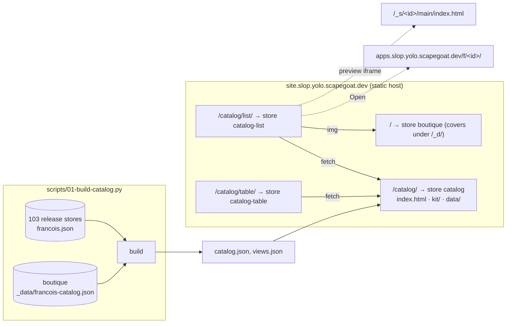

# Intern guide: catalog views on slop's static host

## 1. What this is and why

Ramon's site, html.moldandyeast.com, presents one piece of content in several ways. The content is a library of single-file HTML applications. There is an editorial index with sorting and tag filters, a modal viewer that shows an application at phone, tablet or desktop size, a command palette for search, and a set of plain-text and JSON views meant for agents. Every interface reads the same index file.

slop.yolo now has comparable content: the 103 applications imported from francois (ticket SLOP3-013). Each one is a slop store, and each store carries a `francois.json` describing its release. This ticket builds the same pattern on slop. A **catalog** is generated from those stores, and several **views** of it are published. Each view is a separate store on the static host, so adding a view means writing one HTML page and running three commands. That short path from "some files" to "a page at a URL" is one of the things slop is designed to make cheap (`doc/design/slop-v3.md` §13.2, "How content becomes an app"), and this ticket uses it on purpose.

The first release has three interfaces:

| View | URL | What it shows |
| --- | --- | --- |
| Index | `site.slop.yolo.scapegoat.dev/catalog/list/` | rows with cover, title, description and tags; sort; tag filter; search |
| Table | `site.slop.yolo.scapegoat.dev/catalog/table/` | one row per app, with sortable columns for capabilities, free or paid, version, date and size |
| Viewer | `?open=<id>` on any view | a modal: a live preview at phone, tablet or desktop size, plus details, open and download links |

A landing page at `/catalog/` lists the views. A shared header on every page switches between them.

> [!summary]
> 1. **One catalog file, many pages.** `catalog.json` is generated from the release stores, and each view is a static page that fetches it.
> 2. **Each view is its own store,** mounted under `/catalog/<view>/` on the static host. Shared code and data live in the `catalog` store at `/catalog/`.
> 3. **A running app cannot be framed by another page.** The viewer therefore previews a free app's raw HTML in a sandboxed iframe, without slop's runtime, and links to the running app. Paid apps show their cover.

## 2. Background you need

### 2.1 Stores, trees and the two kinds of host

A slop **store** is one SQLite database with a versioned file tree (`doc/design/slop-v3.md` §4). `files.push` writes the tree and takes a snapshot; `main` names the snapshot that is served. A **mount** (`mount.set`) attaches a store to a host and path. Two kinds of host matter here:

- The **live host** (`apps.slop.yolo.scapegoat.dev`) runs apps. A request gets the **shell**, a page that asks the server for a view. The app then runs in an iframe on the store's own sandbox origin, with the `window.claude` runtime (`db`, `sample`, `room`, …). The 103 francois apps are served there at `/f/<id>/`.
- The **static host** (`site.slop.yolo.scapegoat.dev`) serves files. It has no sessions, no cookies and no runtime, and it serves everything as an anonymous guest (`serveStatic`, `pkg/doors/pages/site.go:68`). A store may be served there only if `@guest` holds at least `view` on it. Responses carry `Cache-Control: public, max-age=60, stale-while-revalidate=600`.

The catalog views are plain HTML, CSS and JavaScript. They read one JSON file, which makes them a natural fit for the static host.

### 2.2 How the static host maps a URL to a file

`serveStatic` finds the mount with `registry.BestMount` (`pkg/registry/mounts.go:211`). A literal segment beats a `:param`, and among equal kinds the longer pattern wins. With these mounts:

```
/                 → store boutique      (the existing storefront)
/catalog          → store catalog
/catalog/list     → store catalog-list
/catalog/table    → store catalog-table
```

the request `/catalog/list/` is answered by `catalog-list` with `Rest = ""`, and `/catalog/data/catalog.json` by `catalog` with `Rest = "data/catalog.json"`. An empty `Rest` serves the entry page (`index.html`), and a path ending in `/` serves `<path>/index.html`. A mount root without its trailing slash is redirected to it, so relative URLs inside the page resolve under the mount.

Because all of these mounts are on the same host, every view can `fetch('/catalog/data/catalog.json')` and load `/catalog/kit/views.js` from the same origin. No CORS is involved, and the views share one HTTP cache.

### 2.3 Where the catalog's facts come from

| Fact | Source | Read with |
| --- | --- | --- |
| id, title, description, tags, visibility, version, `freeSample`, capabilities, HTML size, attachments | `francois.json` in each release store (SLOP3-013) | `files.cat <store> francois.json` |
| cover image (`src`, width, height), featured, creators | `boutique` store, `_data/francois-catalog.json` (SLOP3-004) | `files.cat boutique _data/francois-catalog.json` |
| store type | `store.ls --all` | type `release` |

The covers are already served by the static host under `/_d/francois-media*/…`, because the `boutique` store holds them. A catalog item can therefore point at a cover with a same-origin path. 96 of the 103 apps have one; the views draw a monogram for the rest.

### 2.4 Why the viewer cannot embed a running app

The shell on the live host answers with `Content-Security-Policy: frame-ancestors 'none'`. App sandboxes only allow the main and live hosts to frame them (`frameOrigins`, `pkg/doors/pages/sandbox.go:62`). These rules are deliberate. The shell carries the visitor's session, and the cookie is `SameSite=Strict`, but `site.` and `apps.` are the same site, so a framed shell would be signed in. The static host also serves stores that other people control (the `/s/:id` mount serves any store of type `site`). Allowing the static host to frame the shell would therefore let any such page put a signed-in shell under its own buttons.

The static host does serve a store's tree files at `/_s/<store>/<ref>/<path>` (`serveStoreFile`, `site.go:159`), to anyone who may read the store. For a free app, `/_s/weft/main/index.html` is the app's own HTML, served as `text/html`. For a paid app (`@subscriber` only, SLOP3-013), an anonymous request gets 404. This gives the viewer an honest preview:

- **Free app:** the raw HTML in an `<iframe sandbox="allow-scripts">`. The page runs, but in an opaque origin. It cannot read the catalog page, its cookies or its storage, and it has no `window.claude`. Features that need the runtime (`sample`, `db`, `room`) are unavailable in the preview. The viewer says so and offers "Open" for the real thing. Weft, for example, renders fully this way, and only its agent panel says it needs Claude.
- **Paid app:** the cover image and a notice that the app is for subscribers, with "Open" (which asks for sign-in on the live host).

## 3. Design

### 3.1 Stores, mounts and files



| Store | Repository source | Mount | Grants |
| --- | --- | --- | --- |
| `catalog` | `apps/catalog/` plus the generated `data/` | `site…/catalog` | `@guest view` |
| `catalog-list` | `apps/catalog-list/` | `site…/catalog/list` | `@guest view` |
| `catalog-table` | `apps/catalog-table/` | `site…/catalog/table` | `@guest view` |

None of these stores needs an `app.json`. A store whose tree has an `index.html` is served with that page as its entry (`apps.Manifest.Entry`), as the existing `static-site` example shows.

### 3.2 The catalog file

`/catalog/data/catalog.json`:

```json
{
  "generated": "2026-11-06T…Z",
  "source": "https://slop.boutique",
  "appsOrigin": "https://apps.slop.yolo.scapegoat.dev",
  "count": 100,
  "totalBytes": 99000000,
  "tags": [{"tag": "games", "count": 9}, …],
  "items": [{
    "id": "weft", "title": "Weft",
    "description": "A shader language whose pixels are glyphs, …",
    "tags": ["shaders", "typography"], "featured": true,
    "version": "1.0.0", "publishedAt": "2026-10-23T20:15:50Z",
    "free": true,
    "capabilities": ["sample"],
    "bytes": 1042897,
    "attachments": [{"name": "…-source.zip", "label": "Source (zip)", "size": 6800896, "href": "/_s/<id>/main/attachments/…"}],
    "cover": {"src": "/_d/francois-media/1/files/med_….png", "width": 2070, "height": 1344},
    "open": "https://apps.slop.yolo.scapegoat.dev/f/weft/",
    "preview": "/_s/weft/main/index.html",
    "download": "/_s/weft/main/index.html"
  }]
}
```

The rules that produce it:

- **Only listed apps.** Hidden francois artifacts (`craftkit-studio`, `polis`, `stackchan-pet-studio`; `aasd` has no release) are left out, as on slop.boutique. That leaves 100 items.
- **`free` is the current release's `freeSample`.** When it is false, `preview`, `download` and attachment `href`s are `null`, because the static host would answer 404 to anonymous visitors anyway.
- **`capabilities`** are the keys of the release manifest, sorted.
- **`items` are sorted newest first.** Views re-sort as they need.

`/catalog/data/views.json` lists the views for the switcher:

```json
[{"id": "list", "title": "Index", "path": "/catalog/list/", "blurb": "Rows with covers, sort and tag filter."},
 {"id": "table", "title": "Table", "path": "/catalog/table/", "blurb": "Every app as a row: capabilities, access, version, size."}]
```

### 3.3 The kit

`/catalog/kit/views.js` defines one global, `SlopCatalog`. A view page includes the stylesheet and the script and calls three functions:

| Function | Does |
| --- | --- |
| `SlopCatalog.load()` | fetches `catalog.json` and `views.json` once; resolves `{catalog, views}` |
| `SlopCatalog.header(el, current)` | renders the site header: name, item count, the view switcher (current view marked), and a search box that dispatches `catalog:search` events |
| `SlopCatalog.viewer` | `open(item)`, `close()`, `bind(catalog)`: the modal viewer; syncs `?open=<id>` with the address bar, closes on Esc and on Back |
| helpers | `el(tag, attrs, ...children)`, `bytes(n)`, `date(iso)`, `monogram(item)`, `matches(item, query)` |

Viewer pseudocode:

```js
open(item):
  history.pushState(…, "?open=" + item.id)          // shareable, Back closes it
  modal.title = item.title
  devices = {phone: 390×844, tablet: 820×1180, desktop: 1280×800}
  if item.preview:                                   // free app
    frame = <iframe sandbox="allow-scripts allow-forms allow-modals" src=item.preview referrerpolicy="no-referrer">
    size frame to the device; scale it to fit the modal with CSS transform
    note: "Preview without slop's runtime; model calls, shared data and rooms need Open."
  else:                                              // paid app
    show cover (or monogram) and "For subscribers; sign in when you open it."
  info: description, tags, version, date, capabilities, size, attachments
  actions: Open (item.open, new tab) · Download HTML (item.download, if any) · Copy link
close(): remove the iframe (stops the app), history back to the list URL
```

The iframe sandbox omits `allow-same-origin`, so the previewed app runs in an opaque origin. It cannot reach the catalog page through `window.parent`, and it cannot read or write the site host's storage.

### 3.4 The two views

**Index** (`apps/catalog-list/index.html`): a headline, a sort control (newest, A–Z, smallest, largest), tag filter buttons with counts, and one row per app: cover (lazy-loaded) or monogram, title, description, tags, a "subscribers" mark on paid apps, and actions (View, Open, size). The search box in the header filters the rows by title, description and tags.

**Table** (`apps/catalog-table/index.html`): one row per app, with columns for title, capabilities (one cell per capability: sample, db, room, user, downloads), access (free or subscribers), version, published date, size and attachments. Clicking a column header sorts by that column. Header search and a "capability" filter apply to the rows. Clicking a row opens the viewer.

Both views pick up `?open=<id>` when they load, so a viewer link can be shared.

### 3.5 Deploying

`scripts/02-deploy.py` (dry run by default, `--apply` to write):

```
build catalog.json and views.json                        (01-build-catalog.py)
for store, source, mount in [(catalog, apps/catalog + data, /catalog),
                             (catalog-list, apps/catalog-list, /catalog/list),
                             (catalog-table, apps/catalog-table, /catalog/table)]:
    store.new(store)                       if missing
    files.push(store, files of source)     only if the tree differs
    grant.set(store, @guest, view)         if missing
    mount.set(site host, mount, store)     if missing
```

It uses the same comparison as SLOP3-013's importer: path and SHA-256 against `files.ls`, so a second run changes nothing. Adding a view later means adding one directory under `apps/` and one line each in `views.json` and the deploy script's list.

### 3.6 Security and privacy

- **The views run with no privileges.** The static host has no session. The pages read only public files, and the catalog contains only public listing data.
- **The preview cannot escape its iframe.** `sandbox="allow-scripts allow-forms allow-modals"` without `allow-same-origin` gives it an opaque origin. `referrerpolicy="no-referrer"` keeps the catalog URL away from the app.
- **Paid apps are never previewed.** Their HTML is not reachable anonymously (SLOP3-013's grants). The catalog does not link to it either: `preview` and `download` are `null` for them.
- **No visitor data is collected,** and no third-party script or font is loaded. The pages use system fonts. The design is our own: Ramon's site is the pattern, not the look, and no assets or typeface are copied from it.

## 4. Implementation plan

1. **Build script:** `scripts/01-build-catalog.py` writes `catalog.json` and `views.json`. Keep a copy in `various/` as evidence.
2. **The kit:** `apps/catalog/` — `index.html` (landing), `kit/views.css`, `kit/views.js`.
3. **The views:** `apps/catalog-list/index.html` and `apps/catalog-table/index.html`.
4. **Test:** `pkg/host/catalog_views_test.go` pushes the three stores with a two-item catalog and checks that the static host serves `/catalog/list/` and `/catalog/table/` from their own stores, and `/catalog/data/catalog.json` and `/catalog/kit/views.js` from `catalog`. This tests the nested mounts and confirms that no app runtime is injected.
5. **Local check:** serve the three directories with a static file server and check them in a browser: sorting, filtering, the viewer at three sizes, Esc and Back.
6. **Deploy:** `02-deploy.py --apply` against slop.yolo, then check in a browser and record screenshots in `various/`.
7. **Later, after #31 and #32 are deployed:** the views for agents (`llms.txt`, `search-index.json`, a read-only MCP endpoint, an `/agents` page), served by an actor on a mount.

## 5. API reference

| Verb (`POST /api/v1/<verb>`) | Input | Used for |
| --- | --- | --- |
| `store.ls` | `{"all": true}` | find the release stores |
| `files.cat` | `{"store", "path"}` | read `francois.json` and `_data/francois-catalog.json` |
| `files.ls` | `{"store"}` | the current tree, for the comparison |
| `store.new` | `{"id"}` | create a view store |
| `files.push` | `{"store", "files": [{"path", "text"}], "message"}` | write a view's tree and snapshot it |
| `grant.ls` / `grant.set` | `{"store", "subject": "@guest", "level": "view"}` | make the store public |
| `mount.ls` / `mount.set` | `{"host": "site.slop.yolo.scapegoat.dev", "path": "/catalog/list", "store"}` | attach it to the static host |

| HTTP path on the static host | Served by |
| --- | --- |
| `/catalog/…` | `serveStatic` → store `catalog` |
| `/catalog/<view>/…` | `serveStatic` → store `catalog-<view>` |
| `/_d/…` | `serveStatic` → store `boutique` (covers) |
| `/_s/<store>/main/<path>` | `serveStoreFile` (raw tree files, guest-readable stores only) |

## 6. File reference

| File | Role |
| --- | --- |
| `pkg/doors/pages/site.go` | `serveStatic` (mount → file, trailing-slash redirect, cache headers), `serveStoreFile` (`/_s/`) |
| `pkg/registry/mounts.go` | `BestMount`, which decides which mount answers a path |
| `pkg/doors/pages/sandbox.go`, `pkg/doors/pages/live.go` | `frame-ancestors`; why apps run only in their own shell |
| `pkg/apps/manifest.go` | `Entry()`, which makes `index.html` the default page |
| `apps/examples/static-site/` | the smallest static store in the repository |
| `ttmp/2026/11/06/SLOP3-013--…/` | the import that produced `francois.json` in every release store |

## 7. Open questions

- **Running previews would need a platform change.** One option is an admin-only, per-mount `frameAncestors` allowance that lets a named static mount frame the live shell. It is worth its own ticket and threat model; it is not part of this work.
- **The covers are full-size PNGs** (up to ~2000 px). The index lazy-loads them. Generating thumbnails would make the index much lighter, and slop v2 had a thumbnail service (SLOP-012) that v3 does not.
- **The catalog is regenerated by hand** (`02-deploy.py`). An alarm in a catalog actor could rebuild it once actors can serve files on a static mount (#31 and #32).
