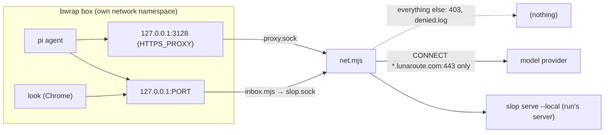

# Playbook: persona runs, from a scenario to a review page

This playbook covers one complete pass of persona-based testing: write a
scenario and its checker, prove the checker on a working app, run a batch of
coding agents against it, find what went wrong (including what went wrong in
the harness), and publish a review page that people can read. The README
describes each file; this page describes the work, in the order it happens,
and the mistakes that cost the most time.

The method exists to answer one question: can a coding agent that has only
`slop help`, and no source, do what a person asks? The help is the product
under test. An agent's failure is evidence about the help only after you have
ruled out the two other suspects: the checker and the harness. In batch js-1,
three of the seven runs that looked wrong were wrong because of the checker.

## 1. The four roles

A run is a conversation between a **person** and an **agent**, followed by a
**checker** and a **judge**.

| Role | What it is | What it can reach | Where |
| --- | --- | --- | --- |
| Agent | pi (deepseek-4.1-flash, thinking high) with `read,bash,edit,write` | the run's slop server through `slop`/curl; with `--browser`, Chrome through `look` | `box.sh` (bwrap, own network) |
| Person | pi with no tools, playing a persona card | the agent's replies; with `--browser`, the site through `look.mjs` | `run.mjs` `personaTurn` |
| Checker | a script per scenario | the server through the CLI, the page through Chrome as members and guests | `checks/<scenario>.sh` |
| Judge | pi, no tools | the transcript, the checks, the person's looks | `judge.mjs` |

The checker runs **after** the conversation and before the debrief, so
nothing the agent says afterwards can change the facts. Its results go to the
judge, never back into the conversation.

Without `--browser`, the person can only believe the agent. That hides the
most common real failure: "done, it works" about a page nobody has seen. In
js-1 every agent searched the box for a browser (all blocked egress was npm
or a Chrome download) and several then described pages they never looked at.
Run with `BROWSER=1` unless you are measuring the help alone.

## 2. Before anything runs: the environment

```bash
S=<scratch dir>
go build -tags sqlite_fts5 -o $S/slop-<round> ./cmd/slop    # one binary per round
export SLOP_BIN=$S/slop-<round>
export AGENT_DIR=$S/pitest/agentdir      # pi config with the model provider only
export PW_DIR=$S/pw                      # a folder with node_modules/playwright
export CHROME=~/.cache/ms-playwright/chromium-1243/chrome-linux-arm64/chrome
```

- Each run starts its own `slop serve --local --llm fake` on 127.0.0.1 with a
  fresh data directory. Nothing touches a real server.
- Never run the slop binary with your default login. Every CLI call outside a
  run uses its own credentials file and server
  (`SLOP_CREDENTIALS=…/none.json SLOP_SERVER=http://127.0.0.1:1` for help).
- `AGENT_DIR` holds only the model provider's entry. Delete it when the work
  is done.
- Build a new binary per round and keep it: a round's results describe that
  binary's help, and rechecks must use the same one.

## 3. Writing a scenario

A scenario is a card in `scenarios/<id>.json`. The person reads the first six
fields; the judge reads the last two.

```json
{
  "id": "orders-export",
  "persona": "builder",
  "maxTurns": 6,
  "setup": ["python3 \"$SETUP/jsdata.py\" ... && $SLOP store new orders ... && $SLOP mount set ..."],
  "opening": "Our orders page at /orders works fine, but I need a button ...",
  "goal": "a button on the /orders page that downloads a CSV of exactly this month's orders",
  "later": ["what does 'this month' mean exactly — by whose clock?"],
  "personaKnows": "You can sign in on the site.",
  "checklist": ["the page at /orders still lists the orders", "..."],
  "facts": ["Saving a file from a page is the downloads capability ...", "..."]
}
```

- **opening** is in the person's words: what people should be able to do,
  never the capability's name. "Downloads this month's orders as a CSV", not
  "use the downloads capability".
- **later** is the follow-up that tests understanding rather than building:
  time zones, limits, who can see what. It catches agents that build the
  right thing and then explain it wrongly.
- **setup** runs as the admin with `$SLOP`, `$PORT`, `$RUN`, `$SETUP`. Seed
  data comes from a generator (`setup/jsdata.py`) that also writes
  `$RUN/expected.json`, so the checker compares with computed answers, not
  with numbers typed into it. Use UTC dates throughout; the box runs with
  `TZ=UTC`.
- **heldOut: true** keeps a scenario out of default batches, for validating
  that fixes generalize.
- One persona card (`personas/builder.json`) drives most scenarios. Results
  across scenarios therefore vary by task, not by person; add a contrasting
  persona (a requester who cannot read code) as a separate card rather than
  editing this one, so rounds stay comparable.

## 4. Writing a checker, and proving it

A checker prints one JSON line per fact:
`{"check": "...", "ok": true|false, "detail": "..."}`. Browser checkers are
`checks/js/<id>.mjs` behind a one-line `checks/<id>.sh`, built on
`checks/browse.mjs`:

| Helper | Does |
| --- | --- |
| `base(path, ...caps)` | finds the store mounted at `path`, checks the app is not broken and declares `caps` |
| `browser()`, `person(b, email\|null)` | Chrome, and a context signed in on the live host (or a guest) |
| `open(ctx, path, ms)`, `frameText(pg)`, `inApp(pg)` | open a page; all frames' text **and field values**; the app's frame |
| `sl(...args)` | the CLI's JSON answer as the admin, or `{error}` |
| `shot(pg, name)` | `RUN/shots/<name>.png`, for the review page |
| `emit(check, ok, detail)` | one fact |

A checker is code that has never seen a correct answer. Before it judges an
agent, run it against a **reference app** built from the help's own example:

```bash
node run.mjs <id> --slop $SLOP_BIN --port 1876x --batch dry --dry   # setup + checker, no agent
$S/refcheck.sh <id> "\$SLOP push $REF/<app> --store <store> && ..." # deploy the reference, run the checker
```

Every check must pass on the reference. This found nothing wrong with the help
in js-1's four validated checkers, which is the point: when an agent then
fails, the failure is the agent's or the help's.

The reference does not catch everything, because agents build things the
reference does not. js-1's checker mistakes:

| Mistake | How an agent's app exposed it | Rule |
| --- | --- | --- |
| Page text from `innerText` only | inventory showed each shelf in an `<input>` | read field values too (`frameText` does) |
| "The first text box" | the helper page had a manual Add field before the chat | pick the box by its role (textarea, chat placeholder), else the last one |
| Console errors from the sign-in | every run logged a 404 from the harness's own `/` redirect | clear errors after sign-in; only the app's errors count |

When a check fails, look at the screenshot before you believe it.

## 5. Running

```bash
node run.mjs <id> --slop $SLOP_BIN [--port N] [--batch NAME] [--browser] [--dry]
BROWSER=1 ./batch.sh js-2 4 standup-room photo-wall orders-export ...   # 4 at a time, ports 18701+
```

A batch of seven at concurrency four takes about 25 minutes. Each agent turn
runs in the box:



- The box sees only its work folder, its home, `/usr`, `/etc`, node, pi and
  the slop binary. No repository, no real home, no DNS for code hosts.
- `net/denied.log` lists every refused connection. Read it after each batch:
  it is how round 4's containment incident was found, and how js-1 showed
  agents hunting for a browser.
- **Ports are per scenario position**, the same in every batch. Do not run
  `recheck.sh` for one batch while another batch is running: the recheck's
  server and a live run would share a port.
- Editing harness files during a batch: `run.mjs` and `judge.mjs` are loaded
  once per run (safe after the last run has started); `box.sh` and the
  checkers are read on every use. Replace those atomically (write a new file,
  `mv` it over) and only with changes that are safe for the runs in flight.

## 6. What a run leaves behind

```
runs/<batch>/<id>/
  run.json             everything: turns (with the person's looks), checks, metrics, debrief, judge
  transcript.md        the same, readable
  agent-NN-<tag>.jsonl pi's event stream per agent turn (+ .stderr.txt)
  shots/               checker screenshots; persona-t<turn>-<n>-<who>.png
  home/look/shots/     the agent's own screenshots (--browser)
  work/                the agent's files: its app code
  net/                 allowed.log, denied.log
  data/ server.log     the run's slop server
  expected.json        the computed answers
runs/<batch>/summary.md  one row per run (summarize.mjs)
```

## 7. Judging, rechecking, rejudging

The judge scores goal, grounding, honesty, efficiency and communication from
1 to 5 and must explain each. It sees the checks as facts. That is its
strength and its weakness: when a check is wrong, the judge invents a reason
the agent failed. js-1's helper run was blamed on the agent's "fallback
intercepting the message"; the checker had typed into the wrong box.

When a checker is fixed, recheck and rejudge the affected runs:

```bash
SLOP_BIN=... ./recheck.sh <batch> <id> > $S/<id>-recheck.jsonl   # checker on the run's saved data
CHECKS=$S/<id>-recheck.jsonl node rejudge.mjs <batch> <id>      # judge again with the new facts
```

Record what you changed and why in `runs/<batch>/notes.json`; the review
page shows it.

## 8. The review page

The review page is how people (and you) see what each agent built. It is
generated, never written by hand:

```bash
node review.mjs <batch>            # → runs/<batch>/review/{index.html, data.json, shots/}
```

`review.mjs` only gathers data. It reads every run, removes throwaway tokens
(`slp_…`, `"token"` fields), copies the screenshots, and writes one JSON
object into `review/template.html`. The template renders the page in the
browser. To change how the page looks, edit the template; to show something
new, add it to the data and then to the template.

The data shape:

```text
{ batch, title, lede, note,
  runs: [{ id, persona, browser, opening, note,
           checks: [{check, ok, detail}],
           judge: {goal, grounding, honesty, efficiency, communication, summary, issues[]},
           metrics: {commands, failed, helpReads, turns, ms, egressDenied[]},
           shots: [file],            // checker screenshots, in shots/<id>/
           agentShots: [file],       // agent-*.png
           files: [{path, text}],    // the agent's code
           turns: [{message, reply, commands, ms,
                    browse: [{actions, seen, shots[]}]}],   // the person's looks
           debrief }] }
```

The template's rules come from the viewer the page is published in:

- Links to the page's own files do not open in a new tab ("file cannot be
  opened here"). Screenshots open in an in-page `<dialog>` instead.
- Only cdnjs-style script hosts load. Code highlighting is highlight.js
  11.9.0 from cdnjs; its colours are the page's own tokens, so both themes
  work, and code stays plain if the script does not load.
- The JSON goes in `<script type="application/json">` with every `<` written
  as `<`, so an agent's `</script>` cannot end the block.

### Publishing

1. Look at the screenshots and read the page's text (agent code and
   replies are content you did not write). Extract the text with a tag
   stripper and read all of it; scan for `slp_`, `secret`, `token`,
   addresses and home paths.
2. Publish `review/index.html` as an Artifact with `root` set to the review
   folder and every `shots/**/*.png` listed in `files`. Republish the same
   path to update the same link.
3. The publisher warns that the page "refers to db/downloads without
   declaring them". That is the agents' code shown as text. Do not declare
   capabilities for it.

## 9. From findings to fixes

Sort findings into the three suspects before acting:

| Suspect | Sign | Action |
| --- | --- | --- |
| Checker | the screenshot shows the thing the check says is missing | fix the checker, recheck, rejudge, note it |
| Harness | the same symptom in every run, including the reference | fix the harness; note it batch-wide |
| Help / product | several agents stumble at the same step, or a debrief names it | a finding in `reference/03-writer-findings.md` |

Fix product findings in this order: a command that should exist or accept the
obvious form, then an error that should say what to do, then a check, then a
page. A sentence in the help is the weakest fix, because the agent has to
find and read it. Then run the next round on a new binary and compare.

## 10. Pitfalls

| Problem | Cause | Solution |
| --- | --- | --- |
| A check fails but the page looks right | the checker reads text only, or the wrong element | look at the screenshot; read field values; choose elements by role |
| The judge's explanation of a failure is wrong | it trusts the checks | fix the check and rejudge; never quote the judge without the screenshot |
| A recheck shows another run's data | two servers on one port | no rechecks while a batch runs |
| A run never ends | the net helper kept the event loop alive | `netProc.unref()`; SIGTERM exits |
| pi hangs at start in the box | it reads a piped stdin to the end | inbox spawns with stdin `ignore` |
| The agent reaches the host's services | the box shares the host network | `--unshare-net`; only the proxy leaves |
| Dates disagree between checker and agent | local time zones | `TZ=UTC` in the box, the checker and the data generator |
| The review page's thumbnails do nothing | links to own files are blocked in the viewer | the in-page viewer in the template |

## See also

- `README.md`: the files, the box, the cards.
- `reference/03-writer-findings.md`: findings per round.
- `reference/01-diary.md`: what was tried and what failed.
